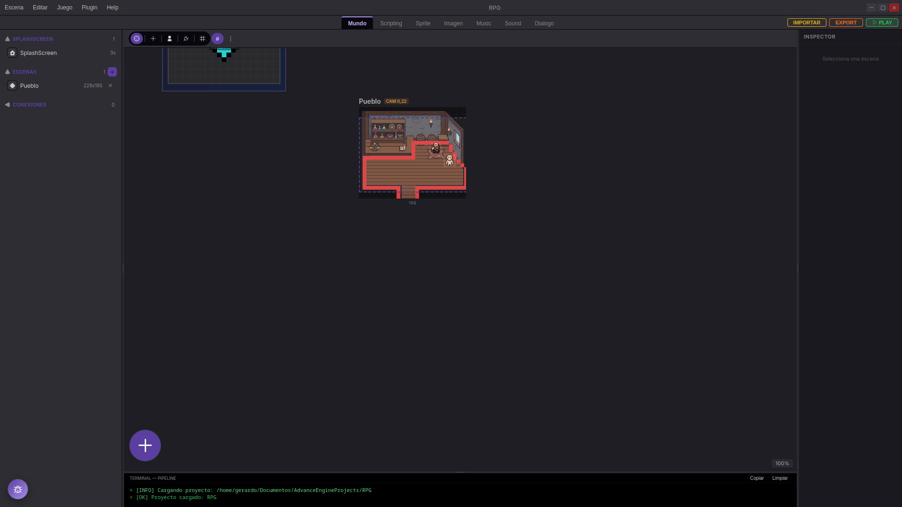
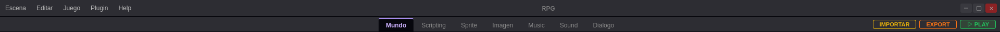
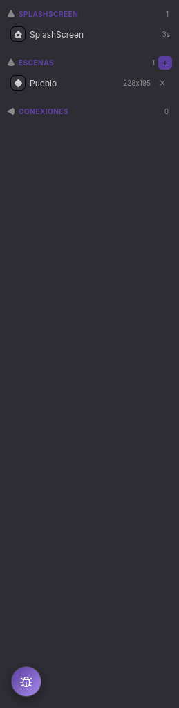
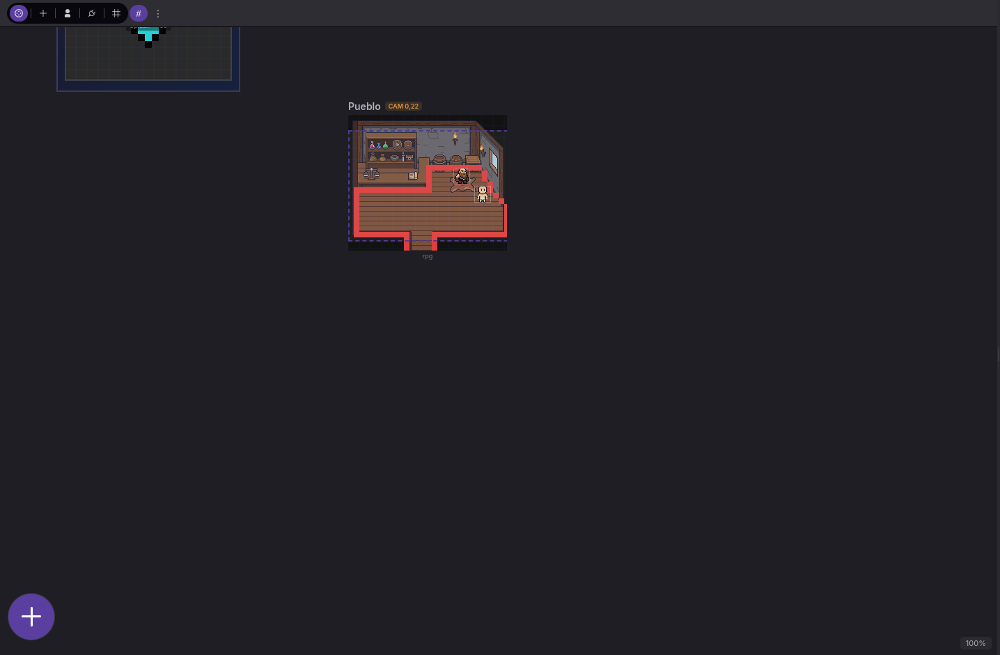
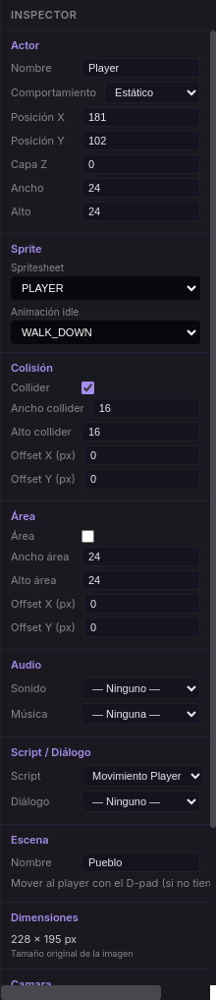

# 02 — Módulo Mundo (editor de escenas)

El módulo **Mundo** es el corazón del editor: aquí se colocan las escenas, los actores, las colisiones y las conexiones. Todo lo que el jugador ve y toca se construye desde esta pestaña.

---

## 1. Barra superior

### 1.1. Menú de módulos (izquierda)

Las pestañas para cambiar entre módulos: **Mundo, Scripting, Sprite, Imagen, Music, Sound, Dialogo**. Cada una abre su propio editor.

### 1.2. Acciones (derecha)

| Botón | Acción |
| :--- | :--- |
| **IMPORTAR** | Carga assets al proyecto (sprites, fondos, sonidos, canciones, scripts…). |
| **EXPORT** | Guarda el proyecto, exporta la ROM GBA, la web o la app de escritorio. |
| **PLAY** | Compila y ejecuta el juego en el emulador integrado. |
| **STOP** | Detiene el emulador. |
| **SPLASHSCREEN** | Abre la configuración de la pantalla de arranque (imagen, duración, música). |

---

## 2. Jerarquía (panel izquierdo)

El árbol muestra la estructura del proyecto:

- **SPLASHSCREEN** — la escena de arranque (siempre la primera).
- **ESCENAS** — cada escena, con su tamaño en píxeles (`228x195`).
  - **CAM** — la cámara de la escena (solo en escenas más grandes que la pantalla). Muestra `x,y`.
  - **Actores** — cada actor de la escena (Player, NPC…).
- **CONEXIONES** — las transiciones entre escenas, con su nombre.

### Acciones de la jerarquía

- **Clic** en un nodo → lo selecciona y muestra su inspector.
- **✕** en un nodo → lo elimina (con confirmación).
- **Lápiz** → renombra en línea.
- **⋮** → menú contextual (renombrar, eliminar, duplicar).
- **+** → crea una escena nueva.

---

## 3. Lienzo

El lienzo muestra la escena activa. Herramientas:

| Herramienta | Descripción |
| :--- | :--- |
| **Seleccionar/Mover** | Selecciona y arrastra actores por el lienzo. |
| **Agregar escena (+)** | Crea una escena nueva en el centro de la vista. |
| **Agregar actor** | Crea un actor en el centro de la escena. |
| **Vincular (link)** | Traza conexiones entre escenas. |
| **Colisiones** | Abre la paleta de pintura de colisiones. |
| **Cuadrícula** | Muestra/oculta la rejilla. |
| **Tamaño de celda (⋮)** | 1, 2, 4, 8, 16, 32 o 64 px. |

### Movimiento por el lienzo

- **Arrastrar** un actor → lo mueve.
- **Rueda del ratón** → zoom del lienzo.
- **Ctrl + rueda** → zoom fino.
- **Barra espaciadora + arrastrar** → desplaza la vista (pan).
- **Flechas del teclado** → mueven el actor seleccionado 1 px (con Mayús, 8 px).

---

## 4. Menú radial

En la esquina inferior izquierda, el menú radial da acceso rápido a las acciones de inserción: **Escena, Actor, Vincular, Colisiones**.

---

## 5. Colisiones

Al activar la herramienta de colisiones se abre una barra con dos bloques.

### 5.1. Herramientas de trazado

| Herramienta | Uso |
| :--- | :--- |
| **Bote** | Rellena áreas contiguas. |
| **Varita** | Selecciona por contorno. |
| **Lápiz** | Pinta celda a celda. |
| **Rectángulo** | Dibuja un rectángulo de colisión. |
| **Goma** | Borra colisión celda a celda. |

### 5.2. Tipos de superficie

| Tipo | Color | Comportamiento |
| :--- | :--- | :--- |
| **Sólida** | Rojo | Bloqueo total en los 4 ejes. |
| **Semisólida** | Naranja | Bloquea en un sentido, se atraviesa en el opuesto (plataformas). |
| **Escalera** | Verde | Permite subir/bajar (plataformas). |
| **Rampa** | Amarillo | Pendiente en las 4 direcciones. |

---

## 6. Inspector

El inspector (panel derecho) muestra las propiedades del nodo seleccionado.

### 6.1. Inspector de actor

| Bloque | Opciones | Descripción |
| :--- | :--- | :--- |
| **Actor** | Nombre | El identificador del actor. |
| | Comportamiento | Estático, Interactuable, Objeto o Texto. Define cómo reacciona al tocarlo. |
| | Posición X / Y | Coordenadas en píxeles dentro de la escena. |
| | Capa Z | Orden de dibujo (0 = detrás, valores mayores = delante). |
| | Ancho / Alto | Tamaño del sprite en píxeles. |
| **Sprite** | Spritesheet | La hoja de sprites asignada. |
| | Animación | La animación inicial. |
| **Colisión** | Collider | Activa la caja de impacto. |
| | Ancho / Alto collider | Tamaño de la caja (independiente del sprite). |
| | Offset X / Y | Desplazamiento de la caja respecto al sprite. |
| **Área** | Área | Activa una zona de detección que sigue al actor. |
| | Ancho / Alto área | Tamaño de la zona. |
| | Offset X / Y | Desplazamiento de la zona. |
| **Audio** | Sonido | SFX asignado (al chocar, al interactuar…). |
| | Música | Canción asignada al actor. |
| **Script / Diálogo** | Script | El script C / AdvanceCode asignado. |
| | Diálogo | El diálogo asignado (para NPCs). |
| | Caja de texto | El sprite de caja de diálogo (CAJATEXTO). |
| | Tamaño de caja | Ancho / Alto de la caja. |
| | Posición de caja | Offset X / Y de la caja en pantalla. |

### 6.2. Inspector de escena

| Bloque | Opciones | Descripción |
| :--- | :--- | :--- |
| **Nombre** | — | El nombre de la escena. |
| **Mover al player** | Interruptor | Si el actor 0 no tiene script, el motor lo mueve con el D-pad. |
| **Dimensiones** | Ancho × Alto | El tamaño del lienzo en píxeles. |
| **Camara** | Camara X / Y | La posición de la cámara (escenas grandes). |
| **Imagen de fondo** | — | El fondo de la escena. |
| **Canción de fondo** | — | La música que suena en la escena. |

---

## 7. Transiciones entre escenas

Al **vincular** dos escenas se crea una conexión. Cada conexión tiene:

- **Transición de entrada**: lo que se ve al entrar a la escena de destino.
- **Transición de salida**: lo que se ve al salir.
- **Tipo**: instantánea, fundido (fade) o tileset personalizado.
- **Velocidad**: la duración de la transición.
- **Nombre**: para elegirla desde `switchScene(n, "nombre")` en el script.

### Tipos de transición

| Tipo | Descripción |
| :--- | :--- |
| **Instantánea** | Cambio de pantalla sin animación. |
| **Fundido** | Fundido a negro / desde negro. |
| **Tileset** | Cada bloque 8×8 reproduce un tileset como máscara píxel a píxel (blanco revela, negro oculta). |

---

## 8. Rendimiento (presupuesto GBA)

El dibujo ocurre dentro del VBLANK (~83.800 ciclos/frame). El límite son los **píxeles de sprite visibles en cámara**, no el número de actores:

- Presupuesto: **~5.600 px de sprite por frame**.
- 5-6 actores de 21×31 px, o 1 de 64×64 + 2 pequeños.
- Los actores fuera de cámara apenas gastan.
- Un actor parcialmente fuera solo paga la parte visible.

---

**Anterior:** [01 — Interfaz](01-interfaz.md) · **Siguiente:** [03 — Sprite](03-sprite.md)
