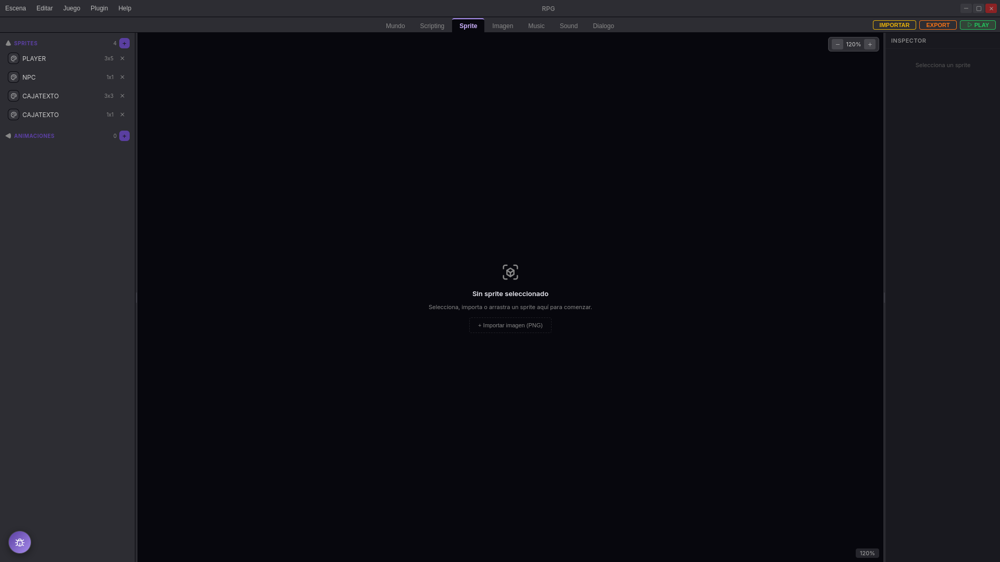
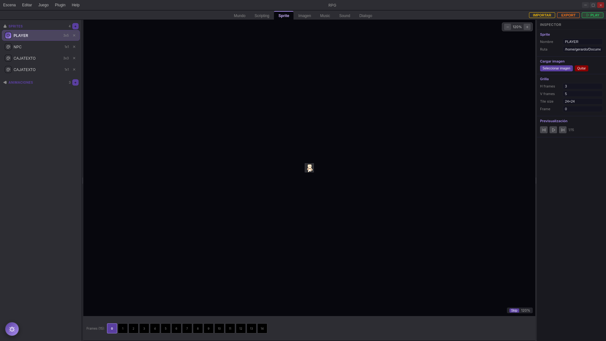

# 03 — Módulo Sprite

El módulo **Sprite** convierte una hoja de sprites (spritesheet) en los frames que el motor anima: divide la imagen en una rejilla, descarta los frames vacíos y crea animaciones con sus modos de ciclo.

---

## 1. Importar una hoja

1. Pulsa **IMPORTAR** (o arrastra el PNG al lienzo).
2. Elige la imagen. Se guarda en `sprites/` del proyecto.
3. En la lista de sprites aparece con su nombre y su rejilla.

## 2. Dividir la hoja (rejilla)

Al importar, el asistente pide la **rejilla**:

| Campo | Descripción |
| :--- | :--- |
| **Columnas** | Cuántos frames hay en horizontal. |
| **Filas** | Cuántos frames hay en vertical. |
| **Ancho / Alto de tile** | Tamaño de cada frame en píxeles. |

La hoja se divide en `columnas × filas` frames. Cada frame es un tile independiente que el motor puede animar.

## 3. Saltar frames vacíos

Si la hoja tiene huecos (frames transparentes o de relleno), usa **«Saltar frames vacíos»**: marca en rojo los frames que no quieres y el motor los omite al exportar. Así una hoja con espacios irregulares no genera frames fantasma.

## 4. Animaciones

Cada sprite puede tener varias **animaciones**. Una animación es una secuencia de frames con un retardo.

| Campo | Descripción |
| :--- | :--- |
| **Nombre** | El identificador (WALK_DOWN, IDLE…). |
| **Frames** | La lista de frames que componen la animación. |
| **Retardo** | Cuántos vsyncs dura cada frame (6 ≈ 10 veces/sg). |
| **Modo** | **Una vez** (once), **bucle** (loop) o **ping-pong** (ida y vuelta). |

### Modos de ciclo

- **Una vez**: la animación se reproduce una sola vez y se queda en el último frame.
- **Bucle**: al terminar vuelve al primer frame.
- **Ping-pong**: va del primero al último y del último al primero (para caminar, aleteos…).

## 5. Inspector del sprite

- **Lista de sprites** (izquierda): todas las hojas del proyecto.
- **Previsualización**: el frame seleccionado, con la rejilla.
- **Animaciones**: lista, añadir, eliminar, renombrar.
- **Línea de tiempo**: los frames de la animación, con el onion skin (encaje con el frame anterior).

## 6. Onion skin

El **onion skin** dibuja el frame anterior como fantasma para encadenar animaciones a mano (cada fotograma continúa el anterior). Se activa con el botón correspondiente.

## 7. Uso en el juego

- Un actor tiene un **spritesheet** y una **animación inicial**.
- El script puede cambiar de animación y de frame:
  - `gSelf->frame` — frame actual.
  - `gSelf->animSpeed` — cuántos frames de reloj avanza por vsync (0/1 = cadencia exacta; 2+ = más rápido).
- La animación corre en el motor (`advanceAllActors`), salvo que un diálogo/menú esté abierto (se congela).

---

**Anterior:** [02 — Mundo](02-mundo.md) · **Siguiente:** [04 — Imagen](04-imagen.md)
