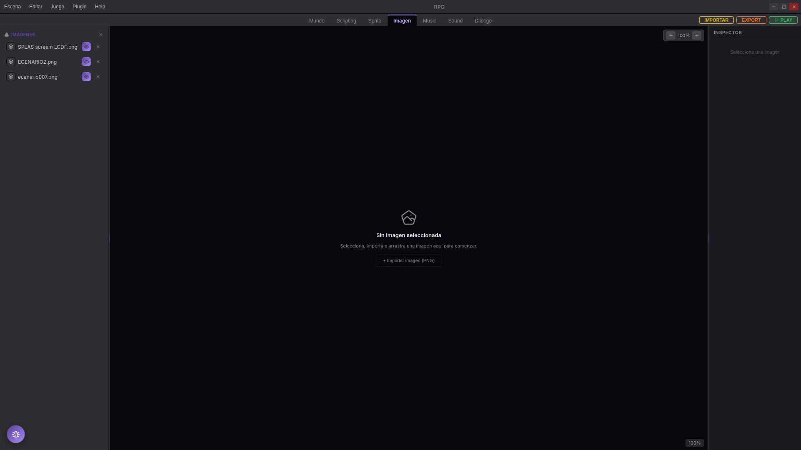

# 04 — Módulo Imagen

El módulo **Imagen** gestiona los fondos del juego: la imagen de cada escena y las capas con parallax.

---

## 1. Fondos de escena

Cada escena tiene una **imagen de fondo**. Se asigna desde el inspector de la escena (Mundo) o importando aquí.

- La imagen se recorta según la cámara si la escena es más grande que la pantalla (240×160).
- Si la escena es más pequeña, se centra.

## 2. Capas (parallax)

Puedes añadir **capas** sobre el fondo para dar profundidad. Cada capa es una imagen que se desplaza a distinto ritmo que la cámara.

| Campo | Descripción |
| :--- | :---| 
| **Imagen** | La imagen de la capa. |
| **Parallax X / Y** | 0 = no se mueve, 1 = se mueve con la cámara, >1 = más rápido. |
| **Repetición** | Si la capa se repite en horizontal/vertical (tiles). |
| **Velocidad de animación** | Si la capa es un fondo animado. |

## 3. Fondos animados

Una capa puede ser un **fondo animado**: una secuencia de frames que se reproduce en bucle.

- **Velocidad**: frames por vsync.
- **Modo**: bucle o una vez.
- **Dirección**: avance o retroceso.

## 4. Inspector de capa

- **Ojo** — muestra/oculta la capa.
- **Nombre** — el identificador.
- **Parallax X / Y** — la velocidad de seguimiento.
- **Animación** — si tiene frames y su velocidad.

---

**Anterior:** [03 — Sprite](03-sprite.md) · **Siguiente:** [05 — Music](05-music.md)
