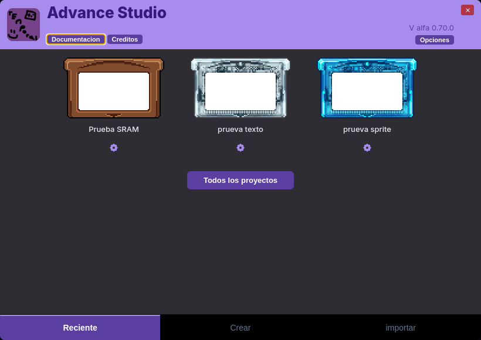
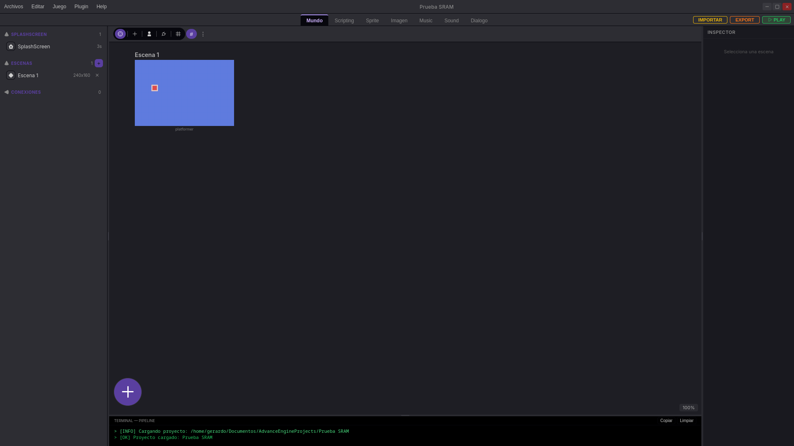
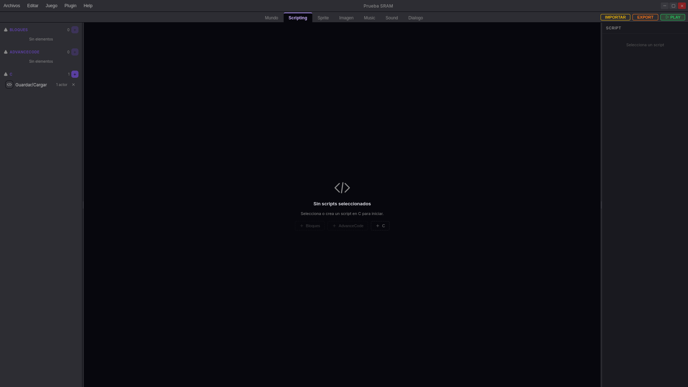
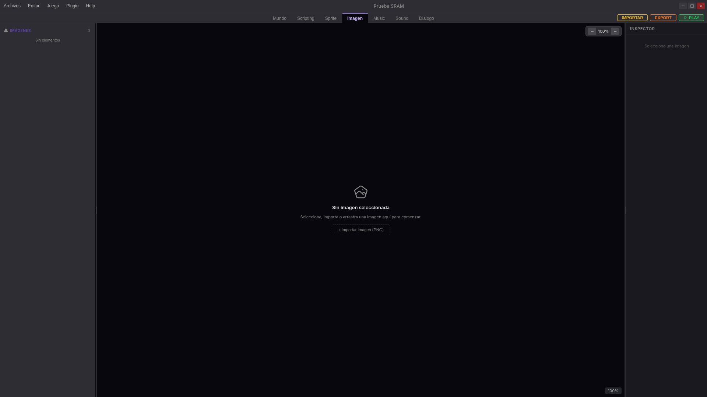
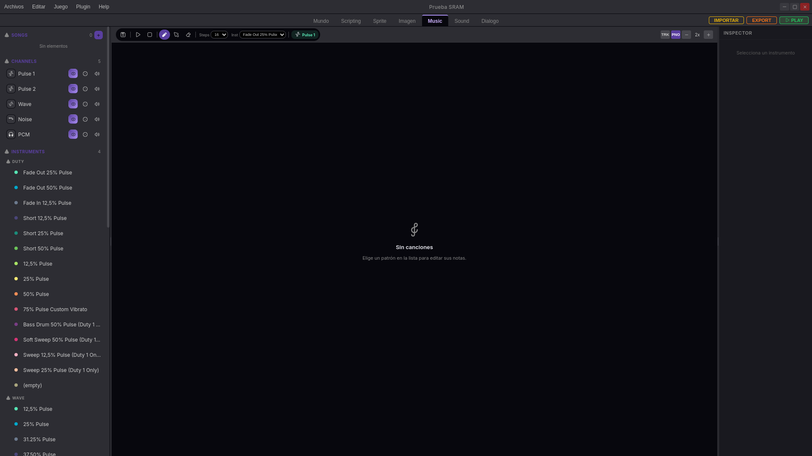
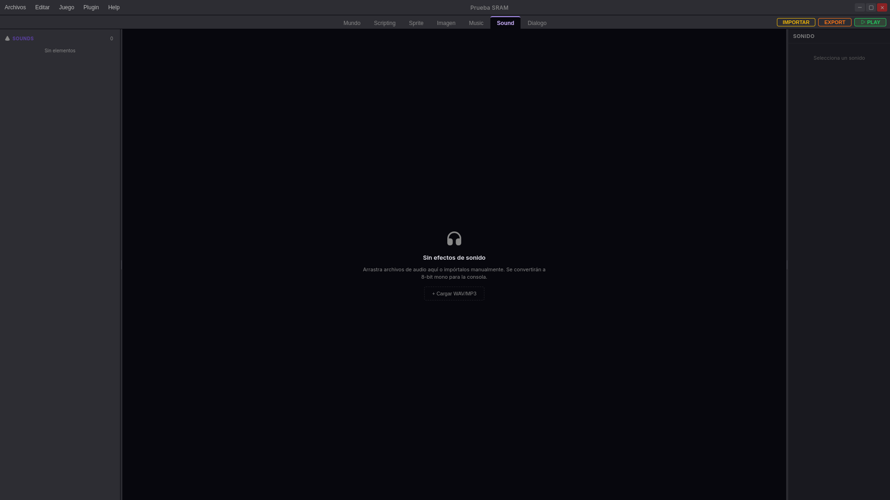
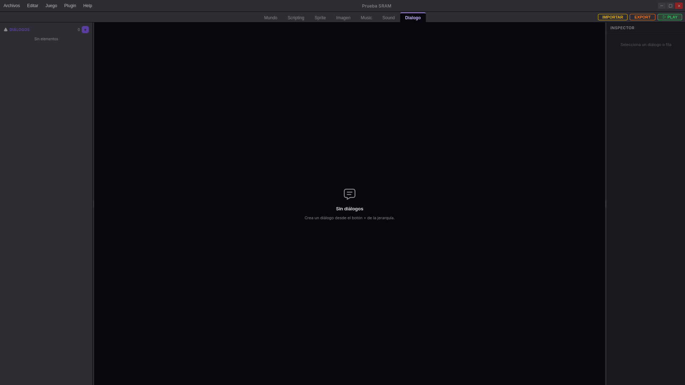

# Manual completo de AdvanceEngine

> **AdvanceEngine** es un IDE visual para hacer juegos de Game Boy Advance: dibujas escenas, animas sprites, compones música, escribes diálogos y programas la lógica en C. Luego exporta una ROM `.gba` que funciona en emuladores y en flashcarts.
>
> Este manual explica **cada pestaña, cada panel, cada opción y cada función de la API de C**, con capturas de la aplicación real.

---

## Índice

1. [Introducción y arranque](#1-introducción-y-arranque)
2. [El Launcher (pantalla principal)](#2-el-launcher-pantalla-principal)
3. [El Editor (estructura general)](#3-el-editor-estructura-general)
4. [Pestaña Mundo](#4-pestaña-mundo)
5. [Pestaña Scripting (C)](#5-pestaña-scripting-c)
6. [Pestaña Sprite](#6-pestaña-sprite)
7. [Pestaña Imagen](#7-pestaña-imagen)
8. [Pestaña Music](#8-pestaña-music)
9. [Pestaña Sound](#9-pestaña-sound)
10. [Pestaña Dialogo](#10-pestaña-dialogo)
11. [Ajustes](#11-ajustes)
12. [Exportación a GBA](#12-exportación-a-gba)
13. [Referencia de la API C del motor](#13-referencia-de-la-api-c-del-motor)
14. [Guía: hacer un juego de 0 a fin](#14-guía-hacer-un-juego-de-0-a-fin)
15. [Solución de problemas](#15-solución-de-problemas)

---

## 1. Introducción y arranque

### Qué se puede hacer
- Juegos 2D completos: **plataformas, top-down/RPG, puzzles, visual novels**, etc.
- Escenas con imagen de fondo, colisión por tiles, actores con sprites y animaciones.
- Multi-escena con transiciones (fundido, instante o tileset personalizado).
- Música (4 canales PSG + PCM) y efectos de sonido.
- Diálogos con fuentes (tilesets), caja 9-slice, varios idiomas y paginación.
- Lógica en **C** con primitivas de movimiento y guardado en SRAM.

### Requisitos
- Windows 10/11 (x64) o Linux (x64/arm64).
- **devkitARM** para exportar la ROM. La app lo instala sola desde **Opciones → General → Instalar devkitPro**.
- Un editor de imágenes externo (Aseprite, GIMP, Photoshop) para sprites y fondos.

### Arranque rápido
1. Abre la app. Aparece el **Launcher** (pestañas Reciente / Crear / Importar).
2. Crea un proyecto nuevo o abre uno existente.
3. En el **Editor**, trabaja en las pestañas: Mundo, Scripting, Sprite, Imagen, Music, Sound, Dialogo.
4. Pulsa **Juego → Exportar GBA** (o el botón PLAY) para generar la ROM.
5. Pruébala en el emulador integrado.

---

## 2. El Launcher (pantalla principal)



Es la pantalla al abrir la app. Arriba está el **AppHeader** y abajo las pestañas.

### AppHeader
- **Logo y versión** (`AdvanceEngine`, `V alfa 0.70.0`).
- **Documentacion**: abre el manual (este archivo y el resto de la documentación).
- **Creditos**: pantalla de créditos con fondo de nubes animado.
- **Opciones**: abre el modal de Ajustes (ver sección 11).

### Pestañas del Launcher

#### Reciente
Muestra los **3 últimos proyectos** abiertos como cartuchos (con portada si tiene). Al hacer clic en un cartucho se abre el proyecto. Debajo está el botón **Todos los proyectos**.

#### Crear
Formulario para crear un proyecto nuevo:
- **Nombre** del proyecto.
- **Autor**.
- **Plantilla** (color del cartucho): `transparente:blanco`, `plano:amarillo`, etc.
- **Ruta** donde se guarda (carpeta `AdvanceEngineProjects` por defecto).
- **Portada** (PNG 480×270 recomendado).

Al crear, se abre el editor con una escena por defecto.

#### Importar
Permite importar un proyecto desde una carpeta (por ejemplo, uno descargado o copiado).

#### Todos los proyectos
Lista completa de proyectos con:
- Nombre, autor, fecha.
- Menú contextual (clic derecho): **Abrir**, **Modificar portada**, **Eliminar**.
- Búsqueda.

### Cartucho
El cartucho es la representación visual del proyecto:
- **Portada** (imagen 480×270).
- **Color** (según la plantilla).
- **Calcomanía** (recorte/plantilla decorativa).
- Menú contextual: renombrar, modificar portada, eliminar.

---

## 3. El Editor (estructura general)



Al abrir un proyecto se entra al **Editor**, que es la pantalla principal. Se organiza en:

### Barra superior (EditorTopBar)
- **Menús**: Archivo, Edición, Juego, Plugin, Ayuda.
  - **Archivo**: guardar, exportar GBA, exportar assets, cerrar proyecto.
  - **Edición**: deshacer/rehacer, copiar/pegar.
  - **Juego**: PLAY/STOP del emulador integrado.
  - **Plugin**: gestión de plugins (futuro).
  - **Ayuda**: abre la configuración en la pestaña correspondiente, o el manual.
- **Botones de ventana** (minimizar, maximizar, cerrar) — la ventana es frameless.
- **PLAY/STOP**: exporta y abre el emulador integrado con la ROM.

### Pestañas
Las 7 pestañas del editor, cada una con su lienzo, jerarquía e inspector:
- **Mundo**: escenas, cámara, actores, conexiones, transiciones.
- **Scripting**: lógica en C.
- **Sprite**: spritesheets y animaciones.
- **Imagen**: fondos y capas.
- **Music**: piano roll / tracker.
- **Sound**: efectos de sonido.
- **Dialogo**: diálogos con filas e idiomas.

### Panel de jerarquía (izquierda)
Árbol con secciones y elementos. Permite:
- **Seleccionar** un elemento.
- **Renombrar** (doble clic o F2).
- **Eliminar** (botón ✕ con confirmación).
- **Menú contextual** (clic derecho): renombrar, eliminar.
- **Colapsar** secciones.
- **Arrastrar** escenas (en Mundo).

### Lienzo (centro)
El área de trabajo de cada pestaña: escenas, código, sprites, fondos, piano roll, etc.

### Inspector (derecha)
Muestra las propiedades del elemento seleccionado. Cambia según la pestaña y el elemento.

### Terminal del pipeline (abajo, en Mundo)
Muestra el log de exportación (INFO, WARN, ERROR) con auto-scroll y botones **Copiar** y **Limpiar**.

### Atajos de teclado globales
- **Ctrl+S**: guardar proyecto.
- **Ctrl+Z / Ctrl+Y**: deshacer/rehacer.
- **Ctrl+C / Ctrl+V / Ctrl+X / Ctrl+A**: portapapeles (respeta el campo con foco).
- **Supr**: borrar (respeta el campo con foco).
- **Escape**: cerrar menús/modales.

---

## 4. Pestaña Mundo


Es la pestaña principal: aquí se colocan las **escenas**, los **actores**, la **cámara**, las **conexiones** y las **transiciones**.

### Lienzo
- **Escenas** (tarjetas) con su mini-mapa (la imagen de fondo), el nombre y el indicador `CAM x,y` si la escena es mayor que 240×160.
- **Cámara** (rectángulo discontinuo 240×160): se puede **arrastrar** para mover el punto de vista. Es la porción de la escena que se ve en la GBA.
- **Conexiones** entre escenas (líneas curvas con flecha). El color indica el tipo (entrada/salida).
- **Zoom/pan**: rueda para zoom (Ctrl+rueda en algunos casos), arrastre con botón medio o con la herramienta mover.
- **Cuadrícula** de píxeles (tamaño configurable).

### Herramientas (barra inferior del lienzo)
- **Mover**: arrastrar la vista.
- **Añadir escena**: crea una escena nueva (la nombra `Escena N`).
- **Conectar**: une dos escenas (entrada/salida).
- **Eliminar**: borra la escena o conexión seleccionada.
- **Colisión**: pinta tiles de colisión (sólido, plataformas, rampas).

### Jerarquía
- **SplashScreen** (la pantalla de presentación, no se puede borrar).
- **Escenas**: cada una con sus **actores** anidados.
- **Conexiones**: las relaciones entre escenas.
- Se puede **renombrar** (doble clic), **eliminar** (con confirmación) y usar el **menú contextual**.

### Inspector de escena
- **Nombre**.
- **Tipo**: platformer / topdown / rpg / fighting (informativo, no cambia el motor).
- **Posición** (x, y en el mundo del editor).
- **Tamaño** (ancho, alto).
- **Color de fondo** (si no hay imagen).
- **Imagen de fondo**: se asigna desde **Imagen** (fondos y capas).
- **Cámara**: `Camara X` e `Camara Y` (el punto de vista).
- **Colisión**: tamaño de tile y mapa de colisión (se pinta en el lienzo con la herramienta colisión).
- **Canción**: la canción de fondo de la escena.
- **Sonido de fondo**: efecto PCM en bucle.

### Inspector de actor
- **Nombre**, **tipo** (Estático, Interactuable, Objeto, Texto).
- **Posición** (x, y), **tamaño** (ancho, alto), **z** (orden de pintado).
- **Sprite**: el spritesheet y la animación.
- **Colisión**: collider (anchura, altura, offset) y colisión por tiles.
- **Área**: zona de disparo (anchura, altura, offset) para `actor_in_area`/`actor_entered` en el script.
- **Dialog Box** (para actores de tipo Texto): ver sección 10.
- **Script**: el script C asignado (el que se ejecuta para este actor).
- **Canción / sonido**: asignados al actor.

### Conexiones
- Se crean con la herramienta **Conectar** (clic en la escena origen y en la destino).
- **Inspector de conexión**: nombre, tipo de transición de entrada y salida (fundido, instante o tileset), velocidad y tileset/degradado.
- **Menú contextual**: renombrar, eliminar.
- El motor reproduce la transición configurada al hacer `switchScene(n)`.

### Transiciones
- **Fundido**: la escena se oscurece/aparece gradualmente.
- **Instante**: cambio directo.
- **Tileset personalizado**: una imagen 3×3 (o más) que se anima como máscara (ver sección 12).
- Se configuran en el inspector de la **conexión** (entrada/salida) y del **SplashScreen**.

### Terminal del pipeline
- Muestra el log de exportación: escenas, actores, fuentes, diálogos, errores.
- Botones **Copiar** y **Limpiar**.

---

## 5. Pestaña Scripting (C)



Aquí se programa la **lógica del juego** en **C**. Es el único modo habilitado (AdvanceCode y Bloques están deshabilitados por ahora).

### Modos
- **Bloques**: deshabilitado (próximamente).
- **AdvanceCode**: deshabilitado (próximamente).
- **C**: el lenguaje del motor. Es el que se usa.

### Jerarquía
- Sección **C**: lista los scripts en modo C.
- Botón **+** para crear un script nuevo.
- Doble clic para renombrar, ✕ para eliminar (con confirmación).
- Al crear, el campo **Nombre** del inspector queda enfocado y seleccionado para renombrarlo al instante.

### Editor de código
- **Gutter** con números de línea.
- **Resaltado de sintaxis**: comentarios, `#include`, cadenas, números, palabras clave, tipos de devkitARM (`u8`, `s16`…) y la API del motor.
- **Tab** = 2 espacios, **auto-indent** al Enter, **auto-cierre** de llaves/paréntesis.
- **Deshacer/rehacer** (Ctrl+Z / Ctrl+Y / Ctrl+Shift+Z) con historial propio (agrupa lo escrito seguido).
- **Zoom** (Ctrl+rueda, 9–26 px) con indicador de porcentaje (clic para volver al 100%).
- **Minimapa** estilo VS Code a la derecha (barritas por línea; clic o arrastre para saltar).
- **Snippets** (barra superior): `script_update()`, `script_init()`, leer teclas, primitivas, diálogos, guardado, etc.

### Inspector de script
- **Nombre**.
- **Modo** (C, deshabilitado el resto).
- **Estado**: "Se exporta", "Sin asignar", "Vacío", "Falta script_update", etc.
- **Asignación**: el script se ejecuta **por cada actor asignado** (Mundo → actor → Script). Si no está asignado, no se ejecuta.
- **Ayuda**: explicación del modo y del contrato.

### El contrato
```c
void script_init(void) {
  // 1 vez, al entrar en la escena (después de colocar los actores).
}
void script_update(void) {
  // cada frame del juego.
}
```
- Ambos son opcionales. Si no defines `script_update`, el script solo hace setup.
- Debe haber **exactamente una** definición de cada uno (el motor no llama a ninguna si hay varias).
- El motor llama a `script_update` **cada frame** (60 fps).

### La API del motor (C)
Ver la **sección 13** para la referencia completa función por función.

---

## 6. Pestaña Sprite


Editor de **spritesheets y animaciones**. Importas la imagen y defines la rejilla y los frames.

### Lienzo
- Muestra el **spritesheet** con la **rejilla** de tiles (cols × rows).
- **Zoom y pan** con rueda y arrastre.
- **Paginación** de tiles y **selección de brush** (tile).
- **Línea de tiempo** de frames con reproducción (play/pause).
- **Papel cebolla** (onion skin) para ver el frame anterior/debajo.
- **Cuadrícula** y suavizado de imagen configurables.

### Jerarquía
- **Sprites**: lista de spritesheets (con su imagen).
- Botón **+** para crear uno nuevo (o importar una imagen).
- Renombrar/eliminar con el menú contextual o el ✕.

### Inspector
- **Nombre** del spritesheet.
- **Imagen**: cargar/importar (PNG/JPG), con la ruta.
- **Rejilla**: columnas y filas.
- **Tile**: ancho y alto de cada tile.
- **Animaciones**: lista de animaciones con sus frames, modo (loop/once/pingpong) y velocidad.
- **Frame**: tile, duración.

### Notas
- El spritesheet se importa como imagen (no se dibuja píxel a píxel en el editor).
- El motor dibuja los tiles con **transparencia real** (el canal alfa del PNG).

---

## 7. Pestaña Imagen



Editor de **fondos y capas** (con parallax).

### Lienzo
- Muestra el **fondo** con las capas apiladas.
- **Zoom y pan**.
- **Vista previa** de la capa seleccionada (con su tamaño real o escalado).
- **Importar imagen** (botón o arrastrar y soltar).

### Jerarquía
- **Fondos**: lista de fondos con sus **capas** anidadas.
- Botón **+** para crear un fondo o capa.
- Renombrar/eliminar con el menú contextual o el ✕.

### Inspector de capa
- **Nombre**.
- **Imagen**: cargar/importar.
- **Parallax**: velocidad X/Y (se mueve con la cámara).
- **Velocidad**: animación de la capa (si es animada).
- **Visibilidad** (ojo) y **rescale** (escalar al tamaño de la pantalla).
- **Modo de animación** (loop/once/pingpong).

### Notas
- Las capas se pueden reordenar (arrastrar en la jerarquía).
- La capa seleccionada se puede previsualizar con su tamaño real o escalada.

---

## 8. Pestaña Music



Editor de **música** con piano roll (PNO) y tracker (TRK).

### Lienzo
- **Piano roll** (PNO): teclado real + grid de notas.
- **Tracker** (TRK): vista compacta tipo tracker.
- **Zoom** (Ctrl+rueda), **scroll horizontal** (Shift+rueda).
- **Grid** con tamaño de paso configurable (16/32/48/64).
- **Fondo** configurable: cuadrícula o ajedrez.
- **Playhead** arrastrable.

### Herramientas
- **Lápiz**: pintar notas.
- **Seleccionar**: seleccionar notas.
- **Borrador**: borrar notas.

### Instrumentos
- **Canales**: Pulse 1, Pulse 2, Wave, Noise, PCM.
- **Instrumentos** por canal con presets.
- **Mute/Solo** por canal.
- **Undo/Redo** (Ctrl+Z/Y) para todas las operaciones.

### Patrones
- Lista de patrones con reproducción (play/pause).
- **Patrones redimensionables** (16/32/48/64 pasos).
- **Loop** multi-patrón.

### Inspector
- **Canción**: nombre, artista, tempo (BPM).
- **Patrón**: pasos, instrumentos.
- **Instrumento**: tipo (duty/wave/noise), volumen, duty, envelope, sweep, etc.

### Notas
- La música se exporta a la ROM con los 4 canales PSG + PCM.
- Los instrumentos se derivan de los presets usados por las notas.

---

## 9. Pestaña Sound



Editor de **efectos de sonido**.

### Lienzo
- **Forma de onda** visualizada según el tipo.
- **Preview** en tiempo real con Web Audio.
- **Importar** WAV/MP3/OGG.

### Inspector
- **Nombre** del efecto.
- **Tipo**: Pulse / Wave / Noise.
- **Nota**, **duración**, **volumen**, **duty cycle**, **envelope**, **sweep**.
- **Waveform** (para Wave).
- **Preview** (play/stop).

### Notas
- Los efectos se pueden reproducir en el editor y en el juego (`sound_play` desde el script, o asignados a un actor/diálogo).

---

## 10. Pestaña Dialogo



Editor de **diálogos** con filas e idiomas.

### Tabla
- **Columnas**: ID, Código, Nombre (hablante), y una columna por idioma (ES, FR, etc.).
- **Filas**: cada fila es un "renglón" del diálogo.
- **Cabecera de sección**: el diálogo, con su número de filas y idiomas.
- **+ Fila** para añadir filas.
- **Edición en línea** de todas las celdas.
- **Navegación con flechas** entre celdas.
- **Eliminar** filas con el ✕.

### Jerarquía
- **Diálogos**: lista de diálogos.
- Botón **+** para crear.
- Renombrar/eliminar con el menú contextual o el ✕.

### Inspector de fila
- **ID** (solo lectura).
- **Código** (identificador corto, para `showDialogueRow("codigo")`).
- **Nombre** (hablante).
- **Texto por idioma**.
- **Sonido** (efecto al mostrar la fila).
- **Fuente** (tileset de la fila).
- **Eliminar fila**.

### Inspector de diálogo
- **Nombre**.
- **Escena** vinculada.
- **Idiomas** (hasta 6, con + para añadir).
- **Eliminar diálogo**.

### Dialog Box (caja 9-slice)
En el inspector del **actor de tipo Texto** (Mundo → actor):
- **Imagen 3×3**: esquinas, bordes y centro.
- **Ancho / Alto** (limitados a la pantalla).
- **Offset X / Offset Y** (posición, limitada a la pantalla).
- **Nombre del hablante dentro de la caja** (checkbox).
- **Salto de línea**: Por palabra / Por carácter.

### Motor de diálogos (C)
- `showDialogue(id)`: muestra el diálogo desde la fila 0.
- `showDialogueRow("codigo")` / `showDialogueRow("ID")`: salta a una fila.
- `nextDialogueRow()`: avanza a la siguiente **página** (si el texto no cabe, la siguiente página; si no, la siguiente fila).
- `dialogueUpdate()`: avanza solo al pulsar A (llamar cada frame).
- `hideDialogue()`: oculta.

---

## 11. Ajustes

Se abren con **Opciones** (AppHeader) o **Ayuda → Tabs/General**.

### General
- **Idioma** de la app (es-ES, en-US, ja-JP, ru-RU).
- **Tema** (7 predefinidos + colores personalizados).
- **Tamaño del texto**.
- **Colores planos** (interruptor).
- **Splash**: duración, imagen de fondo.
- **devkitPro**: instalar/verificar.

### Apariencia
- Colores del tema (panel, acento, texto, fondo).
- Tamaño de fuente.

### Pestañas de módulos
- **Mundo**: cuadrícula, colores de conexión, animaciones.
- **Scripting**: tamaño de fuente del editor, minimapa.
- **Sprite**: rejilla, onion skin.
- **Imagen**: suavizado.
- **Music**: vista por defecto (PNO/TRK), colores del piano.
- **Sound**: volumen.
- **Dialogo**: colores de la caja, fondo del lienzo.
- **Emulador**: remapeo de botones, tema de la ventana.

---

## 12. Exportación a GBA

### Pipeline
1. **Guardas** el proyecto (Ctrl+S) — se genera el `main.c` y el `Makefile` en `<proyecto>/build/`.
2. **Exportar GBA** (Juego → Exportar, o PLAY) — compila la ROM con devkitARM.
3. Se abre el **emulador integrado** con la ROM.

### Estructura generada
```
<proyecto>/build/
├── main.c          # el código fuente C del juego
├── Makefile
├── <proyecto>.elf
└── <proyecto>.gba
```

### El `main.c`
- **Escenas**: todas las escenas del proyecto, con su imagen de fondo, colisión, cámara, actores y canción.
- **Actores**: sprites, animaciones, colliders, áreas.
- **Fuentes y diálogos**: tablas de texto y cajas 9-slice.
- **Scripts C**: tu lógica, insertada antes de `main()`.
- **Motor**: render por software, sonido PSG + PCM, entrada, guardado en SRAM.

### Requisitos
- **devkitARM** (instalado desde Opciones → General).
- La ROM funciona en **mGBA** (externo y el integrado) y en **flashcarts**.

### Notas
- El render es por software: presupuesto ~5.600 píxeles visibles por frame.
- La SRAM persiste en el `.sav` (mGBA externo y flashcarts). El emulador interno no volca la SRAM al cerrar.

---

## 13. Referencia de la API C del motor

> Esta es la referencia **función por función** de lo que el motor pone a disposición de tus scripts. Tu código se inserta antes de `main()` y puede llamar a todo lo que aquí aparece.

### Tipos
```c
typedef struct {
  u16 period;   // valor del registro FREQ (o ratio|cs<<3 para noise); 0xFFFF = silencio
  u8 instIdx;
} GBANote;

typedef struct {
  s16 x, y, z;
  u16 w, h;
  s16 prevX, prevY, prevW, prevH;
  u8 hasCollider;
  u16 cw, ch;
  s16 cox, coy;
  u8 hasArea;
  u16 aw, ah;
  s16 aox, aoy;
  u32 areaInside, areaWas;
  s16 vx, vy;
  s8 face;
  u8 coyote, jumpBuf, jumpHeld;
  const GBAFrame* frames[MAX_ACTOR_FRAMES];
  u16 delays[MAX_ACTOR_FRAMES];
  u8 frameCount, mode, frame, prevFrame, dir, animSpeed;
  u8 dbIdx;        // caja de diálogo del actor
  s16 dbX, dbY, dbW, dbH;
  u8 speakerInside;  // nombre dentro/fuera de la caja
  u8 wordWrap;       // salto de línea
} GBAActor;

extern GBAActor gActors[ACTOR_COUNT];
extern GBAActor* gSelf;      // el actor cuyo script se está ejecutando
#define PLAYER_INDEX 0       // el actor 0 es "el jugador"
```

### Entrada
```c
#define KEY_A       0x0001
#define KEY_B       0x0002
#define KEY_SELECT  0x0004
#define KEY_START   0x0008
#define KEY_RIGHT   0x0010
#define KEY_LEFT    0x0020
#define KEY_UP      0x0040
#define KEY_DOWN    0x0080
#define KEY_R       0x0100
#define KEY_L       0x0200
#define KEY_SHOULDER 0x0300   // R|L

#define REG_KEYINPUT *(vu16*)0x04000130   // 0 = pulsado
```
- `u16 keys = ~REG_KEYINPUT & 0x3FF;` → bits con 1 = pulsado.
- `gJp` → flanco (bits pulsados **este frame**). Se actualiza solo; se usa para "pulsé A ahora".
- `gKeysPrev` → estado del frame anterior.

### Actores y movimiento
```c
// Mover con colisiones (desliza por paredes)
void moveActorCollide(GBAActor* a, s16 dx, s16 dy);
// Mover al jugador con el D-pad (solo si no hay script C)
void movePlayer(u16 keys, GBAActor* p);
// Actualiza el jugador (input + empuje actor-actor)
void updatePlayer(void);

// Primitivas de movimiento (listas para usar)
void moveTopDown(GBAActor* a, u16 keys);     // 4 direcciones, sin gravedad
void movePlatformer(GBAActor* a, u16 keys);  // gravedad + coyote + salto variable
int  onFloor(GBAActor* a);                   // 1 si está en el suelo
static inline void approach(s16* v, s16 target, s16 step);

// Geometría
static inline void actorBox(const GBAActor* a, s16* bx, s16* by, s16* bw, s16* bh);
static inline int rectsOverlap(...);
static inline int rectHitsSolid(s16 bx, s16 by, s16 bw, s16 bh, s16 dx, s16 dy);
```

### Escenas
```c
void switchScene(int n);                       // cambia a la escena n (orden del editor)
void switchSceneNamed(int n, const char* name); // con el nombre de la conexión
extern int gScene;
```
- `n` es el **orden del diálogo en el editor** (0, 1, 2…).

### Sonido
```c
void noteOn(int ch, const GBAInst* inst, u16 period);  // suena una nota
void soundPlay(int idx, int loop);                     // efecto PCM (0 = una vez, 1 = bucle)
void soundStop(void);
```
- `idx` es el índice del efecto entre los que tienen PCM.

### Diálogos
```c
void showDialogue(int id);              // muestra el diálogo id desde la fila 0
void showDialogueRow(const char* key);  // salta a una fila por su Código o ID
void nextDialogueRow(void);             // siguiente página/fila
void hideDialogue(void);
void dialogueUpdate(void);              // avanza solo al pulsar A
extern int gLang;                       // 0 = primer idioma, 1 = segundo, …
```
- `id` = orden del diálogo en el editor.
- `key` = el campo **Código** o el **ID completo** de la fila.
- El texto se divide en **páginas** que caben en la caja; al avanzar pasa a la siguiente página y luego a la siguiente fila.

### Guardado (SRAM)
```c
int  aeSaveHasGame(void);              // 1 si hay partida guardada válida
int  aeSaveWrite(const u8* data, u32 size); // guarda (0 ok, -1 si no cabe)
int  aeSaveRead(u8* data, u32 size);   // carga (0 ok, -1 sin partida)
void aeSaveClear(void);                // borra la partida
```
- Bloque de **256 bytes** (`AE_SAVE_MAX`), en la SRAM `0x0E000000`.
- Con magic, versión y checksum (FNV-1a). Si el checksum no coincide, se trata como "sin partida".
- La SRAM persiste en el `.sav` (mGBA externo y flashcarts).

### Constantes y defines
```c
#define SCREEN_W 240
#define SCREEN_H 160
#define PIXEL_COUNT (SCREEN_W * SCREEN_H)
#define ACTOR_COUNT ...
#define MAX_ACTOR_FRAMES 32
#define AE_SAVE_MAX 256
#define WALK_SPEED 2
#define RUN_SPEED 3
#define GRAVITY 1
#define MAX_FALL 5
#define JUMP_VEL -11
#define COYOTE_FRAMES 5
#define JUMP_BUFFER 5
```

### Depuración
- El motor no tiene consola. Para depurar, usa `gBackBuf` y revisa los píxeles, o añade un indicador visual (como el píxel de la esquina en el proyecto de prueba).
- La terminal del pipeline (Mundo) muestra el log de exportación.

---

## 14. Guía: hacer un juego de 0 a fin

### 1. Crear el proyecto
- Launcher → **Crear** → nombre, autor, plantilla, portada.
- Se abre el editor.

### 2. Dibujar los assets (externo)
- **Sprites**: un PNG con la rejilla de tiles (por ejemplo 16×16 por tile).
- **Fondos**: una imagen 240×160 (o mayor, se recorta con la cámara).
- **Tilesets de transición**: una imagen con los frames de la máscara.

### 3. Mundo
- **Mundo → +** para crear escenas. Arrastra para colocarlas.
- Asigna la **imagen de fondo** (desde Imagen) y la **canción**.
- **Añade actores** (botón + del actor en la jerarquía) y asígnales un sprite y una animación.
- Pinta la **colisión** con la herramienta colisión.
- **Conecta** escenas con la herramienta conectar.

### 4. Sprite
- Importa el spritesheet, define la rejilla (cols × rows).
- Crea una **animación** y sus frames.

### 5. Imagen
- Importa el fondo, define las capas y el parallax.

### 6. Music
- Crea una canción, un patrón, y pinta notas con los instrumentos.

### 7. Sound
- Crea efectos (Pulse/Wave/Noise) o importa un WAV.

### 8. Dialogo
- Crea un diálogo, añade filas (con el **Código** para referenciarlas), idiomas, fuentes y caja 9-slice.

### 9. Scripting (C)
- Crea un script en modo **C**, asígnalo a un actor.
- Escribe `script_update` con la lógica (input, movimiento, diálogos, guardado).
- Usa las primitivas (`moveTopDown`/`movePlatformer`), `showDialogueRow`, `aeSaveWrite`, etc.

### 10. Exportar y probar
- **Juego → Exportar GBA** (o PLAY).
- La ROM se genera en `<proyecto>/build/`.
- Pruébala en el emulador integrado o en mGBA/flashcart.

### Ejemplo: plataformas con diálogo y guardado
```c
u8 save[16];

void script_update(void) {
  u16 keys = ~REG_KEYINPUT & 0x3FF;
  movePlatformer(gSelf, keys);

  if (gJp & KEY_B) {          // B: guardar
    save[0] = gScene;
    save[1] = gSelf->x;
    save[2] = gSelf->y;
    aeSaveWrite(save, 3);
  }
  if (gJp & KEY_START) {     // START: cargar
    if (aeSaveHasGame()) {
      aeSaveRead(save, 3);
      gSelf->x = save[1];
      gSelf->y = save[2];
    }
  }
  if (gJp & KEY_A) showDialogueRow("saludo");  // A: hablar
  dialogueUpdate();
}
```

---

## 15. Solución de problemas

### La ROM no compila
- Mira el log en la terminal del pipeline (Mundo). Los errores de C aparecen ahí.
- Errores comunes: función sin declarar (añade la declaración adelantada), variable sin definir, tipo incorrecto.

### El texto no se ve
- Revisa que la fuente tenga imagen y que `gFontCharMap` tenga el carácter.
- El texto se dibuja en la caja; si la caja es muy pequeña, el texto se corta (paginación).

### El diálogo no avanza
- `dialogueUpdate()` debe llamarse cada frame.
- `showDialogueRow` usa el **Código** o el **ID** de la fila.

### El guardado no persiste
- En mGBA externo/flashcart, el `.sav` se guarda al salir.
- En el emulador interno (EJS), la SRAM no se vuelca al cerrar.
- Verifica con el indicador visual (rojo/verde) que el write/read funciona en la sesión.

### El juego va lento
- Reduce los píxeles visibles por frame (menos actores en cámara, sprites más pequeños).
- Usa `animSpeed` para la animación.
- Revisa el presupuesto VBLANK (~5.600 píxeles visibles).

### El actor parpadea
- Usa el doble buffer (el motor ya lo hace).
- No redibujes actores innecesariamente.

### El tile de transición no se ve
- El tileset debe tener frames; la máscara usa el bit 0x8000 para la transparencia.

---

> **Nota**: Este manual describe la versión **0.70.0**. Algunas funciones avanzadas (AdvanceCode, Bloques, editor de tiles/píxeles) están en desarrollo.
