#00 — Getting started

> **Note:** This translation may contain errors, as the original documentation was written in Spanish.

> **Note:** This translation may contain errors, as the original documentation was written in Spanish.

> **Note:** This translation may contain errors, as the original documentation was written in Spanish.

## 0.1. First boot

When you open the application for the first time, it checks the tools needed to build Game Boy Advance ROMs. If **devkitARM** is not installed, a window appears informing you and giving you two options:

- **Install devkitPro** automatically (on Linux it may ask for your system password).
- **Download it manually**, following the official devkitPro guide, and install it yourself.

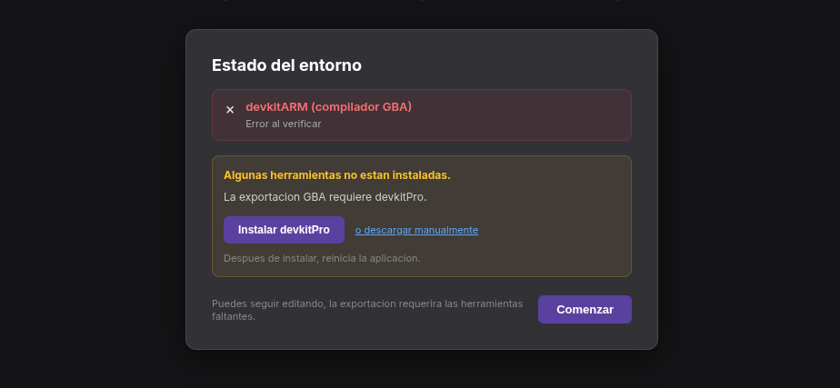

> You can continue editing your project even if tools are missing; building the ROM will require them to be installed.

## 0.2. Home Screen (Recent Projects)

Once you have devkitARM installed, the application takes you to the **recent projects** screen, where up to the **3 most recently opened projects** are displayed.

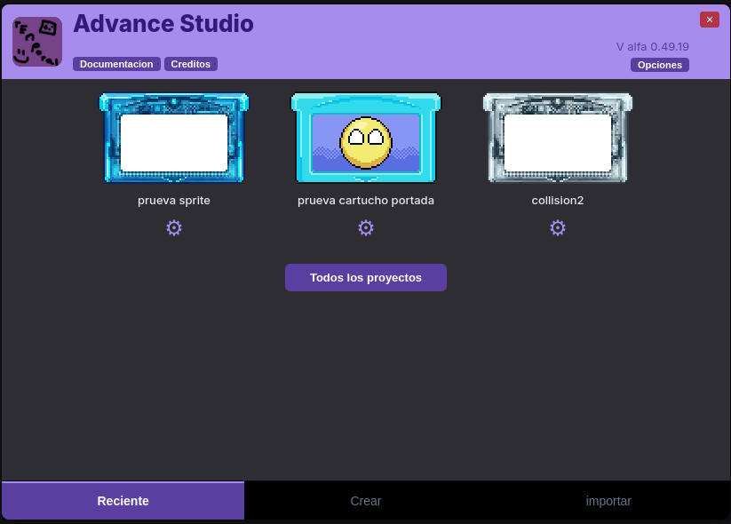

Each card shows the project cartridge and its name. Below each one, the gear (⚙️) allows you to **edit the project** (change the cartridge, cover or name). Clicking on the cartridge opens it in the editor.

## 0.3. Top bar and options

At the top is the main navigation:

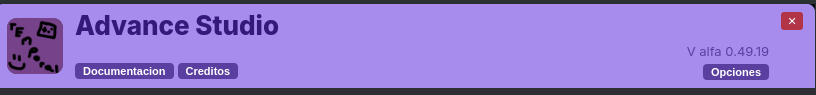

- **Documentation:** access to this documentation.
- **Credits:** project acknowledgments screen.- **Options:** application configuration menu.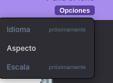> **Note:** in the current version, the **Appearance** (visual theme) option is the only one operational. **Language** and **Scale** are marked “coming soon”.

## 0.4. All projects

The **All Projects** button opens the complete list of created and imported projects, to access any of them without depending on the recent screen.

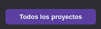

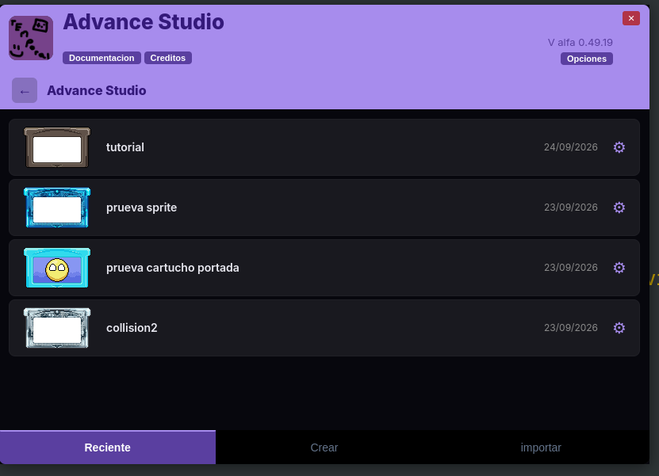

## 0.5. Create a project

In the **Create** tab a new project is configured:

- **Name:** project identifier.
- **Path:** folder where it will be saved (use the `...` button to choose it in the explorer).
- **Templates:** one of the base templates (Classic, Flat Color, Transparent).
- **Modify cartridge:** customize the project cartridge.

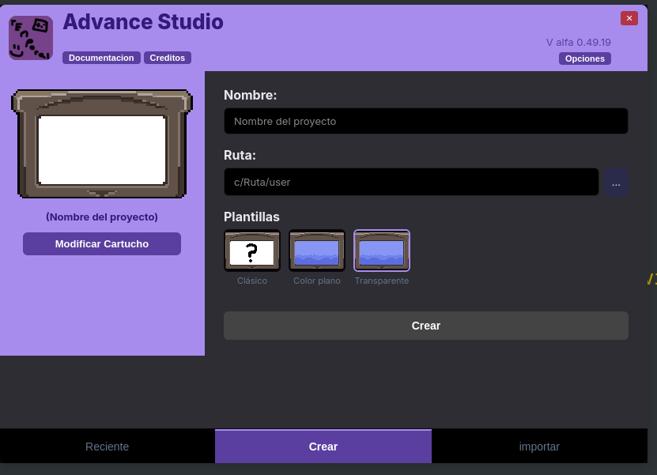

Press **Create** to generate the project and directly enter the editor.

## 0.6. Import to project

In the **Import** tab you can link to a previously created project:

- Choose the **path** of the existing project folder.
- Adjust the **name** if you want.
- You can **modify the cartridge** the same as when creating.

This allows you to continue working on a project without having to create it from scratch.

## 0.7. Cartridge customization

The **Modify Cartridge** (gear) button opens the customization screen: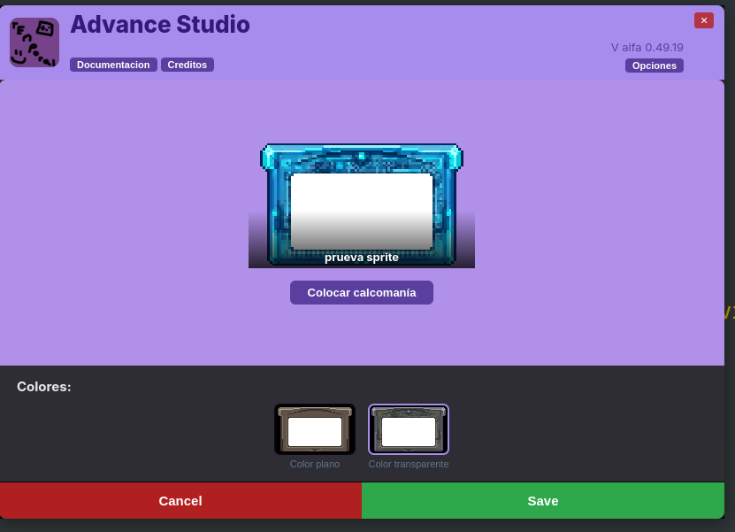- **Cartridge type:** *Flat color* or *Transparent color*.- **Color:** one of the 9 fixed colors (gray, white, red, green, blue, purple, brown, yellow, black) or a custom color with selector.

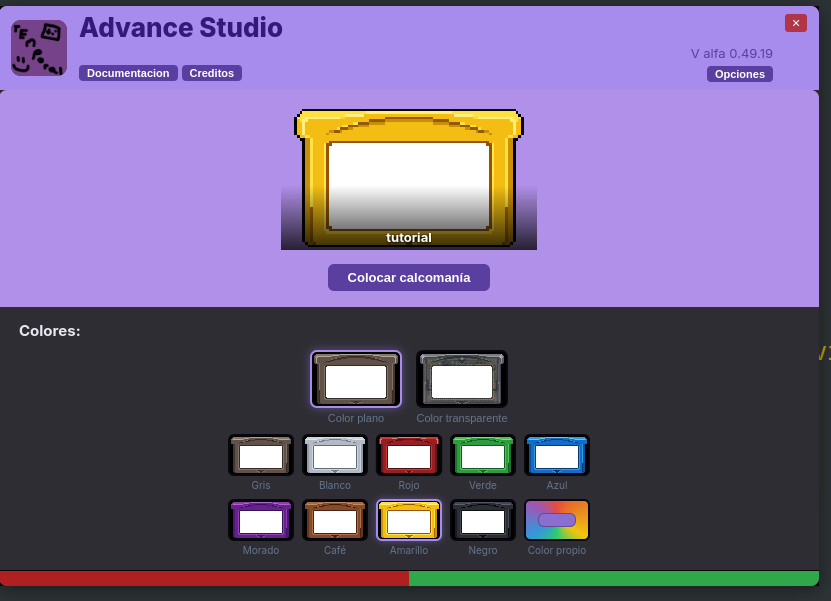

You can also add a custom **cover (decal)**:

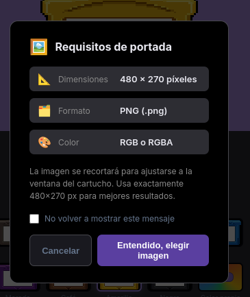

> **Requirement:** use exactly **480×270 px** for best results.

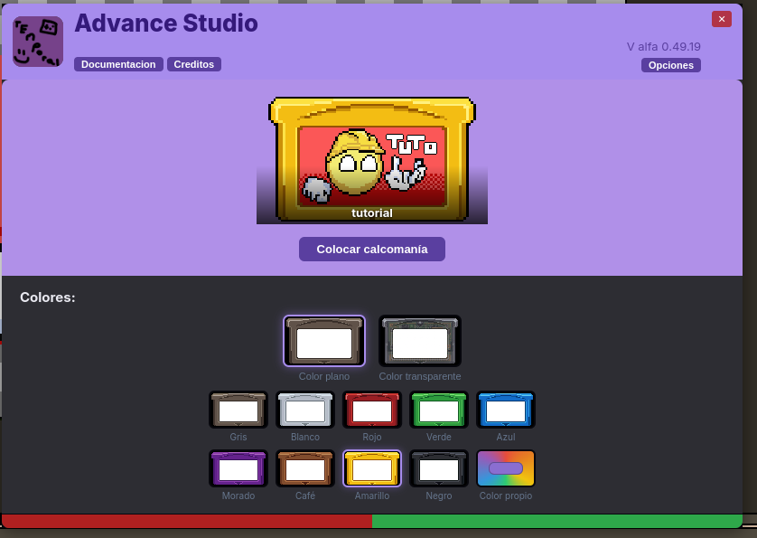

---

**Next:** [01 — Application interface](01-interfaz.md)