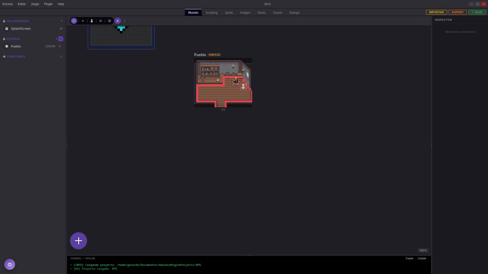
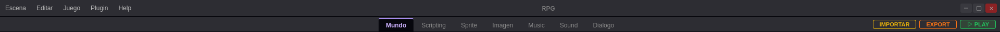
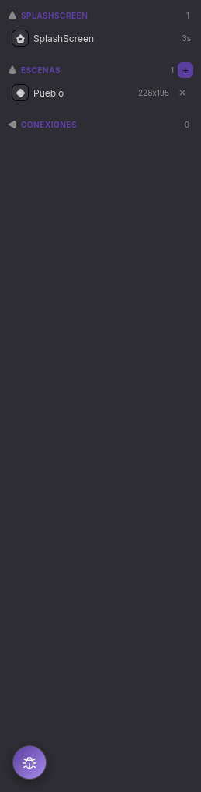
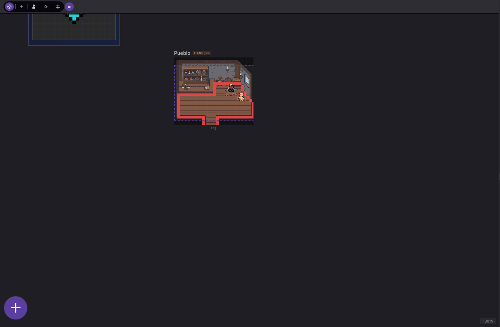
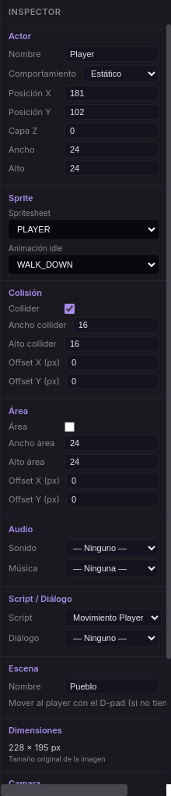

#02 — World Module (scene editor)

> **Note:** This translation may contain errors, as the original documentation was written in Spanish.

> **Note:** This translation may contain errors, as the original documentation was written in Spanish.

> **Note:** This translation may contain errors, as the original documentation was written in Spanish.

The **World** module is the heart of the editor: scenes, actors, collisions and connections are placed here. Everything the player sees and touches is built from this tab.

---

## 1. Top bar

### 1.1. Modules menu (left)

The tabs to switch between modules: **World, Scripting, Sprite, Image, Music, Sound, Dialogue**. Each one opens its own editor.

### 1.2. Actions (right)

| Button | Action |
| :--- | :--- |
| **IMPORT** | Load assets to the project (sprites, backgrounds, sounds, songs, scripts...). |
| **EXPORT** | Save the project, export the GBA ROM, the web or the desktop app. |
| **PLAY** | Compile and run the game in the built-in emulator. |
| **STOP** | Stop the emulator. |
| **SPLASHSCREEN** | Open your home screen settings (picture, duration, music). |

---

## 2. Hierarchy (left panel)

The tree shows the structure of the project:

- **SPLASHSCREEN** — the starting scene (always the first one).
- **SCENES** — each scene, with its size in pixels (`228x195`).
  - **CAM** — the scene camera (only in scenes larger than the screen). Displays `x,y`.- **Actors** — each actor in the scene (Player, NPC...).- **CONNECTIONS** — the transitions between scenes, with their name.### Hierarchy Actions

- **Click** on a node → selects it and shows its inspector.
- **✕** on a node → deletes it (with confirmation).
- **Pencil** → rename online.
- **⋮** → context menu (rename, delete, duplicate).
- ***** → create a new scene.

---

## 3.Canvas

The canvas displays the active scene. Tools:

| Tools | Description |
| :--- | :--- |
| **Select/Move** | Select and drag actors around the canvas. |
| **Add scene (+)** | Create a new scene in the center of the view. |
| **Add actor** | Create an actor in the center of the scene. |
| **Link (link)** | Draw connections between scenes. |
| **Collisions** | Open the collision paint palette. |
| **Grid** | Show/hide the grid. |
| **Cell size (⋮)** | 1, 2, 4, 8, 16, 32 or 64 px. |

### Movement across the canvas

- **Drag** an actor → moves it.
- **Mouse wheel** → canvas zoom.
- **Ctrl + wheel** → fine zoom.
- **Space bar + drag** → pan the view.
- **Arrows on the keyboard** → move the selected actor 1 px (with Shift, 8 px).

---

## 4. Radial menu

In the lower left corner, the radial menu gives quick access to the insert actions: **Scene, Actor, Link, Collisions**.

---

## 5. Collisions

Activating the collision tool opens a bar with two blocks.

### 5.1. Plotting tools

| Tools | Usage |
| :--- | :--- || **Boat** | Fill in adjoining areas. || **Wand** | Select by outline. || **Pencil** | Paint cell by cell. |
| **Rectangle** | Draw a collision rectangle. |
| **Rubber** | Clears cell-to-cell collision. |

### 5.2. Surface types

| Type | Color | Behavior |
| :--- | :--- | :--- |
| **Solid** | Network | Total locking on all 4 axes. |
| **Semi-solid** | Orange | It blocks in one direction, it crosses in the opposite direction (platforms). |
| **Staircase** | Green | Allows raising/lowering (platforms). |
| **Ramp** | Yellow | Slope in all 4 directions. |

---

## 6. Inspector

The inspector (right panel) displays the properties of the selected node.

### 6.1. actor inspector

| Block | Options | Description |
| :--- | :--- | :--- |
| **Actor** | Name | The actor's identifier. |
| | Behavior | Static, Interactable, Object or Text. You define how it reacts when touched. |
| | X/Y position | Coordinates in pixels within the scene. |
| | Z Layer | Drawing order (0 = behind, larger values ​​= in front). |
| | Width/Height | Sprite size in pixels. |
| **Sprite** | Spritesheet | The assigned sprite sheet. |
| | Animation | The initial animation. |
| **Collision** | Collider | Activate the hitbox. |
| | Collider Width/Height | Box size (independent of sprite). |
| | X/Y Offset | Displacement of the box with respect to the sprite. || **Area** | Area | Activates a detection zone that follows the actor. |
| | Width/Height area | Zone size. || | X/Y Offset | Displacement of the area. || **Audio** | Sound | Assigned SFX (when colliding, when interacting...). |
| | Music | Song assigned to the actor. |
| **Script / Dialog** | Script | The assigned C/AdvanceCode script. |
| | Dialogue | The assigned dialogue (for NPCs). |
| | Textbox | The dialog box sprite (TEXTBOX). |
| | Box size | Width/Height of the box. |
| | Cash position | X/Y offset of the box on screen. |

### 6.2. scene inspector

| Block | Options | Description |
| :--- | :--- | :--- |
| **Name** | — | The name of the scene. |
| **Move to player** | Switch | If actor 0 does not have a script, the motor moves it with the D-pad. |
| **Dimensions** | Width × Height | The size of the canvas in pixels. |
| **Camera** | X/Y Camera | The position of the camera (large scenes). |
| **Background image** | — | The background of the scene. |
| **Background song** | — | The music that plays in the scene. |

---

## 7. Transitions between scenes

**Linking** two scenes creates a connection. Each connection has:

- **Entry Transition**: what you see when entering the destination scene.
- **Exit transition**: what you see when you exit.
- **Type**: snapshot, fade or custom tileset.
- **Speed**: the duration of the transition.
- **Name**: to choose it from `switchScene(n, "name")` in the script.### Transition types

| Type | Description |
| :--- | :--- |
| **Snapshot** | Screen change without animation. || **Fade** | Fade to black / from black. || **Tileset** | Each 8x8 block reproduces a tileset as a mask pixel by pixel (white reveals, black hides). |

---

## 8. Performance (GBA budget)

Drawing occurs within the VBLANK (~83,800 cycles/frame). The limit is the **sprite pixels visible in camera**, not the number of actors:

- Budget: **~5,600 px of sprite per frame**.
- 5-6 actors of 21×31 px, or 1 of 64×64 + 2 small ones.
- Off-camera actors hardly spend any money.
- An actor who is partially out only pays the visible part.

---

**Previous:** [01 — Interface](01-interfaz.md) · **Next:** [03 — Sprite](03-sprite.md)