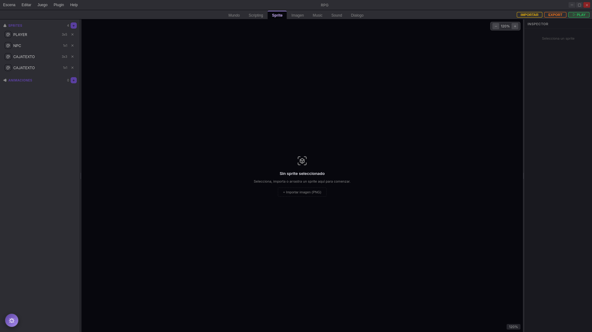
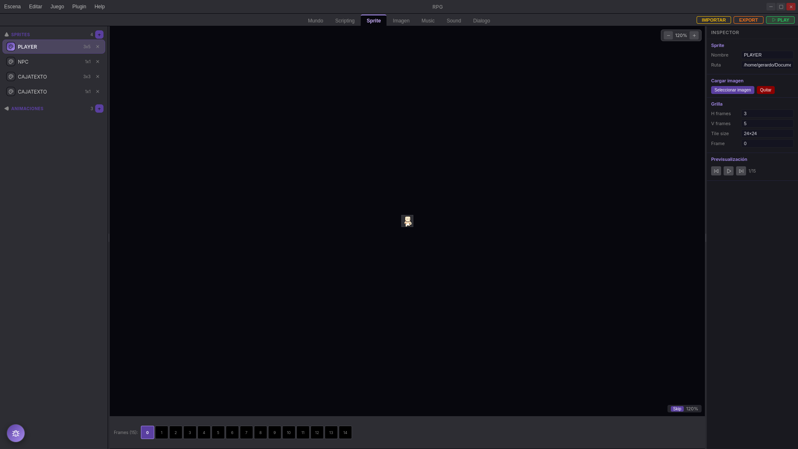

#03 — Sprite Module

> **Note:** This translation may contain errors, as the original documentation was written in Spanish.

> **Note:** This translation may contain errors, as the original documentation was written in Spanish.

> **Note:** This translation may contain errors, as the original documentation was written in Spanish.

The **Sprite** module converts a sprite sheet into the frames that the engine animates: it divides the image into a grid, discards empty frames and creates animations with its cycle modes.

---

## 1. Import a sheet

1. Press **IMPORT** (or drag the PNG to the canvas).
2. Choose the image. It is saved in `sprites/` of the project.
3. It appears in the sprite list with its name and grid.

## 2. Split sheet (grid)

When importing, the wizard asks for the **grid**:

| Field | Description |
| :--- | :--- |
| **Columns** | How many frames are there horizontally? |
| **Rows** | How many frames are there vertically. |
| **Width / Height of tile** | Size of each frame in pixels. |

The sheet is divided into `columns × rows` frames. Each frame is an independent tile that the engine can animate.

## 3. Skip empty frames

If the sheet has gaps (transparent or fill frames), use **«Skip empty frames»**: mark the frames you don't want in red and the engine will skip them when exporting. Thus, a sheet with irregular spaces does not generate ghost frames.

## 4.Animations

Each sprite can have multiple **animations**. An animation is a sequence of frames with a delay.

| Field | Description |
| :--- | :--- || **Name** | The identifier (WALK_DOWN, IDLE…). || **Frames** | The list of frames that make up the animation. |
| **Delay** | How many vsyncs each frame lasts (6 ≈ 10 times/sg). || **Mode** | **Once** (eleven), **loop** (loop) or **ping-pong** (round trip). |

### Cycle modes

- **Once**: the animation is played only once and remains in the last frame.
- **Loop**: when finished returns to the first frame.
- **Ping-pong**: goes from first to last and from last to first (for walking, flapping...).

## 5. Sprite Inspector

- **List of sprites** (left): all the sheets in the project.
- **Preview**: the selected frame, with the grid.
- **Animations**: list, add, delete, rename.
- **Timeline**: the frames of the animation, with the onion skin (fit with the previous frame).

## 6. Onion skin

The **onion skin** draws the previous frame as a ghost to chain animations by hand (each frame continues the previous one). It is activated with the corresponding button.

## 7. Use in the game

- An actor has a **spritesheet** and a **start animation**.
- The script can change animation and frame:
  - `gSelf->frame` — current frame.
  - `gSelf->animSpeed` — how many clock frames are advanced by vsync (0/1 = exact cadence; 2+ = faster).
- The animation runs in the engine (`advanceAllActors`), unless a dialog/menu is open (it freezes).

---

**Previous:** [02 — World](02-mundo.md) · **Next:** [04 — Image](04-imagen.md)