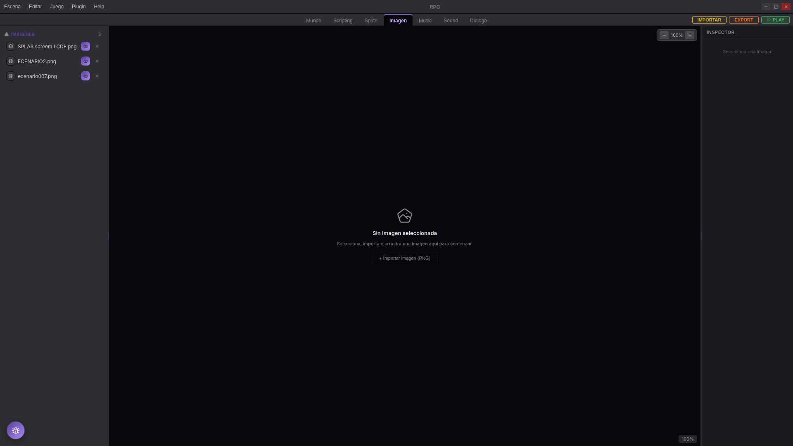

#04 — Image Module

> **Note:** This translation may contain errors, as the original documentation was written in Spanish.

> **Note:** This translation may contain errors, as the original documentation was written in Spanish.

> **Note:** This translation may contain errors, as the original documentation was written in Spanish.

The **Image** module manages the game backgrounds: the image of each scene and the layers with parallax.

---

## 1. Scene Backgrounds

Each scene has a **background image**. It is assigned from the scene inspector (World) or by importing here.

- The image is cropped depending on the camera if the scene is larger than the screen (240x160).
- If the scene is smaller, it is centered.

## 2. Layers (parallax)

You can add **layers** over the background to give depth. Each layer is an image that moves at a different pace than the camera.

| Field | Description |
| :--- | :---| 
| **Image** | The image of the layer. |
| **Parallax X / Y** | 0 = does not move, 1 = moves with the camera, >1 = faster. |
| **Repeat** | If the layer repeats horizontally/vertically (tiles). |
| **Animation speed** | Whether the layer is an animated background. |

## 3. Animated backgrounds

A layer can be an **animated background**: a sequence of frames that plays in a loop.

- **Speed**: frames per vsync.
- **Mode**: loop or once.
- **Direction**: forward or backward.

## 4. Layer Inspector

- **Note** — show/hide the layer.
- **Name** — the identifier.
- **Parallax X / Y** — the tracking speed.- **Animation** — if it has frames and its speed.

---

**Previous:** [03 — Sprite](03-sprite.md) · **Next:** [05 — Music](05-music.md)