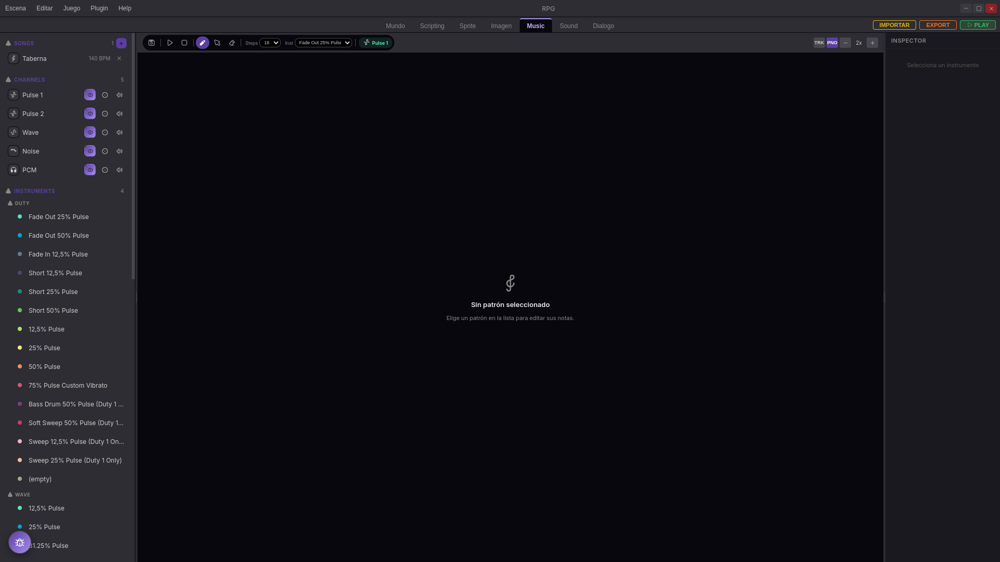

#05 — Music Module (Chiptune Tracker & Sequencer)

> **Note:** This translation may contain errors, as the original documentation was written in Spanish.

> **Note:** This translation may contain errors, as the original documentation was written in Spanish.

> **Note:** This translation may contain errors, as the original documentation was written in Spanish.

The **Music** editor is an integrated chiptune composition and sequencing tool, aimed at classic retro PSG (*Programmable Sound Generator*) audio hardware. It allows you to create musical themes with two interchangeable interfaces: a graphical **Piano Roll** and a traditional **Tracker** view.

## 1. Lateral hierarchy and channels

### 1.1. List of songs (`SONGS`)
- Allows you to create (+), rename and manage the songs in the project.
- Shows the name of the active track and its speed in BPM.

### 1.2. Hardware channels (`CHANNELS`)
The system emulates the 4-channel PSG sound architecture:

- **Pulse 1:** pulse or square wave channel with frequency sweep support (*sweep*). Ideal for main melodies.
- **Press 2:** second press channel. For countermelodies, harmonies or accompaniment.
- **Wave:** custom wave channel programmable by sample table. Predominant for bass lines.
- **Noise:** white/percussive pseudo-random noise generator. For rhythmic effects (drums, cymbals, hits).

> **Quick controls per channel:**
> - **Visibility (eye):** shows or hides the notes for that channel on the canvas.
> - **S (Solo):** mutes all other channels.> - **M (Mute):** mutes the active channel.

### 1.3. Instrument Library (`INSTRUMENTS`)Catalog of sound timbres grouped by type of synthesis:- **DUTY:** instruments based on pulse duty cycle (12.5%, 25%, 50%, 75%).
- **WAVE:** predefined waveforms for table synthesis.
- **NOISE:** percussion presets and sound effects (White Noise, Snare, Hi-Hat, Metallic, Gritty 7-bit...).
- **SURDO / Customized:** own banks; allows you to create instruments by assigning color, name and physical properties of the oscillator.

## 2. Editing modes and workspace

The interface has two switchable composition modes (top right switch):

- **PNO (Piano Roll):** visual representation with keyboard of chromatic frequencies on the vertical axis and time on the horizontal.
- **TRK (Tracker):** vertical step sequencer view; each column is a channel (Pulse 1, Pulse 2, Wave, Noise) and displays the note next to the assigned instrument.

### Top editing bar controls
- **Save (💾):** stores the changes to the audio file.
- **Play (▶) / Pause / Stop (⏹):** transport of the active song or pattern.
- **Pen:** draw notes or triggers on the canvas.
- **Selection / Cursor:** drag, move and relocate existing notes.
- **Rubber:** deletes individual notes.
- **Steps selector:** length of the active measure/pattern (8, 16, 32 or 64 steps).
- **Instrument quick selector (Inst):** preset that will be applied when painting.
- **Active channel:** indicator and selector of the channel to which it is written.- **Zoom / Scale (-, 2x, +):** visual scale of the cells.## 3. Pattern Sequencing (`PATTERNS`)The compositional structure of the theme is managed in the lower bar:

- **Pattern line:** chains sequential musical blocks (e.g. `1: E35_`, `2: …`).
- Each pattern stores the combination of notes from all four channels for a defined number of steps.
- During playback, patterns play in sequential order along the timeline.
- **Lower Channel Quick Panel (CH):** shows the status of each oscillator with access to Mute (M) and Solo (S).

![SHAPTURE: PNO (piano roll) view with notes → `assets/music-pianoroll.png`]
![SHAPTURE: TRK (tracker) view with all four channels → `assets/music-tracker.png`]

## 4. Inspector panel

The options in the right side panel adapt to the selected item:

### 4.1. Song properties (global selection)
- **Name:** descriptive title of the track.
- **Artist:** authorship or composer credits.
- **Tempo:** knob control and numerical value that defines the BPM and overall speed of the sequence.

### 4.2. Instrument/frequency properties (note or preset)
- **Name and color identifier:** visual label to distinguish notes and instruments.
- **LENGTH (Duration):** time of decay or sustain of the note.
- **INITIAL VOL (Initial Volume):** attack gain when triggering the note.
- **CHANGE (Surround):** gradient of progressive increase or decrease in volume.- **Test octaves (C3…C8):** prior listening to the instrument in different octaves.- **Oscilloscope viewer:** waveform generated in real time.- **Duty Cycle:** percentage of the square wave cycle (12.5%, 25%, 50%, 75%).
- **Sweep Shift & Hz:** Dynamic pitch shifting (sweep frequency in fractions such as 1/128 Hz), ideal for rise, fall or vibrato.

### 4.3. Channel properties
- Technical information of the selected oscillator: name (`Pulse 1`, `Pulse 2`, `Wave`, `Noise`), **general volume** and **pan/panning** (left / center / right).

---

**Previous:** [04 — Image Module](04-imagen.md) · **Next:** [06 — Sound Module](06-sound.md)