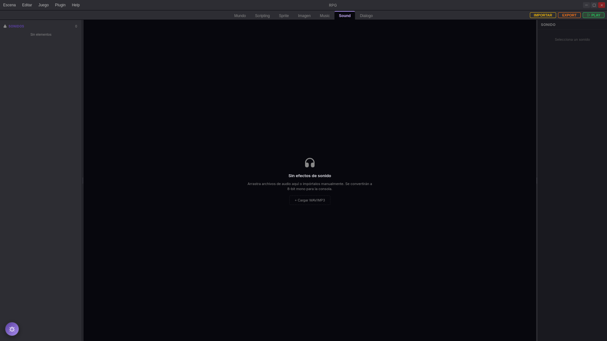

#06 — Sound Module (Sound Effects)

> **Note:** This translation may contain errors, as the original documentation was written in Spanish.

> **Note:** This translation may contain errors, as the original documentation was written in Spanish.

> **Note:** This translation may contain errors, as the original documentation was written in Spanish.

The **Sound** editor allows you to manage the project's sound effects (SFX), play them for real-time preview, and configure how they are synthesized for the GBA's audio hardware.

## 1. List of sounds (`SOUNDS`)

In the left side hierarchy all the effects of the project are listed:

- **Create (+):** adds a new sound filled with a default preset.
- Each element shows its **name**, its source file (if it has one) or its duration in seconds (if it is synthesized), and the icon of its type (`Pulse`, `Wave` or `Noise`).

## 2. Sound inspector

### 2.1. Settings

- **Name:** effect identifier.
- **Use:** **SFX** (spot effect) or **Music** (background theme). Determine how it is integrated into the editor and into the export.
- **File:** allows you to load a **WAV/MP3** using `+Load WAV/MP3` (button with dashed border), or unlink it (✕) to return to synthesis.
- **Volume:** master level in percentage (0-100%).
- **Pitch:** relative tuning, in semitones (-12 to +12).
- **Speed:** playback speed (0.25x to 4x).
- **Delay:** initial trigger delay (0-2 s).
- **Attack:** volume rise time (0-1 s).
- **Release:** volume drop time (0-2 s).- **Waveform:** canvas preview of the audio (synthesized or imported) with playback controls.

### 2.2. GBA ExportSet how the effect translates to the sound chip:- **Channel Type:** **Pulse**, **Wave** or **Noise** (you define the PSG oscillator that will play it).
- **Frequency / Note:** base tone of the effect.

![SHOOT: Sound editor with SFX list and waveform → `assets/sound-editor.png`]

## 3. Integration with actors

Once created, the sound is available in the inspector of any actor in the **World** module, in the **Audio > Sound** block, so that it is triggered by collision events, triggers or player actions.

---

**Previous:** [05 — Music Module](05-music.md) · **Next:** [07 — Dialogue Module](07-dialogo.md)