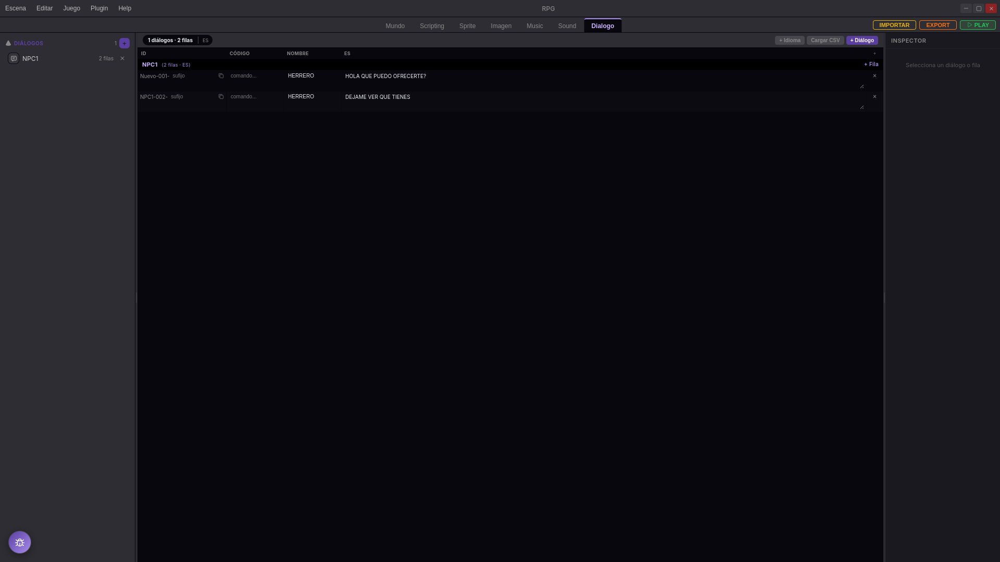

#07 — Dialogue Module (Conversations and texts)

> **Note:** This translation may contain errors, as the original documentation was written in Spanish.

> **Note:** This translation may contain errors, as the original documentation was written in Spanish.

> **Note:** This translation may contain errors, as the original documentation was written in Spanish.

The **Dialogue** editor allows you to create branching conversations, pages of text, and linking to NPCs and interactive actors in the world. Each dialog is organized into **pages** and can have **options** that lead to other pages.

## 1. Lateral hierarchy

The **dialogs** of the project are listed in the side tree. When you select one, the inspector allows you to configure its properties.

Each dialogue shows a small preview of its first page of text and, if linked to a scene, the name of that scene.

## 2. Dialog inspector

### Dialog properties
- **Name:** dialog identifier.
- **Scene:** scene of the **World** module to which it is linked (or “(unlinked)”).

### Pages
Each page contains:
- **Text:** page content (multi-line text area). The hierarchy preview shows the beginning.
- **Options:** responses that the player can choose; each option points to another page and allows the conversation to branch.

## 3. Typical workflow

1. Create a dialog and give it a name.
2. Link the **Scene** where the NPC will appear.3. Write the **Text** of the first page.4. Add **Options** to branch to other pages (a link to as many options per page as you want answers).5. In the **World** module, select the actor who will speak and assign the dialogue to him in the **Script / Dialogue** block.

![SHAPTURE: open dialog with its pages and options → `assets/dialogo-editor.png`]

---

**Previous:** [06 — Sound Module](06-sound.md) · **Next:** [08 — Scripting](08-scripting.md)