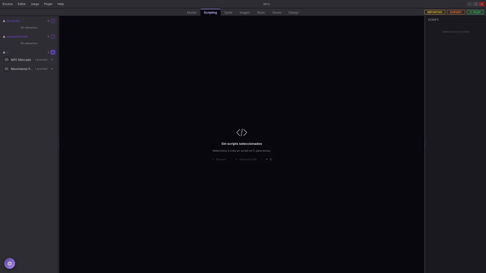

#08—Scripting

> **Note:** This translation may contain errors, as the original documentation was written in Spanish.

> **Note:** This translation may contain errors, as the original documentation was written in Spanish.

> **Note:** This translation may contain errors, as the original documentation was written in Spanish.



> **Status:** AdvanceCode and C functional; Blocks coming soon.

The **Scripting** module is the environment dedicated to the game logic: actor behavior, global events and mechanics.

## 8.1. Script modes

Each script chooses a mode with the `[Blocks][AdvanceCode][C]` selector in the title:

| Mode | State |
| :--- | :--- |
| **Blocks** | Visual, coming soon |
| **AdvanceCode** | **Functional**: transpiled to C and inserted into ROM |
| **C** | **Functional**: *verbatim* is inserted into the ROM |

The code for each mode is saved separately, so you can start in AdvanceCode and move down to C without losing anything. When changing modes you are asked for confirmation.

## 8.2. AdvanceCode (functional)

Own **mid-level** language that transpiles **1:1 to C** (without garbage collector or `malloc`), designed for the ARM7TDMI of the GBA. Remove the semicolons (`;`) at the end of the line — the transpiler places them in C — and use `{}` braces for the blocks.

### Logic and contract

The unit is `logic &lt;Name&gt; for &lt;Entity&gt;`. Your `on start` / `on update` blocks are **the engine contract**:
```advancecode
logic Puerta for Hero {
  mutable abierta: bool = false

  on start {
    abierta = false
  }

  on update {
    if (input.pressed(BUTTON_A)) {
      abierta = true
    }
  }
}
```
-
 `on update` → `void script_update(void)`: executed **every frame** (60 fps).
- `on start` → `void script_init(void)`: executed **once** when entering the scene.
- Within both, `this` is **the actor to which the script is assigned** (in C, `gSelf`).

### Variables and data

| AdvanceCode | C generated |
| :--- | :--- |
| `mutable life: s16 = 3` | `static s16 life = 3;` (RAM) |
| `static LIMIT: u16 = 240` | `static const u16 LIMIT = 240;` (ROM) |
| `entity Item { value: u8 active: bool }` | `typedef struct { u8 value; u8 active; } Item;` |

Types: `u8/s8`, `u16/s16`, `u32/s32`, `bool` (→ `u8`), `fixed` (→ `s16`, hand fixed point).

###Features
```advancecode
function doblar(mutable this, x: u16) -> u16 {
  return x * 2
}
```
Transpiles
 to a flat function with entity prefix (`Hero_doblar`). In parameters, `mutable this` / `this` are mapped to the actor pointer; inside the body `this.field` → `this->field`.

### Flow control

| Syntax | C generated |
| :--- | :--- |
| `if cond { } else if cond { } else { }` | `if (cond) { } else if (cond) { } else { }` (optional parentheses) |
| `while cond { }` | `while (cond) { }` |
| `for i in 0..10 { }` | `for (i = 0; i <= 10; i++) { }` |
| `for mutable i: u8 = 10, i > 0, i -= 2 { }` | `for (u8 i = 10; i > 0; i -= 2) { }` |

Operators: `&&`, `||`, `!`, arithmetic and classic comparisons.

###Input

| AdvanceCode | Meaning |
| :--- | :--- |
| `input.is_pressed(BUTTON_A)` | is it pressed **now**? |
| `input.is_released(BUTTON_A)` | is it **unpressed** now? |
| `input.pressed(BUTTON_A)` | **flank**: **this frame** was pressed (only once) |
| `keys` | shortcut: pressed key mask (`~REG_KEYINPUT & 0x3FF`) |

Buttons: `BUTTON_A/B/SELECT/START/RIGHT/LEFT/UP/DOWN/R/L`.

### Areas and scenes

- `actor_in_area(other)` → `1` if that **other** actor is within the **area of the one executing** the script (`this`). `other` is the **index** of the actor (e.g. `PLAYER_INDEX` or `1`).
- `actor_entered(other)` / `actor_exit(other)` → `1` **only the frame** in which the other actor enters/exits the `this` area (edge). [8.8](#88-switch-scene-from-a-script)).### Everything else is CAny non-language calls (the engine API, `REG_KEYINPUT`, `gActors`, …) are transpiled **verbatim**. This allows you to directly use the movement primitives:
```advancecode
logic Hero for Hero {
  on update {
    moveTopDown(this, keys)      // o movePlatformer(this, keys)
  }
}
```
**Rule of thumb:** what is not recognized emits a **transpilation error** that is listed in the inspector (Scripting tab → GBA Export) and the script **does not enter the ROM**. Not junk code.

## 8.3. C (functional)

Each **C** mode script with written code is inserted *verbatim* into the `main.c` generated before `main()`. The contract:
```c
void script_init(void)   // se llama UNA vez al entrar en la escena
void script_update(void) // se llama CADA frame del juego (60 fps)
```
-
 There must be **exactly 1 definition** of each function (duplicates give a repeated symbol and trigger warnings in the export console).
- Available API: `gActors[]`, `PLAYER_INDEX`, `moveActorCollide()`, `movePlayer()`, `REG_KEYINPUT` (current bits: 0=A 1=B 2=SELEC 3=START 4=RD 5=LEFT 6=UP 7=DOWN 8=R 9=L, **0 = pressed**), `noteOn()` for SFX, and for multi-scene **`switchScene()`, `near()`, `gJp` and `gScene`** (see [8.8](#88-switching-scene-from-a-script)).
- Platform rules: only integers (`u8/s16/int`), no `float`, no `malloc`, no `printf`.

## 8.4. Assign the script to an actor (required)

A script **is only compiled into ROM if it is assigned to at least one actor**. If no one uses it, the export ignores it and notifies the console.

It is assigned in two equivalent ways:

- **Scripting tab** → select the script → inspector → **Actors** section → choose the **scene** in the first drop-down menu and the **actor** in the second. The actor is assigned (it appears in the *Assigned* list, with ✕ to remove it).
- **World tab** → select the actor → inspector → **Script** field.

Each actor supports only one script (checking it in another script reassigns it). When you delete a script, the assignment clears itself across all actors.

With `this` (AdvanceCode) or `gSelf` (C) the script points to the actor that is executing it, so the same script works for several actors:
```c
void script_update(void) {
  GBAActor* p = gSelf;   // el actor al que está asignado ESTE script
  u16 keys = ~REG_KEYINPUT & 0x3FF;
  if (keys & (1 << 4)) moveActorCollide(p, 2, 0);
}
```
## 8.5. Export indicator

The Scripting tab shows in the title and in the inspector what state the script is in:

| State | Meaning |
| :--- | :--- |
| **It is exported** | It has code, is assigned to ≥1 actor, and defines `on update`/`script_update()`. Enter the ROM. |
| **Unassigned** | It has code but no actor uses it → **it is not exported**. |
| **script_update is missing** | It is assigned, but without `on update`/`script_update()` the engine will not execute anything. |
| **Errors** | (AdvanceCode only) transpilation failed; errors are listed in the inspector and the script does not enter the ROM. |
| **Empty** | There is no written code. |
| **Coming soon** | Blocks Mode (does not generate code yet). |

## 8.6. Editor Helps

- **Insert**: buttons with the most used fragments (contract `on start`/`on update`, variables, `yes/else`, topdown/platforms, `actor_in_area`, `actor_entered`...). The catalog changes depending on the mode (AdvanceCode or C).
- **Shortcuts**: `Tab` indents (or unindents with `Shift+Tab`) the selected line or block, `Enter` keeps the indentation and adds a level after `{`, and `Ctrl+/` comments or uncomments the line.- **Auto-closing**: typing `{`, `(` or `[` inserts its partner; typing the closing with the partner right next to it only advances the cursor. - **Balance**: the top bar warns if there are unclosed braces or parentheses (ignores comments and strings). glance where the comments are). The light rectangle marks the area you're viewing: click or drag to move, and the line you touch is in the center. If the file is longer than the panel, the lines are compressed to fit all of them.

### Movement: don't write physics by hand

The template comes with two ready primitives. If your actor moves with the D-pad, this is your entire script:
```c
void script_update(void) {
  u16 keys = ~REG_KEYINPUT & 0x3FF;
  movePlatformer(gSelf, keys);   // plataformas: gravedad, salto, coyote, buffer
  // o bien:
  // moveTopDown(gSelf, keys);    // laberinto / RPG / menús, sin gravedad
}
```
In
 AdvanceCode it is even shorter: `moveTopDown(this, keys)`.

Both respect collision tiles, are adjusted with `#define` (`WALK_SPEED`, `JUMP_VEL`, `GRAVITY`...) and do not force you to do anything: if they do not fit, move `gSelf` by hand. Detail in [10.10](10-programar-c-gba.md#ready-to-use-motion-primitives).

### Animation speed (`animSpeed`)

The animations run **always at their exact cadence** (the `delays` you put on the sprite): the motor does not automatically accelerate anything when walking. If you want the walker's stride to advance faster while they're moving, raise the `animSpeed` field for **that actor** only while you're moving them:
```c
void script_update(void) {
  u16 keys = ~REG_KEYINPUT & 0x3FF;
  if (keys & (KEY_UP | KEY_DOWN | KEY_LEFT | KEY_RIGHT)) {
    moveTopDown(gSelf, keys);
    gSelf->animSpeed = 2;   // solo este actor, solo mientras camina
  } else {
    gSelf->animSpeed = 1;   // cadencia exacta al parar
  }
}
```
`animSpeed` is the vsync step of the feed (`0/1` = normal, `2` = double, …) and only affects the actor you touch; the still NPCs continue with their normal cadence. More detail in [10.8](10-programar-c-gba.md#the-pace-of-animation-and-animspeed).

## 8.7. Areas (actor regions)

The **area** is a property of the **actor**, just like its collision box: a rectangle (Width / Height / Offset) that is attached to it and **moves with it**. It is used to detect areas from the actor's own script: "Is the player within my area?"

How to define it:

1. **World** tab → select the actor → inspector → **Area** section.
2. Activate the switch and adjust **Area Width / Area Height / Offset X / Offset Y** (by default, the sprite size).
3. The blue rectangle is drawn on the actor's card so you can see their range.

From the script (AdvanceCode), the area consulted is **that of the actor that executes** (`this`); the argument is the **index of the other** actor:
```advancecode
logic Puerta for Trigger {
  on update {
    if (actor_in_area(PLAYER_INDEX)) {
      this.animSpeed = 2        // el jugador está dentro de mi área
    }

    if (actor_entered(PLAYER_INDEX)) {
      switchScene(1)            // al entrar en mi área, cambia de escena una sola vez
    }
  }
}
```
In
 C the hooks are `actorInArea(gSelf, &gActors[PLAYER_INDEX])`, `actorEnteredArea(...)`, `actorExitedArea(...)`, `actorOutArea(...)`. Up to **32 actors** are supported (the contact is saved as a bitmask per actor).

## 8.8. Change scene from a script

The export **embeds all the project scenes** in the ROM. To jump from one to the other use `switchScene(n)`, where **n is the order in the editor** (scene 0 is the first in the World list, the last is `N-1`).

Typical: an NPC with his script acts as a door. Interact and change scenes:
```c
void script_update(void) {
  // pegados + pulsas A → escena 1 (segunda de la lista)
  if (near(gSelf, &gActors[PLAYER_INDEX], 20) && (gJp & KEY_A)) {
    switchScene(1);
  }
}
```
In
 AdvanceCode:
```advancecode
logic Puerta for NPC {
  on update {
    if (input.pressed(BUTTON_A) && actor_in_area(PLAYER_INDEX)) {
      switchScene(1)
    }
  }
}
```
-
 `actor_in_area(PLAYER_INDEX)`: `1` if the player is inside the **NPC's own area** (the one you draw in the actor's inspector; see [8.7](#87-actor-regions-areas)).
- `gJp`: key edge — bits pressed **only this frame** (same bits as `REG_KEYINPUT`). So that a button action happens once, not all the time.
- `gScene`: the current scene (read).
- `near(a, b, dist)`: only available in C; ACod doesn't support unary `&`, so for proximity use `actor_in_area`.

### Choose transition animation by name

The source→destination connection of each scene can have its own **input transition** ([World → connection inspector](02-mundo.md)). When doing `switchScene(n)` the engine uses the connection `gScene→n`; If you want to disambiguate (multiple connections to the same destination), pass the **name** of the connection as the 2nd argument:
```c
switchScene(1);            // primera conexión hacia la escena 1
switchScene(1, "puerta");  // la conexión llamada "puerta"
```
In
 AdvanceCode it is written the same (`switchScene(1, "door")`). If there is no matching connection, the default fade is used. The name is edited in the **Name** field of the connection inspector; If you leave it empty, the name of the chosen tileset/gradient is used.

When changing, the engine plays the configured transition (fade/wipe/tileset), loads the image/collision/camera/actors (with their areas and scripts) of the new scene and finishes revealing it. Each scene uses its own actors: the one in the new scene with the script "door" is the one who reacts. Full details (including how they are numbered and the music): [10.15 in 10](10-programar-c-gba.md#1015-varias-escenas-en-la-rom-switchscene-near-y-gjp).

> 📖 **To learn in depth, read [10 — Programming in C for the GBA](10-programar-c-gba.md)**: hardware, memory map, MODE 3, actors, collisions, sound, complete script examples and final cheat sheet.

---

**Previous:** [07 — Dialog Module](07-dialogo.md) · **Next:** [09 — Export and test](09-exportar.md)