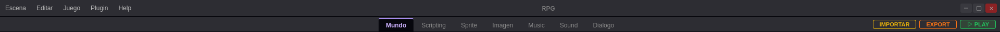

#09 — Export and Test

> **Note:** This translation may contain errors, as the original documentation was written in Spanish.

> **Note:** This translation may contain errors, as the original documentation was written in Spanish.

> **Note:** This translation may contain errors, as the original documentation was written in Spanish.



## 9.1. Integrated emulator (PLAY / STOP)

The **PLAY** button in the editor bar compiles the current state of the project (generates the C code, compiles it with devkitARM, and produces the ROM) and runs it in the **built-in emulator** within the application. The **STOP** button stops the emulator.

- Requires having **devkitARM** installed (see [00 — Getting started](00-inicio.md)).
- It's the fastest way to test scenes, actors and transitions without leaving the editor.
- **Note:** the integrated emulator is more tolerant than real hardware with timing distribution (it does not show certain timing defects). To ensure final performance, test the ROM on a faithful emulator (e.g. mGBA) or a real console.

![CAPTURE: Embedded emulator running the ROM with the PLAY button → `assets/emulator-play.png`]

## 9.2. Export the ROM

The **EXPORT** button opens a menu with the output actions:

- **Save project:** the current state persists.
- **Export GBA ROM:** saves the project, compiles and generates the **executable ROM** (`.gba` file), and automatically opens the project's build folder.- **Export songs / sprites / backgrounds / scripts:** Extracts individual assets (useful if the source asset was lost).- **Open project folder:** Opens the root folder of the project in the explorer.The exported ROM can be run on any GBA emulator or dumped into a **flashcart** to test it on a real console.

![SHAPTURE: EXPORT menu displayed with “Export GBA ROM” → `assets/exportar-rom.png`]

## 9.3. debug console

The bottom panel of the editor records the output of the pipeline:

- Loading of projects and asset routes.
- Build output when using **PLAY** or **Export GBA ROM**.
- Alerts for missing dependencies, performance and unused code.

![SHAPTURE: bottom console with build output → `assets/editor-consola.png`]

## 9.4. GBA platform limits

The GBA draws by software (not hardware sprite); all scene rendering occurs within the **VBLANK** interval (~83,800 cycles per frame, 68 lines × 1232 cycles). If the work exceeds that time, the application loses frames and the animations slow down.

###Budget rule
The limit is not a fixed number of actors: it is the **number of sprite pixels visible by the camera**:
```
~83.800 ciclos ÷ ~15 ciclos por píxel ≈ ~5.600 px de sprite en cámara por frame
```
| Sprite combination | Does it fit? |
| :--- | :--- |
| 5-6 actors of 21×31 px (651 px each) | Comfortable |
| 1 actor of 64×64 px (4096 px) + 2 of 16×16 | Good |
| ~21 actors of 16×16 px (256 px each) | To the limit |
| More elements in the active frame | Slow down animations |

### Actors off camera
- Actors **off camera hardly spend VBLANK**: only cropping their rectangle and updating their timers (~dozens of cycles).
- An actor **partially off-screen** only pays for the visible part.
- You can place **as many actors as you want** in the scene; Only those that the frame focuses on at that moment count.

### Other limits
- **Memory:** is not the limit. The actor background (`gActorBack`) is 240x160 in EWRAM (~76.8 KB), the sprite frames are in ROM and the list of actors is small.
- **Transitions:** a tileset transition of 30×20 tiles × 8 frames × speed 5 is equivalent to ~24,000 vsyncs ≈ 6-7 minutes; Adjust the speed in the inspector to make it shorter.

---

**Previous:** [08 — Scripting](08-scripting.md) · **Next:** [10 — Programming in C for the GBA](10-programar-c-gba.md) · **Return to [index](README.md)**