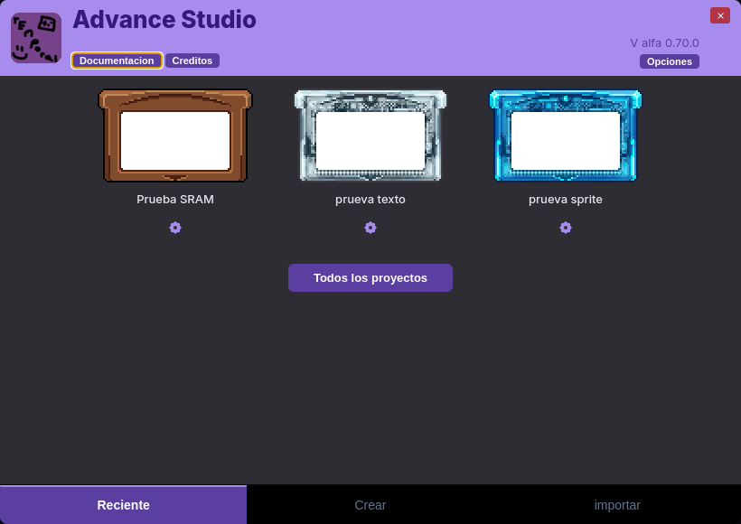
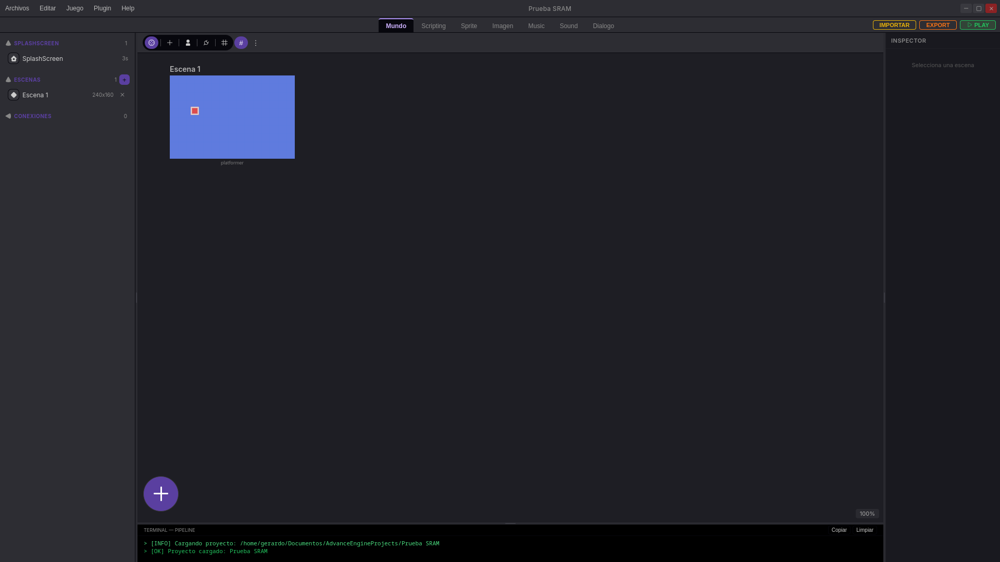
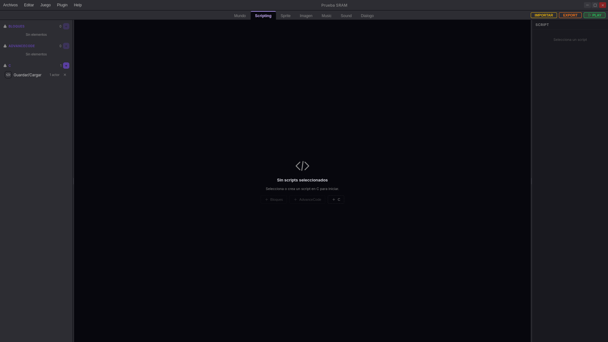
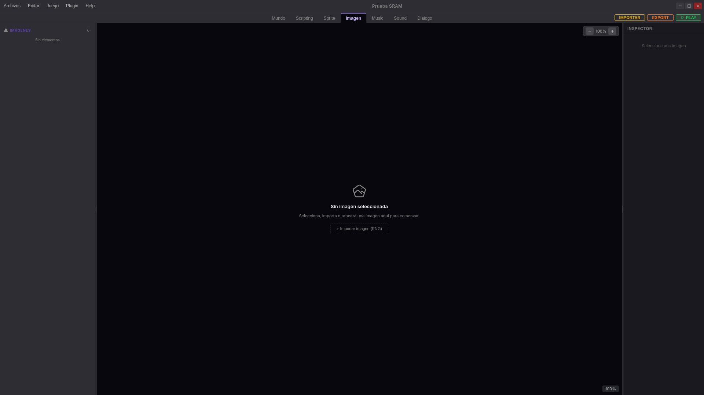
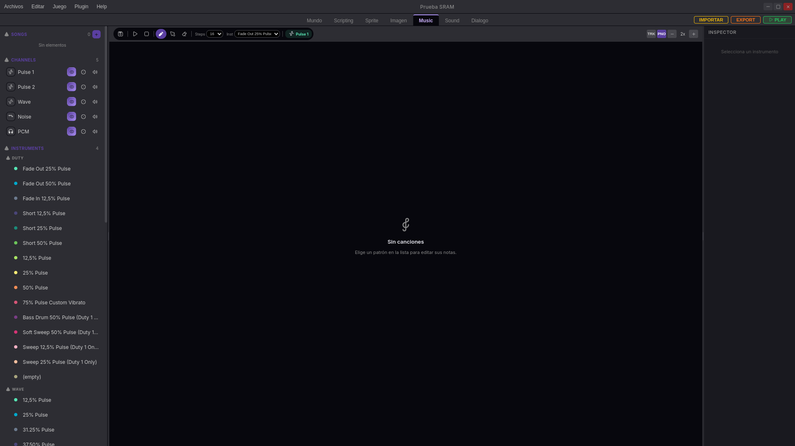
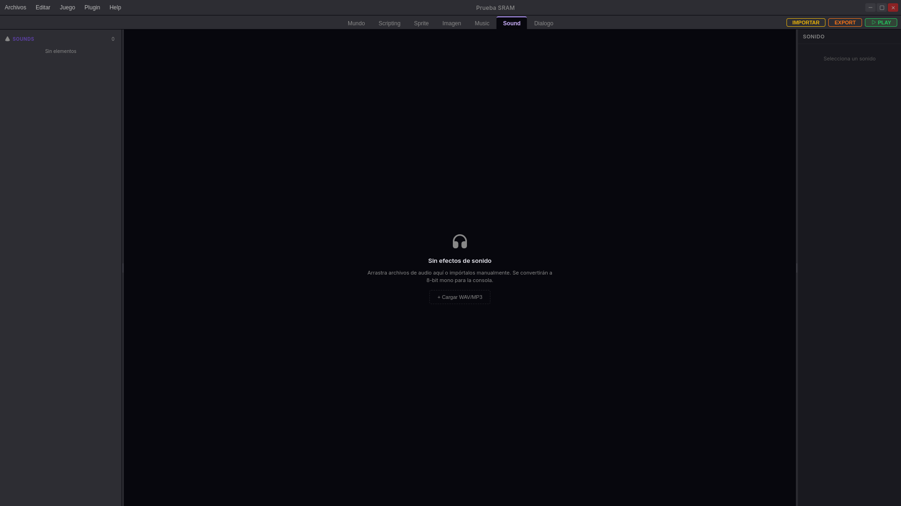
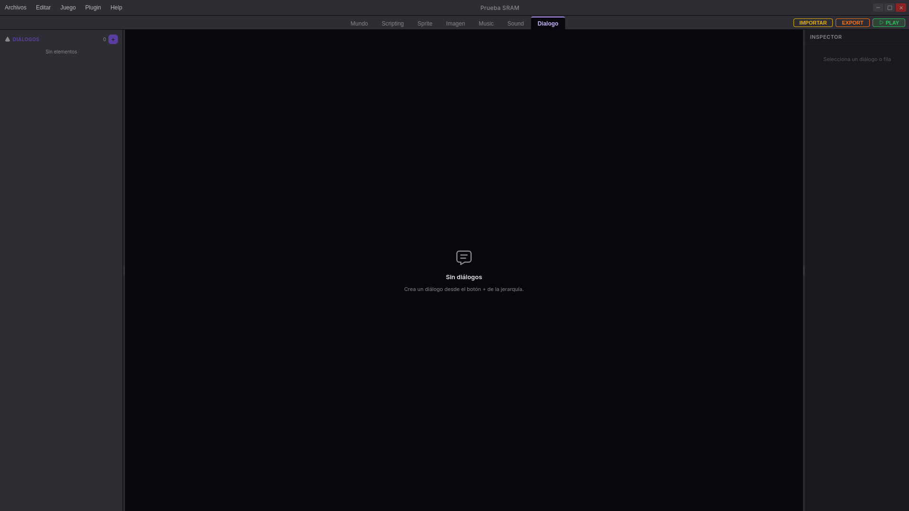

# AdvanceEngine Complete Manual

> **Note:** This translation may contain errors, as the original documentation was written in Spanish.

> **AdvanceEngine** is a visual IDE for making Game Boy Advance games: you draw scenes, animate sprites, compose music, write dialogue and program logic in C. Then export a `.gba` ROM that works on emulators and flashcarts.
>
> This manual explains **every tab, every panel, every option and every function of the C API**, with screenshots of the actual application.

---

## Index

1. [Intro and start](#1-intro-and-start)
2. [The Launcher (main screen)](#2-the-launcher-main-screen)
3. [The Editor (general structure)](#3-the-editor-general-structure)
4. [World Tab](#4-world-tab)
5. [Scripting Tab (C)](#5-scripting-tab-c)
6. [Sprite Tab](#6-sprite-tab)
7. [Image Tab](#7-image-tab)
8. [Music Tab](#8-music-tab)
9. [Sound tab](#9-sound-tab)
10. [Dialog Tab](#10-dialog-tab)
11. [Settings](#11-settings)
12. [Export to GBA](#12-export-to-gba)
13. [Engine C API Reference](#13-engine-c-api-reference)
14. [Guide: make a game from 0 to end](#14-guide-make-a-game-from-0-to-end)
15. [Troubleshooting](#15-troubleshooting)

---

## 1. Introduction and start

### What can be done
- Complete 2D games: **platforms, top-down/RPG, puzzles, visual novels**, etc.
- Scenes with background image, collision by tiles, actors with sprites and animations.
- Multi-scene with transitions (fade, instant or custom tileset).- Music (4 channels PSG + PCM) and sound effects.
- Dialogs with fonts (tilesets), 9-slice box, multiple languages ​​and pagination.
- Logic in **C** with movement primitives and saved in SRAM.

### Requirements
- Windows 10/11 (x64) or Linux (x64/arm64).
- **devkitARM** to export the ROM. The app installs it by itself from **Options → General → Install devkitPro**.
- An external image editor (Aseprite, GIMP, Photoshop) for sprites and backgrounds.

### Fast boot
1. Open the app. The **Launcher** appears (Recent / Create / Import tabs).
2. Create a new project or open an existing one.
3. In the **Editor**, work on the tabs: World, Scripting, Sprite, Image, Music, Sound, Dialog.
4. Press **Game → Export GBA** (or the PLAY button) to generate the ROM.
5. Try it in the built-in emulator.

---

## 2. The Launcher (main screen)



It is the screen when you open the app. Above is the **AppHeader** and below are the tabs.

### AppHeader
- **Logo and version** (`AdvanceEngine`, `V alpha 0.70.0`).
- **Documentation**: open the manual (this file and the rest of the documentation).
- **Credits**: credits screen with animated cloud background.
- **Options**: open the Settings modal (see section 11).

### Launcher Tabs

#### Recent
Shows the **last 3 projects** opened as cartridges (with cover if available). Clicking a cartridge opens the project. Below is the **All Projects** button.#### Create
Form to create a new project:
- **Name** of the project.
- **Author**.
- **Template** (cartridge color): `transparent:white`, `flat:yellow`, etc.
- **Path** where it is saved (`AdvanceEngineProjects` folder by default).
- **Cover** (PNG 480×270 recommended).

When creating, the editor opens with a default scene.

#### Import
Allows you to import a project from a folder (for example, a downloaded or copied one).

#### All projects
Complete list of projects with:
- Name, author, date.
- Context menu (right click): **Open**, **Modify cover**, **Delete**.
- Search.

### Cartridge
The cartridge is the visual representation of the project:
- **Cover** (image 480×270).
- **Color** (depending on the template).
- **Decal** (decorative cutout/stencil).
- Context menu: rename, modify cover, delete.

---

## 3. The Editor (general structure)



When you open a project you enter the **Editor**, which is the main screen. It is organized in:

### Top Bar (EditorTopBar)
- **Menus**: File, Edit, Game, Plugin, Help.
  - **File**: save, export GBA, export assets, close project.
  - **Edit**: undo/redo, copy/paste.
  - **Game**: PLAY/STOP of the integrated emulator.
  - **Plugin**: plugin management (future).
  - **Help**: open the settings in the corresponding tab, or the manual.- **Window buttons** (minimize, maximize, close) — the window is frameless.
- **PLAY/STOP**: export and open the emulator integrated with the ROM.

### Tabs
The 7 tabs of the editor, each with its canvas, hierarchy and inspector:
- **World**: scenes, camera, actors, connections, transitions.
- **Scripting**: logic in C.
- **Sprite**: spritesheets and animations.
- **Image**: backgrounds and layers.
- **Music**: piano roll / tracker.
- **Sound**: sound effects.
- **Dialogue**: dialogues with rows and languages.

### Hierarchy panel (left)
Tree with sections and elements. Allows:
- **Select** an element.
- **Rename** (double click or F2).
- **Delete** (✕ button with confirmation).
- **Context menu** (right click): rename, delete.
- **Collapse** sections.
- **Drag** scenes (in World).

### Canvas (center)
The work area of each tab: scenes, code, sprites, backgrounds, piano roll, etc.

### Inspector (right)
Shows the properties of the selected element. It changes depending on the tab and the element.

### Pipeline terminal (below, in World)
Shows the export log (INFO, WARN, ERROR) with auto-scroll and **Copy** and **Clear** buttons.

### Global keyboard shortcuts
- **Ctrl+S**: save project.
- **Ctrl+Z / Ctrl+Y**: undo/redo.
- **Ctrl+C / Ctrl+V / Ctrl+X / Ctrl+A**: clipboard (respects the field with focus).
- **Del**: delete (respects the field with focus).
- **Escape**: close menus/modals.

---

## 4. World Tab

It is the main tab: **scenes**, **actors**, **camera**, **connections** and **transitions** are placed here.

### Canvas
- **Scenes** (cards) with their mini-map (the background image), the name and the `CAM x,y` indicator if the scene is larger than 240×160.
- **Camera** (dashed rectangle 240×160): can be **dagged** to move the point of view. It's the portion of the scene seen on the GBA.
- **Connections** between scenes (curved lines with arrow). The color indicates the type (input/output).
- **Zoom/pan**: wheel to zoom (Ctrl+wheel in some cases), drag with the middle button or with the move tool.
- Pixel **grid** (configurable size).

### Tools (bottom canvas bar)
- **Move**: drag the view.
- **Add scene**: creates a new scene (name it `Scene N`).
- **Connect**: join two scenes (input/output).
- **Delete**: delete the selected scene or connection.
- **Collision**: paints collision tiles (solid, platforms, ramps).

### Hierarchy
- **SplashScreen** (the splash screen, cannot be deleted).
- **Scenes**: each one with its nested **actors**.
- **Connections**: the relationships between scenes.
- You can **rename** (double click), **delete** (with confirmation) and use the **context menu**.

### Scene Inspector
- **Name**.
- **Type**: platformer / topdown / rpg / fighting (informative, does not change the engine).- **Position** (x, y in the editor's world).
- **Size** (width, height).
- **Background color** (if there is no image).
- **Background Image**: assigned from **Image** (backgrounds and layers).
- **Camera**: `Camera X` and `Camera Y` (the point of view).
- **Collision**: tile size and collision map (painted on the canvas with the collision tool).
- **Song**: the background song of the scene.
- **Background sound**: looped PCM effect.

### Actor Inspector
- **Name**, **type** (Static, Interactable, Object, Text).
- **Position** (x, y), **size** (width, height), **z** (painting order).
- **Sprite**: the spritesheet and animation.
- **Collision**: collider (width, height, offset) and collision by tiles.
- **Area**: trigger zone (width, height, offset) for `actor_in_area`/`actor_entered` in the script.
- **Dialog Box** (for Text type actors): see section 10.
- **Script**: the assigned C script (the one that is executed for this actor).
- **Song / sound**: assigned to the actor.

### Connections
- They are created with the **Connect** tool (click on the source scene and the destination scene).
- **Connection Inspector**: name, input and output transition type (fade, instant or tileset), speed and tileset/gradient.
- **Context menu**: rename, delete.
- The engine plays the transition configured by doing `switchScene(n)`.

### Transitions
- **Fade Out**: The scene fades in/fades in.
- **Instant**: direct change.- **Custom Tileset**: a 3×3 (or larger) image that is animated as a mask (see section 12).
- They are configured in the **connection** (input/output) and **SplashScreen** inspector.

### Pipeline terminal
- Shows the export log: scenes, actors, sources, dialogues, errors.
- **Copy** and **Clear** buttons.

---

## 5. Scripting Tab (C)



Here the **game logic** is programmed in **C**. It is the only mode enabled (AdvanceCode and Blocks are disabled for now).

### Modes
- **Blocks**: disabled (coming soon).
- **AdvanceCode**: disabled (coming soon).
- **C**: the engine language. It is the one that is used.

### Hierarchy
- Section **C**: lists the scripts in C mode.
- **+** button to create a new script.
- Double click to rename, ✕ to delete (with confirmation).
- When creating, the inspector's **Name** field is focused and selected for instant renaming.

### Code Editor
- **Gutter** with line numbers.
- **Syntax highlighting**: comments, `#include`, strings, numbers, keywords, devkitARM types (`u8`, `s16`...) and the engine API.
- **Tab** = 2 spaces, **auto-indent** on Enter, **auto-closing** of braces/parentheses.
- **Undo/redo** (Ctrl+Z / Ctrl+Y / Ctrl+Shift+Z) with its own history (groups what was written in succession).
- **Zoom** (Ctrl+wheel, 9–26 px) with percentage indicator (click to return to 100%).- VS Code style **minimap** on the right (bars per line; click or drag to jump).
- **Snippets** (top bar): `script_update()`, `script_init()`, read keys, primitives, dialogs, saving, etc.

### Script inspector
- **Name**.
- **Mode** (C, disabled the rest).
- **Status**: "Exported", "Unallocated", "Empty", "Script_update missing", etc.
- **Assignment**: the script is executed **for each assigned actor** (World → actor → Script). If it is not assigned, it is not executed.
- **Help**: explanation of the method and contract.

### The contract
```c
void script_init(void) {
  // 1 vez, al entrar en la escena (después de colocar los actores).
}
void script_update(void) {
  // cada frame del juego.
}
```
-
 Both are optional. If you don't define `script_update`, the script only does setup.
- There must be **exactly one** definition of each (the engine does not call any if there are several).
- The engine calls `script_update` **every frame** (60 fps).

### The Engine API (C)
See **section 13** for the complete feature-by-feature reference.

---

## 6. Sprite Tab


**spritesheets and animations** editor. You import the image and define the grid and frames.

### Canvas
- Shows the **spritesheet** with the **grid** of tiles (cols × rows).
- **Zoom and pan** with wheel and drag.
- **Pagination** of tiles and **selection of brush** (tile).
- **Timeline** of frames with playback (play/pause).
- **Onion skin** (onion skin) to see the previous/below frame.
- Configurable **Grid** and image smoothing.

### Hierarchy
- **Sprites**: list of spritesheets (with their image).
- *+** button to create a new one (or import an image).
- Rename/delete with the context menu or the ✕.

### Inspector
- **Name** of the spritesheet.
- **Image**: load/import (PNG/JPG), with path.
- **Grid**: columns and rows.
- **Tile**: width and height of each tile.
- **Animations**: list of animations with their frames, mode (loop/once/pingpong) and speed.
- **Frame**: tile, duration.

### Notes
- The spritesheet is imported as an image (it is not drawn pixel by pixel in the editor).- The engine draws the tiles with **real transparency** (the alpha channel of the PNG).

---

## 7. Image Tab



**backgrounds and layers** editor (with parallax).

### Canvas
- Shows the **background** with the layers stacked.
- **Zoom and pan**.
- **Preview** of the selected layer (with its actual size or scaled).
- **Import image** (button or drag and drop).

### Hierarchy
- **Backgrounds**: list of backgrounds with their nested **layers**.
- *+** button to create a background or layer.
- Rename/delete with the context menu or the ✕.

### Layer inspector
- **Name**.
- **Image**: load/import.
- **Parallax**: X/Y speed (moves with the camera).
- **Speed**: layer animation (if animated).
- **Visibility** (eye) and **rescale** (scale to screen size).
- **Animation mode** (loop/once/pingpong).

### Notes
- Layers can be reordered (drag in the hierarchy).
- The selected layer can be previewed at its actual size or scaled.

---

## 8. Music Tab



**music** editor with piano roll (PNO) and tracker (TRK).

### Canvas
- **Piano roll** (PNO): real keyboard + note grid.
- **Tracker** (TRK): compact tracker-type view.
- **Zoom** (Ctrl+wheel), **horizontal scroll** (Shift+wheel).
- **Grid** with configurable step size (16/32/48/64).
- **Background** configurable: grid or chess.
- **Playhead** draggable.

### Tools- **Pencil**: paint notes.
- **Select**: select notes.
- **Draft**: delete notes.

### Instruments
- **Channels**: Pulse 1, Pulse 2, Wave, Noise, PCM.
- **Instruments** per channel with presets.
- **Mute/Solo** per channel.
- **Undo/Redo** (Ctrl+Z/Y) for all operations.

### Patterns
- List of patterns with playback (play/pause).
- **Resizable patterns** (16/32/48/64 steps).
- Multi-pattern **Loop**.

### Inspector
- **Song**: name, artist, tempo (BPM).
- **Pattern**: steps, instruments.
- **Instrument**: type (duty/wave/noise), volume, duty, envelope, sweep, etc.

### Notes
- Music is exported to ROM with the 4 PSG + PCM channels.
- Instruments are derived from the presets used by the notes.

---

## 9. Sound tab



**sound effects** editor.

### Canvas
- **Waveform** displayed according to type.
- **Preview** in real time with Web Audio.
- **Import** WAV/MP3/OGG.

### Inspector
- **Name** of the effect.
- **Type**: Pulse / Wave / Noise.
- **Note**, **duration**, **volume**, **duty cycle**, **envelope**, **sweep**.
- **Waveform** (for Wave).
- **Preview** (play/stop).

### Notes
- Effects can be played in the editor and in-game (`sound_play` from the script, or assigned to an actor/dialogue).

---

## 10. Dialog Tab



**dialog** editor with rows and languages.

### Board- **Columns**: ID, Code, Name (speaker), and one column per language (ES, FR, etc.).
- **Rows**: each row is a "row" of the dialog.
- **Section header**: the dialog, with its number of rows and languages.
- **+ Row** to add rows.
- **Online editing** of all cells.
- **Navigation with arrows** between cells.
- **Delete** rows with the ✕.

### Hierarchy
- **Dialogues**: list of dialogues.
- *+** button to create.
- Rename/delete with the context menu or the ✕.

### Row Inspector
- **ID** (read only).
- **Code** (short identifier, for `showDialogueRow("code")`).
- **Name** (speaker).
- **Text by language**.
- **Sound** (effect when displaying the row).
- **Source** (row tileset).
- **Delete row**.

### Dialog inspector
- **Name**.
- Linked **Scene**.
- **Languages** (up to 6, with + to add).
- **Delete dialogue**.

### Dialog Box (9-slice box)
In the inspector of the **actor of type Text** (World → actor):
- **3×3 image**: corners, edges and center.
- **Width / Height** (limited to the screen).
- **Offset X / Offset Y** (position, limited to the screen).
- **Name of the speaker inside the box** (checkbox).
- **Line break**: By word / By character.

### Dialogue engine (C)
- `showDialogue(id)`: show the dialog from row 0.
- `showDialogueRow("code")` / `showDialogueRow("ID")`: jump to a row.- `nextDialogueRow()`: advances to the next **page** (if the text does not fit, the next page; if not, the next row).
- `dialogueUpdate()`: advances only when pressing A (call each frame).
- `hideDialogue()`: hide.

---

## 11. Settings

They are opened with **Options** (AppHeader) or **Help → Tabs/General**.

### General
- **Language** of the app (es-ES, en-US, ja-JP, ru-RU).
- **Theme** (7 predefined + custom colors).
- **Text size**.
- **Flat colors** (switch).
- **Splash**: duration, background image.
- **devkitPro**: install/verify.

### Appearance
- Theme colors (panel, accent, text, background).
- Font size.

### Modules tabs
- **World**: grid, connection colors, animations.
- **Scripting**: editor font size, minimap.
- **Sprite**: grid, onion skin.
- **Image**: smoothing.
- **Music**: default view (PNO/TRK), piano colors.
- **Sound**: volume.
- **Dialogue**: box colors, canvas background.
- **Emulator**: button remapping, window theme.

---

## 12. Export to GBA

###Pipeline
1. **Save** the project (Ctrl+S) — the `main.c` and the `Makefile` are generated in `&lt;project&gt;/build/`.
2. **Export GBA** (Game → Export, or PLAY) — build the ROM with devkitARM.
3. The **integrated emulator** with the ROM opens.

### Generated structure
```
proyecto/build/
├── main.c          # el código fuente C del juego
├── Makefile
├── proyecto.elf
└── proyecto.gba
```
### The `main.c`
- **Scenes**: all the scenes in the project, with their background image, collision, camera, actors and song.
- **Actors**: sprites, animations, colliders, areas.
- **Sources and dialogs**: text tables and 9-slice boxes.
- **C Scripts**: your logic, inserted before `main()`.
- **Engine**: software render, PSG + PCM sound, input, saved in SRAM.

### Requirements
- **devkitARM** (installed from Options → General).
- The ROM works on **mGBA** (external and integrated) and on **flashcarts**.

### Notes
- The render is by software: budget ~5,600 visible pixels per frame.
- SRAM persists in the `.sav` (external mGBA and flashcarts). The internal emulator does not dump the SRAM on shutdown.

---

## 13. Engine C API Reference

> This is the **function by function** reference of what the engine makes available to your scripts. Your code is inserted before `main()` and can call everything here.

### Guys
```c
typedef struct {
  u16 period;   // valor del registro FREQ (o ratio|cs<<3 para noise); 0xFFFF = silencio
  u8 instIdx;
} GBANote;

typedef struct {
  s16 x, y, z;
  u16 w, h;
  s16 prevX, prevY, prevW, prevH;
  u8 hasCollider;
  u16 cw, ch;
  s16 cox, coy;
  u8 hasArea;
  u16 aw, ah;
  s16 aox, aoy;
  u32 areaInside, areaWas;
  s16 vx, vy;
  s8 face;
  u8 coyote, jumpBuf, jumpHeld;
  const GBAFrame* frames[MAX_ACTOR_FRAMES];
  u16 delays[MAX_ACTOR_FRAMES];
  u8 frameCount, mode, frame, prevFrame, dir, animSpeed;
  u8 dbIdx;        // caja de diálogo del actor
  s16 dbX, dbY, dbW, dbH;
  u8 speakerInside;  // nombre dentro/fuera de la caja
  u8 wordWrap;       // salto de línea
} GBAActor;

extern GBAActor gActors[ACTOR_COUNT];
extern GBAActor* gSelf;      // el actor cuyo script se está ejecutando
#define PLAYER_INDEX 0       // el actor 0 es "el jugador"
```
### Entrance
```c
#define KEY_A       0x0001
#define KEY_B       0x0002
#define KEY_SELECT  0x0004
#define KEY_START   0x0008
#define KEY_RIGHT   0x0010
#define KEY_LEFT    0x0020
#define KEY_UP      0x0040
#define KEY_DOWN    0x0080
#define KEY_R       0x0100
#define KEY_L       0x0200
#define KEY_SHOULDER 0x0300   // R|L

#define REG_KEYINPUT *(vu16*)0x04000130   // 0 = pulsado
```
-
 `u16 keys = ~REG_KEYINPUT & 0x3FF;` → bits with 1 = pressed.
- `gJp` → edge (bits pressed **this frame**). It updates itself; is used for "press A now."
- `gKeysPrev` → state of the previous frame.

### Actors and movement
```c
// Mover con colisiones (desliza por paredes)
void moveActorCollide(GBAActor* a, s16 dx, s16 dy);
// Mover al jugador con el D-pad (solo si no hay script C)
void movePlayer(u16 keys, GBAActor* p);
// Actualiza el jugador (input + empuje actor-actor)
void updatePlayer(void);

// Primitivas de movimiento (listas para usar)
void moveTopDown(GBAActor* a, u16 keys);     // 4 direcciones, sin gravedad
void movePlatformer(GBAActor* a, u16 keys);  // gravedad + coyote + salto variable
int  onFloor(GBAActor* a);                   // 1 si está en el suelo
static inline void approach(s16* v, s16 target, s16 step);

// Geometría
static inline void actorBox(const GBAActor* a, s16* bx, s16* by, s16* bw, s16* bh);
static inline int rectsOverlap(...);
static inline int rectHitsSolid(s16 bx, s16 by, s16 bw, s16 bh, s16 dx, s16 dy);
```
### Scenes
```c
void switchScene(int n);                       // cambia a la escena n (orden del editor)
void switchSceneNamed(int n, const char* name); // con el nombre de la conexión
extern int gScene;
```
-
 `n` is the **order of the dialog in the editor** (0, 1, 2...).

### Sound
```c
void noteOn(int ch, const GBAInst* inst, u16 period);  // suena una nota
void soundPlay(int idx, int loop);                     // efecto PCM (0 = una vez, 1 = bucle)
void soundStop(void);
```
-
 `idx` is the index of the effect among those with PCM.

### Dialogues
```c
void showDialogue(int id);              // muestra el diálogo id desde la fila 0
void showDialogueRow(const char* key);  // salta a una fila por su Código o ID
void nextDialogueRow(void);             // siguiente página/fila
void hideDialogue(void);
void dialogueUpdate(void);              // avanza solo al pulsar A
extern int gLang;                       // 0 = primer idioma, 1 = segundo, …
```
-
 `id` = order of the dialog in the editor.
- `key` = the **Code** field or the **Full ID** of the row.
- The text is divided into **pages** that fit in the box; As you move forward you go to the next page and then to the next row.

### Saved (SRAM)
```c
int  aeSaveHasGame(void);              // 1 si hay partida guardada válida
int  aeSaveWrite(const u8* data, u32 size); // guarda (0 ok, -1 si no cabe)
int  aeSaveRead(u8* data, u32 size);   // carga (0 ok, -1 sin partida)
void aeSaveClear(void);                // borra la partida
```
-
 Block of **256 bytes** (`AE_SAVE_MAX`), in SRAM `0x0E000000`.
- With magic, version and checksum (FNV-1a). If the checksum does not match, it is treated as "no match".
- SRAM persists in the `.sav` (external mGBA and flashcarts).

### Constants and defines
```c
#define SCREEN_W 240
#define SCREEN_H 160
#define PIXEL_COUNT (SCREEN_W * SCREEN_H)
#define ACTOR_COUNT ...
#define MAX_ACTOR_FRAMES 32
#define AE_SAVE_MAX 256
#define WALK_SPEED 2
#define RUN_SPEED 3
#define GRAVITY 1
#define MAX_FALL 5
#define JUMP_VEL -11
#define COYOTE_FRAMES 5
#define JUMP_BUFFER 5
```
### Debugging
- The engine does not have a console. To debug, use `gBackBuf` and check the pixels, or add a visual indicator (like the corner pixel in the test project).
- The pipeline terminal (World) shows the export log.

---

## 14. Guide: make a game from 0 to finish

### 1. Create the project
- Launcher → **Create** → name, author, template, cover.
- The editor opens.

### 2. Draw the assets (external)
- **Sprites**: a PNG with the tile grid (for example 16×16 per tile).
- **Backgrounds**: a 240×160 image (or larger, it is cropped with the camera).
- **Transition Tilesets**: an image with the mask frames.

### 3. World
- **World → +** to create scenes. Drag to place them.
- Assign the **background image** (from Image) and the **song**.
- **Add actors** (actor + button in the hierarchy) and assign them a sprite and an animation.
- Paint the **collision** with the collision tool.
- **Connect** scenes with the connect tool.

### 4. Sprite
- Import the spritesheet, define the grid (cols × rows).
- Create an **animation** and its frames.

### 5. Image
- Import the background, define the layers and parallax.

### 6.Music
- Create a song, a pattern, and paint notes with the instruments.

### 7. Sound
- Create effects (Pulse/Wave/Noise) or import a WAV.

### 8. Dialogue
- Create a dialog, add rows (with **Code** to reference them), languages, fonts and 9-slice box.

### 9. Scripting (C)- Create a script in **C** mode, assign it to an actor.
- Write `script_update` with the logic (input, movement, dialogs, saved).
- Use the primitives (`moveTopDown`/`movePlatformer`), `showDialogueRow`, `aeSaveWrite`, etc.

### 10. Export and test
- **Game → Export GBA** (or PLAY).
- The ROM is generated in `&lt;project&gt;/build/`.
- Try it in the built-in emulator or in mGBA/flashcart.

### Example: platforms with dialogue and save
```c
u8 save[16];

void script_update(void) {
  u16 keys = ~REG_KEYINPUT & 0x3FF;
  movePlatformer(gSelf, keys);

  if (gJp & KEY_B) {          // B: guardar
    save[0] = gScene;
    save[1] = gSelf->x;
    save[2] = gSelf->y;
    aeSaveWrite(save, 3);
  }
  if (gJp & KEY_START) {     // START: cargar
    if (aeSaveHasGame()) {
      aeSaveRead(save, 3);
      gSelf->x = save[1];
      gSelf->y = save[2];
    }
  }
  if (gJp & KEY_A) showDialogueRow("saludo");  // A: hablar
  dialogueUpdate();
}
```
--
-

## 15. Troubleshooting

### ROM does not compile
- Look at the log in the pipeline terminal (World). C errors appear there.
- Common errors: undeclared function (adds forward declaration), undefined variable, wrong type.

### Text is not visible
- Check that the font has an image and that `gFontCharMap` has the character.
- The text is drawn in the box; if the box is too small, the text is cut off (pagination).

### Dialogue does not progress
- `dialogueUpdate()` must be called every frame.
- `showDialogueRow` uses the **Code** or **ID** of the row.

### Save does not persist
- In external mGBA/flashcart, the `.sav` is saved on exit.
- In the internal emulator (EJS), SRAM is not dumped on shutdown.
- Verify with the visual indicator (red/green) that the write/read works in the session.

### The game is slow
- Reduces visible pixels per frame (fewer actors on camera, smaller sprites).
- Use `animSpeed` for animation.
- Check the VBLANK budget (~5,600 visible pixels).

### The actor blinks
- Use double buffering (the engine already does this).
- Don't redraw actors unnecessarily.

### The transition tile is not visible
- The tileset must have frames; the mask uses bit 0x8000 for transparency.

---

> **Note**: This manual describes version **0.70.0**. Some advanced features (AdvanceCode, Blocks, tile/pixel editor) are in development.