#00 — はじめに

> **注:** この翻訳には誤りが含まれる可能性があります。元のドキュメントはスペイン語で書かれています。

> **注:**この翻訳には誤りが含まれる可能性があります。元のドキュメントはスペイン語で書かれています。

> **注:**この翻訳には誤りが含まれる可能性があります。元のドキュメントはスペイン語で書かれています。

##0.1。最初のブート

ROM **devkitARM** がインストールされていない場合は、次の 2 つのオプションを通知するウィンドウが表示されます。

- **devkitPro** を自動的にインストールします (Linux ではシステムパスワードが要求される場合があります)。
- **公式のdevkitProガイドに従って手動でダウンロード**し、自分でインストールします。

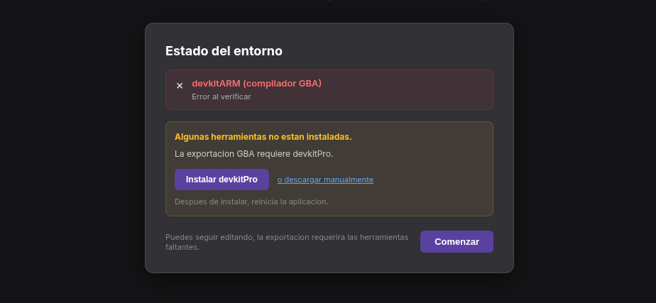

ROMをビルドする必要があります。

## 0.2.ホーム画面（最近のプロジェクト）

devkitARM [**最近のプロジェクト**]画面が表示され、**最近最大3つ**表示されます。

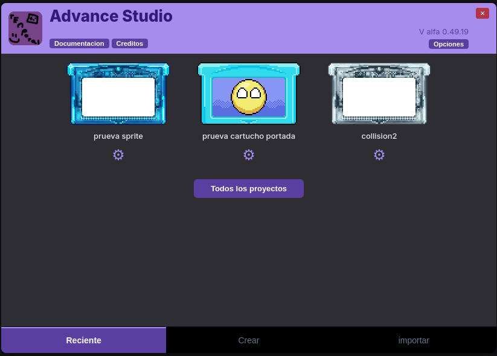

各カードには、プロジェクトそれぞれの下にある歯車を使用すると、**プロジェクトを編集** (カートリッジ、カバー、または名前を変更)できます。カートリッジをクリックすると、エディタでカートリッジが開きます。

##0.3。トップバーとオプション

上部にはメインナビゲーションがあります。

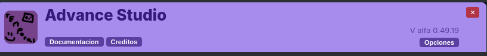

- **ドキュメント:** このドキュメントへのアクセス。
- **クレジット:** プロジェクトの承認画面。
- **オプション:** アプリケーション構成メニュー。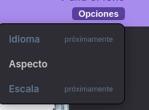

> **注:** 現在のバージョンでは、**外観** (ビジュアルテーマ) オプションのみが機能します。 **言語**と**スケール**は「近日公開」とマークされています。

##0.4。すべてのプロジェクト

[**すべてのプロジェクト**]ボタンをクリックすると、作成およびインポートされたプロジェクトの完全なリストが開き、最近の画面に依存せずにプロジェクトのいずれかにアクセスできます。

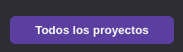

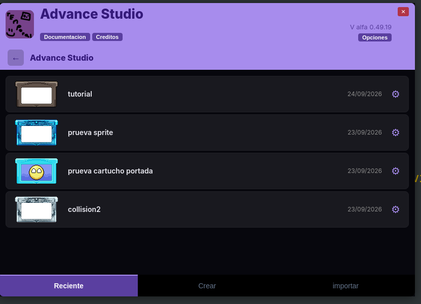

##0.5。プロジェクトを作成する

[**作成**]タブで、新しいプロジェクトを構成します。

- **名前:** プロジェクト識別子。
- **パス:** 保存先確定 (エクスプローラーで[...]ボタンを使用して選択します)。
- **テンプレート:**基本テンプレートの 1 つ (クラシック、フラットカラー、透明)。
- **カートリッジの変更:** プロジェクトカートリッジをカスタマイズします。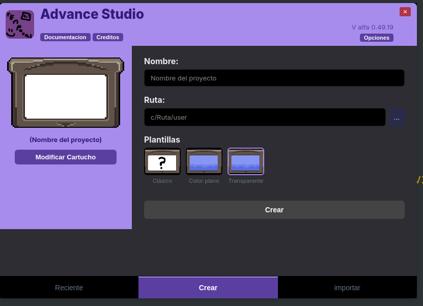

**作成**を押してプロジェクトを生成し、エディタに直接入力します。

##0.6。プロジェクトをインポートする[**インポート**]タブでは、以前に作成したプロジェクトをリンクできます。

- みんなのプロジェクト設定の**パス**を選択します。
- 必要に応じて **名前** を調整します。
- 作成時と同様に**カートリッジを変更**できます。

これにより、プロジェクトを最初から作成しなくても、プロジェクトでの作業を続けることができます。

##0.7。 カートリッジのカスタマイズ

**カートリッジの変更** (歯車)ボタンをクリックすると、カスタマイズ画面が開きます。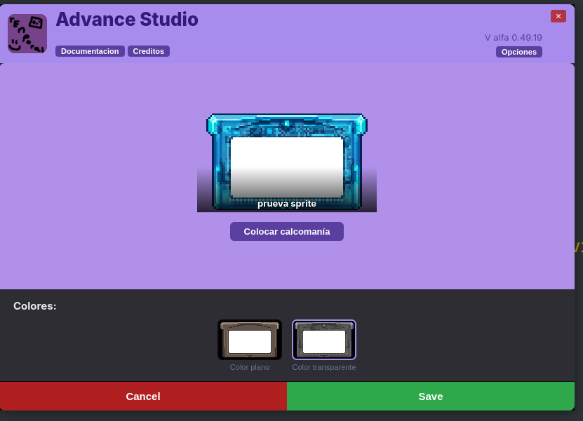

- **カートリッジタイプ:** *フラットカラー* または *透明カラー*。
- **色:** 9 つの固定色 (グレー、白、赤、緑、青、紫、茶色、黄、黒) のいずれか、またはセレクターを使用したカスタムカラー。

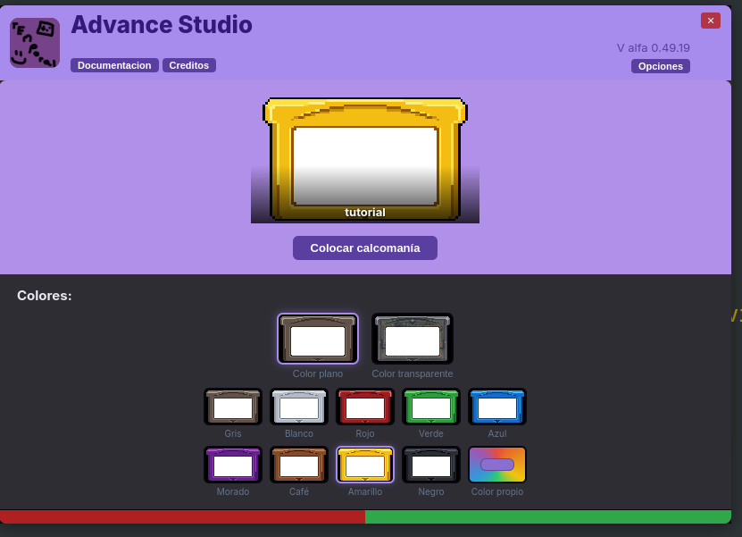

カスタム **カバー (デカール)** を追加することもできます。

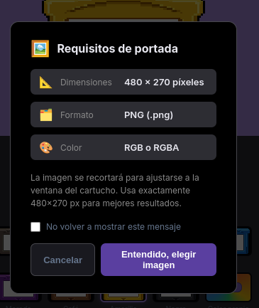

>>

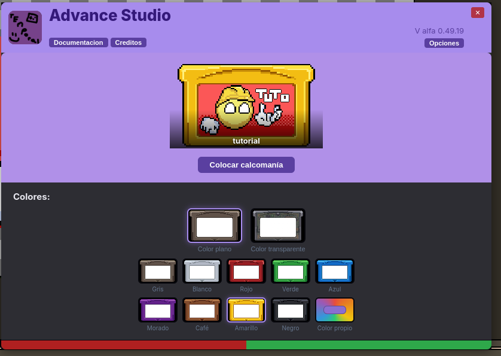

---

**次へ:** [01 — アプリケーションインターフェイス](01-interfaz.md)