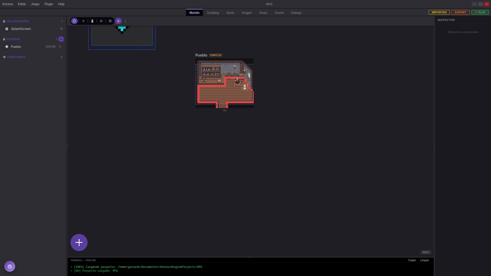
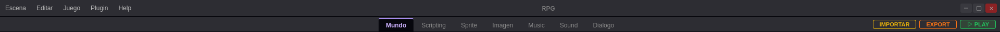
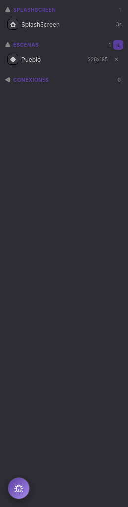
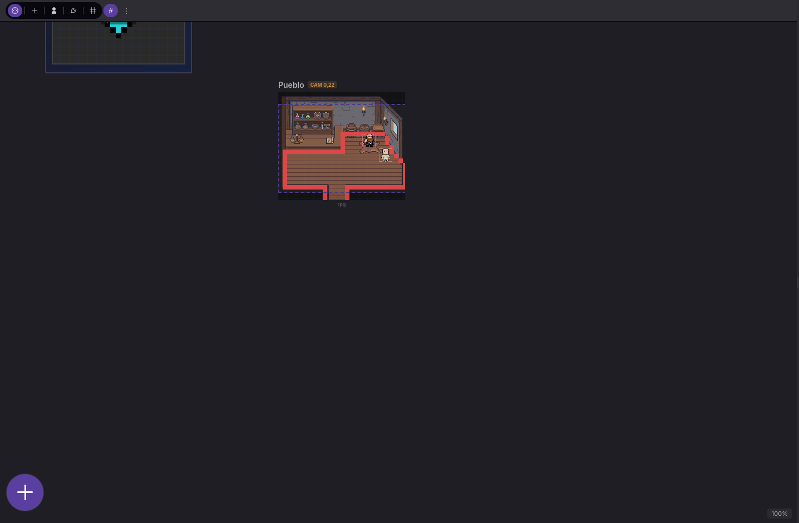
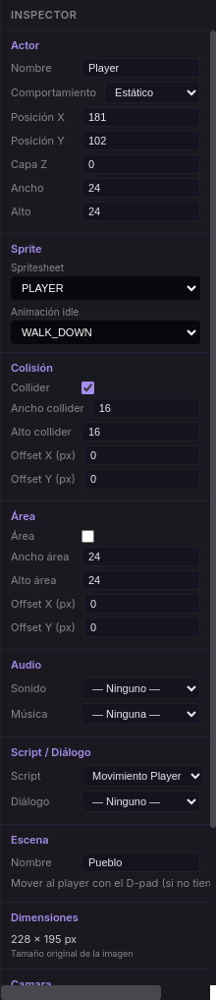

#02 — ワールドモジュール (シーンエディター)

> **注:** この翻訳には誤りが含まれる可能性があります。元のドキュメントはスペイン語で書かれています。

> **注:**この翻訳には誤りが含まれる可能性があります。元のドキュメントはスペイン語で書かれています。

> **注:**この翻訳には誤りが含まれる可能性があります。元のドキュメントはスペイン語で書かれています。

**World** モジュールはエディターの中心であり、シーン、アクターされ、接続がここに構成されます。プレイヤーが見たり感動したりするものはすべてこのタブから構築されます。

---

## 1. トップバー

＃＃＃１．１． モジュールメニュー（左）

モジュール間を待つためのタブ: **、ダイアログ**。それぞれが独自のエディターを開きます。

＃＃＃１．２．アクション（右）

|ボタン |アクション |
| :--- | :--- |
| **インポート** |アセットをプロジェクトにロードします(スプライト、背景、サウンド、曲、スクリプトなど)。
| **エクスポート** |プロジェクトを保存し、GBA ROM、Web、またはデスクトップアプリをエクスポートします。
| **実行中** |内蔵パイルして実行します。
| **停止** | 登山をやめます。
| **スプラッシュスクリーン** | ホーム画面の設定 (画像、再生時間、音楽) を開きます。

---

## 2. 暴力 (左パネル)

ツリーはプロジェクトの構造を示します。

- **スプラッシュ スクリーン** — 開始シーン (常に最初のシーン)。
- **SCENES** — 各シーンのピクセル単位のサイズ (`228x195`)。
  - **CAM** — シーンカメラ (画面より大きいシーンのみ)。 `x,y`を表示します。
  - **アクター** — シーン内の各アクター (プレイヤー、NPC...)。
- **接続** — シーン中のトランジションとその名前。

- ノードを **クリック** → ノードを選択し、そのインスペクタを表示します。
- ノード上の **✕** → ノードを削除します (確認付き)。
- **鉛筆** → オンラインで名前を変更します。
- **⋮** → コンテキストメニュー (名前変更、削除、コピー)。
- ***** → 新しいシーンを作成します。

---

## 3.キャンバス

キャンバスにはアクティブなシーンが表示されます。ツール:

|ツール |説明 |
| :--- | :--- |
| **選択/移動** |
| **シーンを追加 (+)** |ビューの中央に新しいシーンを作成します。 ** 俳優を追加** |シーンの中心に俳優を作成します。
| **リンク (リンク)** |シーン間のつながりを描きます。
| **衝突** |衝突パレットを開きます。
| ** グリッド ** | グリッドの表示/非表示を切り替えます。| **セルサイズ (⋮)** | 1、2、4、8、16、32、または 64 ピクセル。

### キャンバス上の移動

- 俳優を **犯人** →移動します。
- **マウスホイール** → キャンバスズーム。
- **Ctrl +ホイール** → 詳細ズーム。
- **スペースバー + サリン** → ビューをパンします。
- **キーボードの矢印** →選択したアクターを1ピクセル(Shiftキーを使うと8ピクセル)移動します。

---

## 4. ラジアルメニュー

アクション(**シーン、アクター、リンク、衝突**)を挿入すると簡単にアクセスできます。

---

## 5.衝突

衝突ツールをアクティブにすると、2つのブロックを含むバーが開きます。

＃＃＃５．１．プロットツール

|ツール |使い方 |
| :--- | :--- || ** ボート ** |隣接する領域を塗りつぶします。
| **杖** | 任意で選択します。
| **鉛筆** |セルごとにペイントします。
| **決定** |衝突する四角形を描きます。
| **ゴム** |セル間の衝突を解消します。

＃＃＃５．２． 表面の種類

|タイプ |色 |行動 |
| :--- | :--- | :--- |
| **固体** |赤 | 4軸全てをトータルロック。
| **半固体** |
| **階段** |緑 | （プラットフォーム）の上昇が可能です。
| **ランプ** |黄色 | 4方向にすべてを考慮します。

---

## 6.検査官

インスペクター (右パネル) には、選択したノードのプロパティが表示されます。

＃＃＃６．１． 俳優の検査官

|ブロック |オプション |説明 |
| :--- | :--- | :--- |
| **俳優** |名前 |俳優の識別子。
| |行動|静的な、対話型、オブジェクトまたはテキスト。タッチされたときにどのように反応するかを定義します。
| | X/Y 位置 |
| | Z レイヤー |描画順序 (0 = 後ろ、値が大きい = 前)。
| |幅 / 高さ |スプライトのピクセル単位のサイズ。
| **スプライト** |スプライトシート | 与えられたスプライトシート。 | アニメーション |初期アニメーション。
| **衝突** |コライダー |ヒットボックスが有効になります。
| |コライダーの幅 / 高さ |ボックスのサイズ (スプライトとは独立)。
| |オフセット**** |
| |幅/高さエリア |ゾーンのサイズ。
| | X/Y オフセット |領域の移動。
| **オーディオ** | サウンド | 割り当てられた SFX (衝突時、相互作用時など)。
| |音楽 |俳優に与えられた曲。
| ** スクリプト / ダイアログ ** | スクリプト | 割り当てられた C/AdvanceCode スクリプト。
| | ダイアログ | 喋られたダイアログ(NPC用)。
| | テキストボックス |
| |箱のサイズ |ボックスの幅/高さ。
| |キャッシュポジション |画面上のボックスの X/Y オフセット。

＃＃＃６．２．現場検査官

|ブロック |オプション |説明 || :--- | :--- | :--- |
| **名前** | — |シーンの名前。
| | **プレイヤーに移動** | スイッチ |アクター 0 0 を移動します。
| **寸法** |幅×高さ |キャンバスのサイズ (ピクセル単位)。
| **カメラ** | X/Yカメラ |
| **背景画像** | — |シーンの背景。
| **バックグラウンドソング** | — |その場面で流れる音楽。

---

## 7. シーン間のトランジション

**2つのシーンをリンク**すると、つながりが生まれます。それぞれの接続には次のものがあります。

- **エントリトランジション**: 目的のシーンに入っても表示されるもの。
- **終了トランジション**: 終了時に表示されるもの。
- **タイプ**: スナップショット、フェード、またはカスタム タイルセット。
- **速度**: トランジションの継続時間。
- **名前**: スクリプト内の `switchScene(n, "name")` から選択します。### 移行タイプ

|タイプ |説明 |
| :--- | :--- |
| **スナップショット** | アニメーションなしで画面が切り替わります。
| **フェード** |黒へのフェード/黒からのフェード。
| **タイルセット** | 各 8x8 ブロックは、ピクセルごとにマスクとしてタイルセットを再現します(白は表示、黒は非表示になります)。

---

## 8. パフォーマンス (GBA 予算)

描画は VBLANK 内で行われます (~83,800 サイクル/フレーム)。 制限は、アクターの数ではなく、**カメラに表示されるスプライトピクセル**です。

- 予算: **~5,600 ピクセル/フレームのスプライト**。
- 21×31 ピクセルのアクター 5 ～ 6 人、または 64×64 ピクセルのアクター 1 つ + 小さいアクター 2 つ。
- オフカメラの俳優はほとんどお金を使いません。
- 部分的にアウトの俳優は、目に見える部分のみを支払います。

**前:** [01 — インターフェイス](01-interfaz.md) · **次:** [03 — ライトスプ](03-sprite.md)