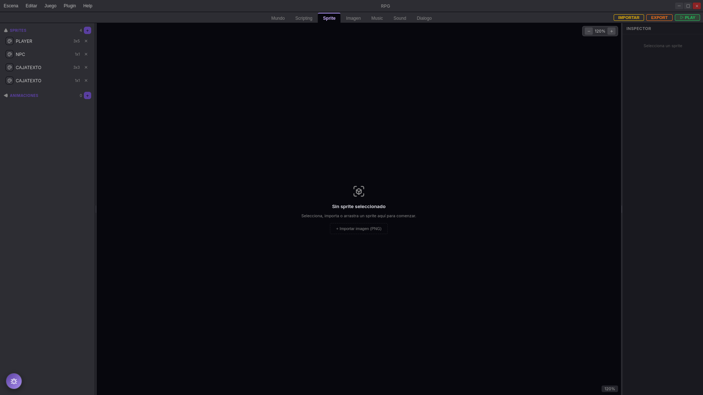
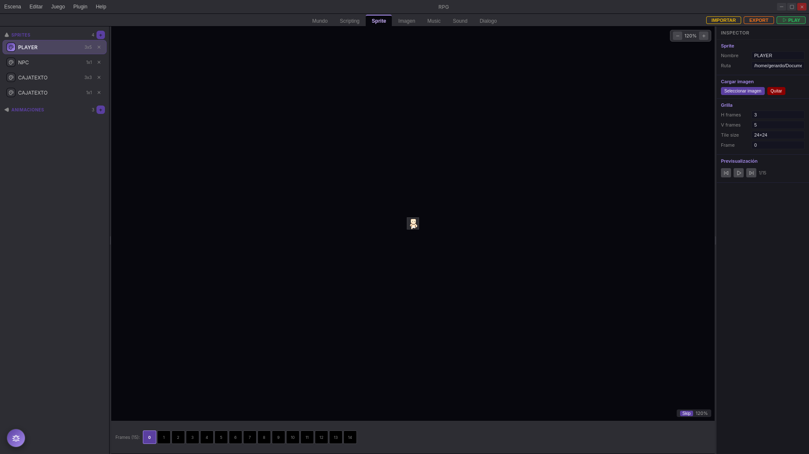

#03 — スプライトモジュール

> **注:** この翻訳には誤りが含まれる可能性があります。元のドキュメントはスペイン語で書かれています。

> **注:**この翻訳には誤りが含まれる可能性があります。元のドキュメントはスペイン語で書かれています。

> **注:**この翻訳には誤りが含まれる可能性があります。元のドキュメントはスペイン語で書かれています。

**ライトスプ** モジュールは、スプライトシートをエンジンがアニメーション化するフレームに変換します。画像をグリッドに分割し、空のフレームを破棄し、そのサイクルモードでアニメーションを作成します。

---

## 1. シートをインポートする

1. **IMPORT** を押します (または PNG をキャンバスにします)。
2. 画像を選択します。プロジェクトの`sprites/`に保存されます。
3.名前とグリに表示されます。

## 2. 分割シート（グリッド）

インポート時に、ウィザードは**グリッド**を要求します。

|フィールド |説明 |
| :--- | :--- |
| **コラム** |横方向のフレームは何フレームありますか? |
| **行** |縦に何フレームありますか。
| **タイルの幅 / 高さ** |各フレームのピクセル単位のサイズ。

シートは「列×行」のフレームに分割されています。各フレームは、エンジンがアニメーション化できる独立したタイルです。

## 3. 空のフレームをスキップする

シートにギャップ (透明なフレームまたは塗りつぶしフレーム) がある場合は、**«空のフレームをスキップ»** を使用します。不要なフレームを赤でマークすると、外出時にエンジンがそのフレームをスキップします。そのため、不規則な隙間のあるシートでもゴーストフレームが発生しません。

## 4. アニメーション

各スプライトには複数の**アニメーション**を含めることができます。アニメーションは、遅延のある連続のフレームです。

|フィールド |説明 |
| :--- | :--- |
| **名前** |識別子 (ウォークダウン、アイドルなど)。
| **フレーム** | アニメーションを構成するフレームのリスト。
| **遅延** | 各フレームが持続する vsync の数 (6 ≈ 10 回/sg)。 **1 回** (11 回)、**loop** (ループ)、または **ピンポン** (往復)。

### サイクルモード

- **1 回**: アニメーションは 1 回だけ再生され、最後のフレームに残ります。
- **ループ**: 終了すると最初のフレームに戻ります。
- **ピンポン**: 最初から最後へ、最後から最初へ行きます (歩く、羽ばたくなど)。

## 5. スプライトインスペクター

- **スプライトのリスト** (左): プロジェクト内のすべてのシート。
- **プレビュー**: 選択したフレームとグリッド。
- **アニメーション**: リスト、追加、削除、名前変更。
- **タイムライン**:オニオンスキン付きのアニメーションのフレーム(前のフレームに合わせます)。##6.オニオンスキン**オニオンスキン**は、前のフレームをゴーストとして描画し、アニメーションを手動でチェーンします(各フレームは前のフレームを継続します)。対応するボタンが有効になります。

## 7. ゲーム内での使用

- アクターには **スプライトシート** と **開始アニメーション**があります。
- スクリプトはアニメーションとフレームを変更できます。
  - `gSelf->frame` — 現在のフレーム。
  - `gSelf->animSpeed` — vsyncによって何クロックフレームが進むか (0/1 = 正確なケイデンス、2+ = 高速)。
- ダイアログ/メニューが開いていない限り(フリーズします)、アニメーションはエンジン(`advanceAllActors`)で実行されます。

---

**前:** [02 — ワールド](02-mundo.md) · **次:** [04 — 画像](04-imagen.md)