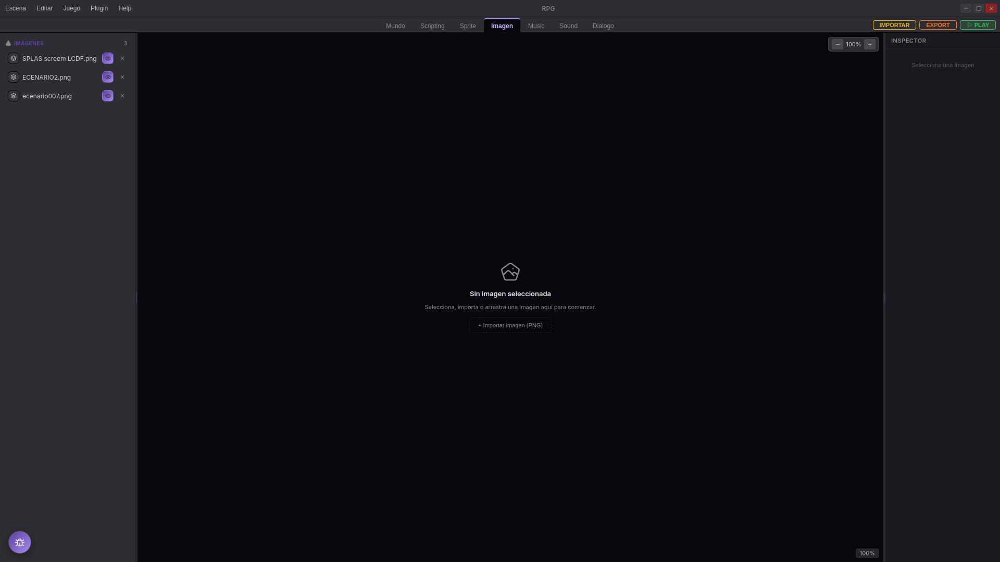

#04 — 画像モジュール

> **注:** この翻訳には誤りが含まれる可能性があります。元のドキュメントはスペイン語で書かれています。

> **注:**この翻訳には誤りが含まれる可能性があります。元のドキュメントはスペイン語で書かれています。

> **注:**この翻訳には誤りが含まれる可能性があります。元のドキュメントはスペイン語で書かれています。

**画像**モジュールは、ゲームの背景、今後各シーンの画像と視差のあるレイヤーを管理します。

---

## 1. シーンの背景

各シーンには**背景画像**があります。シーンインスペクター(ワールド)から、またはここからインポートすることで決まります。

-シーンが画面（240x160）より大きい場合、カメラによっては画像がトリミングされます。
-シーンが小さい場合は中央に配置されます。

## 2. レイヤー（視差）

背景に**レイヤー**を追加して視点を考えることができます。各レイヤーは、カメラとは異なるペースで移動する画像です。

|フィールド |説明 |
| :--- | :---| 
| **画像** |レイヤーのイメージです。
| **視差 X / Y** | 0 = 移動しない、1 = カメラと一緒に移動、>1 = 速くなります。
| **繰り返し** |
| **アニメーション速度** |アニメーション速度** |

## 3. アニメーションの背景

レイヤーは、**アニメーション化された背景**、途中ループで再生される連続のフレームにすることができます。

- **速度**: vsyncあたりのフレーム数。
- **モード**: ループまたは 1 回。
- **方向**: 前方または後方。

## 4. レイヤーインスペクター

- **注** — レイヤーの表示/非表示を切り替えます。
- **名前** — 識別子。
- **視差 X / Y** — トラッキング速度。
- **アニメーション** — フレームとその速度がある場合。

---

**前:** [03 — スプライト](03-sprite.md) · **次:** [05 — 音楽](05-music.md)