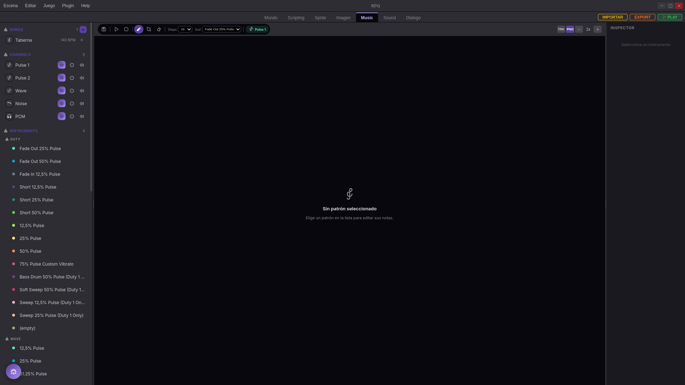

#05 — 音楽モジュール (チップチューン・トラッカー & シーケンサー)

> **注:** この翻訳には誤りが含まれる可能性があります。元のドキュメントはスペイン語で書かれています。

> **注:**この翻訳には誤りが含まれる可能性があります。元のドキュメントはスペイン語で書かれています。

> **注:**この翻訳には誤りが含まれる可能性があります。元のドキュメントはスペイン語で書かれています。

**ミュージック**エディターグラーは、クラシックでレトロなPSGジェネレーター*)オーディオハードウェアを対象とした、統合されたチップチューンの合成およびシーケンスツールです。グラフィカル**ピアノロール**と従来の**トラッカー**というビューという2つの交換可能なインターフェイスを使用して音楽テーマを作成できます。

## 1. 横方向の交渉とチャネル

＃＃＃１．１．曲リスト（`SONGS`）
- プロジェクト内の曲の作成(+)、名前変更、管理が可能です。
- アクティブなトラックの名前とその速度をBPMで表示します。

＃＃＃１．２． ハードウェアチャネル (`CHANNELS`)
システムは 4 チャンネル PSG サウンドアーキテクチャをエミュレートします。

- **パルス 1:** (*勧*)。メインメロディーに最適です。
- **パルス 2:** 2 番目のパルス チャネル。対旋律、ハーモニー、伴奏用。
- **Wave:** サンプルテーブルによってプログラム可能なカスタムウェーブチャンネル。ベースラインで主に使用されます。
- **ノイズ:**ホワイト/パーカッシブな擬似ランダムノイズジェネレーター。リズミックエフェクト用（ドラム、シンバル、ヒット）。

> **チャンネルごとのクイックコントロール:**
> - **進行性 (目):** キャンバス上のそのチャンネルのノートを表示または非表示にします。
> - **S (ソロ):** 他のすべてのチャンネルをミュートします。
> - **M (ミュート):** アクティブなチャンネルをミュートします。

＃＃＃１．３． 楽器ライブラリ (`INSTRUMENTS`)
合成のタイプごとにグループ化されたサウンド音色のカタログ:- **DUTY:**パルスデューティサイクル (12.5%、25%、50%、75%) に基づく機器。
- **WAVE:** テーブル合成用の定義済み波形。
- **ノイズ:** パーカッション プリセットとサウンド エフェクト (白 7 ビット...)。
- **SURDO /カスタマイズ:**独自の銀行。OS スピーカーの色、名前、物理的特性を割り当ててインストゥルメントを作成できます。

## 2. 編集モードとワークスペース

インターフェースには 2 つの切り替え可能な合成モードがあります (右上のスイッチ)。

- **PNO (ピアノロール):** 縦軸に半音周波数、横軸に時間をキーボードで視覚的に表現します。
- **TRK (トラッカー):** 垂直ステップシーケンサービュー; 各列はチャンネル (パルス 1、パルス 2、ウェーブ、ノイズ) であり、割り当てられたインストゥルメントの隣にノートが表示されます。

### 上部の編集バー コントロール- **保存 (💾):** オーディオ ファイルへの変更を保存します。 - **再生 (▶) / 一時停止 / 停止 (⏹):**アクティブなソングまたはパターンのトランスポート。
- **ペン:** キャンバス上にメモまたはトリガーを描画します。
- **選択/選択:** あなたのノートを配置、移動、再配置します。
- **ラバー:** 個人のメモを削除します。
- **ステップセレクター:** アクティブな小節/パターンの長さ (8、16、32、または 64 ステップ)。
- **インストゥルメントクイックセレクター(Inst):**時にペイント適用されるプリセット。
- **アクティブ チャネル:**論点ーと、それが書き込まれるパラレル チャネルのセレクター。
- **ズーム/スケール (-、2x、+):** セルの視覚的なスケール。## 3. パターンの順序付け (`PATTERNS`)

テーマの構成構造は下のバーで管理されます。

- **パターンライン:** 連続した音楽ブロックをチェーンします (例: `1: E35_`、`2: …`)。
- 各パターンには、定義されたステップ数の 4 つのチャンネルすべてからのノートの組み合わせが保存されます。
-再生中、パターンはタイムラインに沿って順番に再生されます。
- **下部チャンネルクイックパネル (CH):** は、ミュート (M) およびソロ (S) にアクセスできる各オシレーターのステータスを表示します。

![SHAPTURE: ノート付き PNO (ピアノロール) ビュー → `assets/music-pianoroll.png`]
![SHAPTURE: 4 つのチャンネルすべてを含む TRK (トラッカー) ビュー → `assets/music-tracker.png`]

## 4. インスペクターパネル

権利のパネルのオプションは、選択した項目に適応します。

＃＃＃４．１．ソングのプロパティ（グローバル選択）
- **名前:** トラックのわかりやすいタイトル。
- **アーティスト:** 著者名または作曲者のクレジット。
- **Tempo:** ノブのコントロールと、シーケンスのBPMと全体の速度を定義する数値。

＃＃＃４．２． 楽器/周波数特性 (ノートまたはプリセット)
- **名前と色の識別子:** 音符と楽器を区別するための視覚的なラベル。
- **LENGTH (デュレーション):** ノートの減衰または持続時間。
- **INITIAL VOL (初期ボリューム):** ノートをトリガーするときのアタックゲイン。
- **CHANGE (Surround):** 音量の漸進的な増加または減少の勾配。 - **テストオクターブ(C3…C8):**異なるオクターブで楽器を聴く前に。
- **オシロスコープ ビューア:** 波形は起こって生成されます。
- **デューティ サイクル:** 方形波サイクルの割合 (12.5%、25%、50%、75%)。
- **意識シフト & Hz:** ダイナミックピッチシフト (周波数を 1/128 Hz最適です。

＃＃＃４．３． チャネルのプロパティ
- 選択したオシレーターの技術情報: 名前 (「パルス 1」、「パルス 2」、「波形」、「ノイズ」)、**一般ボリューム**、**パン/パン** (左/中央/右)。---**前:** [04 — 画像モジュール](04-imagen.md) · **次:** [06 — サウンドモジュール](06-sound.md)