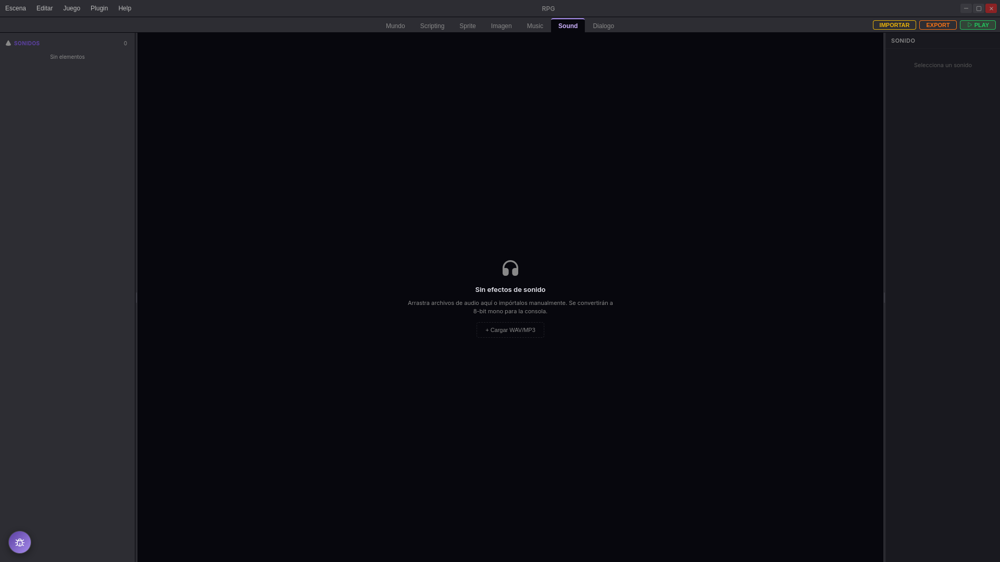

#06 — サウンドモジュール (効果音)

> **注:** この翻訳には誤りが含まれる可能性があります。元のドキュメントはスペイン語で書かれています。

> **注:**この翻訳には誤りが含まれる可能性があります。元のドキュメントはスペイン語で書かれています。

> **注:**この翻訳には誤りが含まれる可能性があります。元のドキュメントはスペイン語で書かれています。

**サウンド** エディタを使用すると、プロジェクトのサウンド エフェクト (SFX) を管理し、中断プレビュー用に再生し、GBA のオーディオハードウェア用に合成する方法を設定できます。

## 1. サウンドのリスト (`SOUNDS`)

本気の交渉には、プロジェクトのすべての効果がリストされています。

- **作成(+):** は、とりあえずのプリセットで埋め込まれた新しいサウンドを追加します。
- 各要素には、**名前**、ソースファイル (存在する場合) またはその継続時間 (秒単位) (合成された場合)、およびそのタイプのアイコン (`Pulse`、`Wave`、または `Noise`) が表示されます。

##2.音響検査員

＃＃＃２．１．設定

- **名前:** エフェクトの識別子。
- **使用方法:** **SFX** (スポットエフェクト) または **音楽** (背景テーマ)。エディタおよびエクスポートにどのように統合されるか決定します。
- **ファイル:** では、「+Load WAV/MP3」(破線のボタン) を使用して **WAV/MP3** をロードするか、リンクを解除して (✕) 合成に戻ることができます。
- **音量:** パーセンテージでのマスターレベル (0 ～ 100%)。
- **ピッチ:** 相対チューニング (半音単位) (-12 ～ +12)。
- **速度:** 再生速度 (0.25倍から4倍)。
- **遅延:** 初期トリガー遅延 (0 ～ 2 秒)。
- **攻撃:** 音量上昇時間(0～1秒)。
- **リリース:** 音量低下時間 (0 ～ 2 秒)。
- **波形:** 再生コントロールを使用したオーディオ (合成またはインポート) のキャンバスプレビュー。

＃＃＃２．２． GBAエクドチップに変換する方法を設定します。

- **チャンネルタイプ:** **パルス**、**波形**、または**ノイズ** (再生するPSGオシレーターを定義します)。
- **周波数/ノート:** エフェクトのベーストーン。

![SHOOT: SFXリストと波形を備えたサウンドエディター → `assets/sound-editor.png`]

## 3. アクターとの統合

サウンドは作成されると、**World** モジュールの **Audio > Sound** ブロック内の任意のアクターのインスペクターで使用できるようになり、衝突イベント、トリガー、またはプレイヤーのアクションによってトリガーされるようになります。

---

**前:** [05 — 音楽モジュール](05-music.md) · **次:** [07 — 対話モジュール](07-dialogo.md)