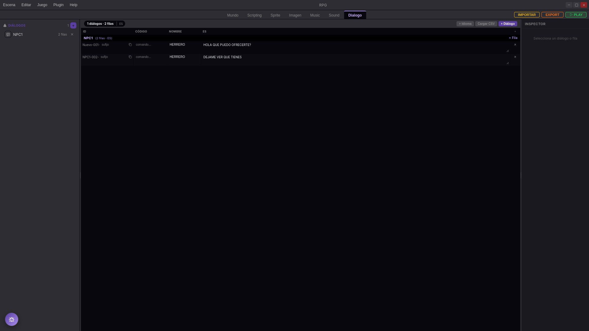

#07 — 対話モジュール (会話とテキスト)

> **注:** この翻訳には誤りが含まれる可能性があります。元のドキュメントはスペイン語で書かれています。

> **注:**この翻訳には誤りが含まれる可能性があります。元のドキュメントはスペイン語で書かれています。

> **注:**この翻訳には誤りが含まれる可能性があります。元のドキュメントはスペイン語で書かれています。

**Dialogue** エディターを使用すると、分岐する会話、テキストのページ、および世界中の NPC やインタラクティブ アクターへのリンクを作成できます。

## 1. 横方向の取り組み

プロジェクトの **ダイアログ**がサイドツリーにリストされます。いずれかを選択すると、インスペクターでそのプロパティを構成できるようになります。

各名前には、テキストの最初のページの小さなプレビューが表示され、シーンにリンクされている場合はそのシーンのが表示されます。

## 2. ダイアログインスペクタ

### ダイアログのプロパティ
- **名前:** ダイアログ識別子。
- **Scene:** リンクされている (または「(リンクされていない)」) **World** モジュールのシーン。

### ページ
各ページには次の内容が含まれます。
- **テキスト:** ページのコンテンツ(複数行のテキスト領域)。
- **オプション:**プレイヤーが選択できる応答。各オプションは別のページを向いており、会話を分岐させることができます。

## 3. 一般的なワークフロー

1. ダイアログを作成し、名前を付けます。
2. NPCが登場する**シーン**をリンクします。
3. 最初のページの **テキスト** を書き込みます。
4. **オプション**を追加して他のページに分岐します(回答が必要な数のページごとのオプションへのリンク)。

![SHAPTURE: ページとオプションを含むダイアログを開く → `assets/dialogo-editor.png`]

---

**前:** [06 — サウンド モジュール](06-sound.md) · **次:** [08 — スクリプト](08-scripting.md)