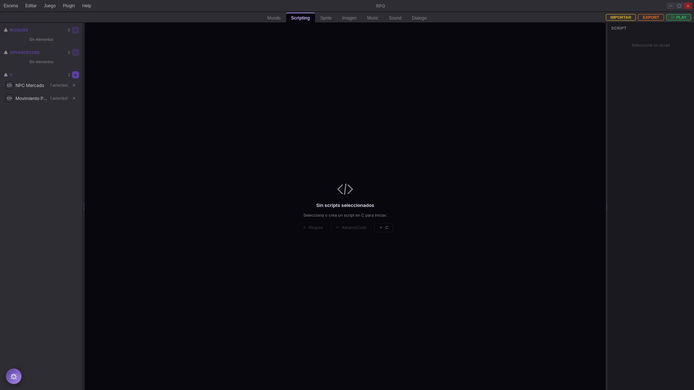

#08 - スクリプト作成

> **注:** この翻訳には誤りが含まれる可能性があります。元のドキュメントはスペイン語で書かれています。

> **注:**この翻訳には誤りが含まれる可能性があります。元のドキュメントはスペイン語で書かれています。

> **注:**この翻訳には誤りが含まれる可能性があります。元のドキュメントはスペイン語で書かれています。



> **ステータス:** AdvanceCode と C は機能します。ブロックはもうすぐ登場します。

**スクリプト**モジュールは、アクターの動作、グローバルイベント、メカニクスなどのゲームロジック専用の環境です。

##8.1。スクリプトモード

各スクリプトは、タイトルの `[Blocks][AdvanceCode][C]` セレクターを使用してモードを選択します。

|モード |状態 |
| :--- | :--- |
| **ブロック** | ビジュアル、近日公開 |
| ** アドバンスコード** | **機能**: Cにトランスパイルされ、ROMに挿入されます。
| **C** | **機能**: *逐語*がROMに挿入されます。

各モードのコードは個別に保存されるため、AdvanceCodeから開始して何も考えずにまで進むことができます。モードを変更するときは、確認を求められます。

##8.2。 AdvanceCode (機能)

GBAのARM7TDMI用に設計された、**1:1をC**(ガジベーコレクターや`malloc`なし)Cに構成され、ブロックには中括弧`{}`を使用します。

### ロジックと契約

単位は「ロジック &lt;Name&gt; for &lt;Entity&gt;」です。 `on start` / `on update` ブロックは **エンジン コントラクト**です。
```advancecode
logic Puerta for Hero {
  mutable abierta: bool = false

  on start {
    abierta = false
  }

  on update {
    if (input.pressed(BUTTON_A)) {
      abierta = true
    }
  }
}
```
-
 `on update` → `void script_update(void)`: **毎フレーム** (60 fps) を実行します。
- `on start` → `void script_init(void)`: シーンを無視したら**1回**実行されます。
-偶然の場合も、`this` は **指定が割り当てられるアクター** (C では `gSelf`) です。

###

| アドバンスコード | Cで生成された |
| :--- | :--- |
| `なんだかんだ人生: s16 = 3` | `static s16 life = 3;` (RAM) |
| `静のLIMIT: u16 = 240` | `static const u16 LIMIT = 240;` (ROM) |
| `entity項目 { 値: u8 active: bool }` | `typedef struct { u8 値; u8 アクティブ。項目;` |

タイプ: `u8/s8`、`u16/s16`、`u32/s32`、`bool` (→ `u8`)、`fixed` (→ `s16`、ハンド固定小数点)。

＃＃＃ 特徴
```advancecode
function doblar(mutable this, x: u16) -> u16 {
  return x * 2
}
```
エンティティ接頭辞 (`Hero_doblar`) 'mutable this' / 'this' がアクターポイントに割り当てられます。本文内「this.field」→「this->field」。

### フロー制御

|構文 | Cで生成された |
| :--- | :--- |
| `if cond { } else if cond { } else { }` | `if (cond) { } else if (cond) { } else { }` (括弧は省略可能) |
| `while cond { }` | `while (cond) { }` |
| `for i in 0..10 { }` | `for (i = 0; i <= 10; i++) { }` |
| `大丈夫 i の場合: u8 = 10、i > 0、i -= 2 { }` | `for (u8 i = 10; i > 0; i -= 2) { }` |

演算子: `&&`、`||`、`!`、算術比較および従来の比較。

### 入力

| アドバンスコード | 意味 |
| :--- | :--- |
| `input.is_pressed(BUTTON_A)` | **今**押されていますか? |
| | `input.is_release(BUTTON_A)` |今は**押されていません**ですか？
| `input.pressed(BUTTON_A)` | **側面**: **このフレーム**が押されました (1 回のみ) |
| `キー` |ショートカット: 押されたキーマスク (`~REG_KEYINPUT & 0x3FF`) |

ボタン: `BUTTON_A/B/SELECT/START/RIGHT/LEFT/UP/DOWN/R/L`。

### エリアとシーン

- `actor_in_area(other)` → `1` は、その **other** アクターがスクリプトを実行している ** エリア (`this`) 内にある場合です。 `other` はアクターの **インデックス** です (例: `PLAYER_INDEX` または `1`)。
- `actor_entered(other)` / `actor_exit(other)` → `1` **他のアクターが `this` 領域 (エッジ) に入るフレームのみ**。 - `switchScene(n)`、`near(a, b, dist)`、`gJp`、`gScene`: マルチシーン API ([8.8](#88-switch-scene-from-a-script) を参照）。

### それ以外はすべて C

非言語呼び出し (エンジン API、`REG_KEYINPUT`、`gActors` など) はすべて **逐語**トランスパイルされます。これにより、プリミティブを直接使用できるようになります。
```advancecode
logic Hero for Hero {
  on update {
    moveTopDown(this, keys)      // o movePlatformer(this, keys)
  }
}
```
**経験則:** 認識されないものは、インスペクター ([スクリプト] タブ → GBA エクスポート) にリストされる **トランスパイル エラー** を生成し、スクリプトは **ROM に入りません**。ジャンクコードはありません。

##8.3。 C（機能的）

コードが記述された各 **C** モードスクリプトは、`main()` の前に生成された `main.c` に*そのまま*挿入されます。
```c
void script_init(void)   // se llama UNA vez al entrar en la escena
void script_update(void) // se llama CADA frame del juego (60 fps)
```
-
 各関数の定義は **正確に 1 つ**である必要があります(重複するとシンボルが見られ、外部コンソールで警告が表示されます)。
- 利用可能なAPI: `gActors[]`、`PLAYER_INDEX`、`moveActorCollide()`、`movePlayer()`、`REG_KEYINPUT` (実際のビット: 0=A 1=B 2=SELEC 3=START 4=RD 5=LEFT 6=UP 7=DOWN 8=R 9=L、**0 =押された**)、SFX用の `noteOn()`、およびマルチシーン用** `switchScene()`、`near()`、`gJp`、`gScene`** ([8.8](#88-switching-scene-from-a-script) を参照)。
- プラットフォーム ルール: 整数 (`u8/s16/int`) のみ、`float`、`malloc`、`printf` は禁止されています。

##8.4。スクリプトをアクターに割り当てます (必須)

**最も 1 にコンパイルされます**。誰も使用しない場合、エクスポートはそれを無視し、コンソールに通知します。

これは、次の２つの同等の方法で割り当てられます。

- **[スクリプト] タブ** → スクリプトを選択 → インスペクター → **アクター**セクション→ 最初のドロップダウンメニューで **シーン**を選択し、2番目のドロップダウンメニューで **アクター**を選択します。 アクターはあります([*割り当て済み*]リストに表示されます。削除されます✕を使用します)。
- **ワールドタブ** → アクターを選択 → インスペクター → **スクリプト** フィールド。

各アクターは 1 つのスクリプトのみをサポートします(別のスクリプトでチェックすると再割り当てされます)除場合、すべてのアクター決定が自動的にクリアされます。

「this」 (AdvanceCode) または「gSelf」 (C) を使用すると、スクリプトはそれを実行しているアクターを探すため、同じスクリプトが複数のアクターで機能します。
```c
void script_update(void) {
  GBAActor* p = gSelf;   // el actor al que está asignado ESTE script
  u16 keys = ~REG_KEYINPUT & 0x3FF;
  if (keys & (1 << 4)) moveActorCollide(p, 2, 0);
}
```
##8.5。 エクスポート注意ー

[]

|状態 |意味 |
| :--- | :--- |
| **公開されます** update」/「script_update()」を定義します。ROMを入力してください。
| **未割り当て** | **公開されません**。
| **script_update はありません** | 割り当てられていますが、「on update」/「script_update()」が必要ありません、エンジンは何も実行しません。
| **エラー** | (AdvanceCodeのみ)ROMは入っておりません。
| **空** |書かれたコードはありません。
| **近日公開予定** |ブロックモード (コードはまだ生成されません)。

##8.6。エディターのヘルプ

- **挿入**:最も使用される区画を含むボタン (契約 `on start`/`on update`、変数、`yes/else`、topdown/platforms、`actor_in_area` 、`actor_entered`...)。カタログはモード(AdvanceCodeまたはC)に応じて変わります。
- **ショートカット**: `Tab` は選択した行またはブロックをインデントします (または `Shift+Tab` でインデントを解除します)。 `Enter` はインデントを維持して `{` の後にレベルを追加します。 `Ctrl+/` は行をコメント化またはコメント解除します。
- **自動終了**: `{`、`(`、または`[`を入力すると、そのパートナーが入力されます。パートナーのすぐ隣に終了文字を入力すると、そのまま進むだけです。
- **バランス**: 中国語 (コメントと文字列は無視されます)。 - **ミニマップ**: 権利の列には1行につき1つのバーが表示されます(幅は行長さ、色はその構文であり、コメントがどこにあるかが一目でわかります)。 明るい四角形は、表示している領域をマークします。

### 動き: 物理学を手書きしないでください

十字キーで動く場合、これがスクリプト全体になります。
```c
void script_update(void) {
  u16 keys = ~REG_KEYINPUT & 0x3FF;
  movePlatformer(gSelf, keys);   // plataformas: gravedad, salto, coyote, buffer
  // o bien:
  // moveTopDown(gSelf, keys);    // laberinto / RPG / menús, sin gravedad
}
```
AdvanceCode
ではさらに短く、「moveTopDown(this,keys)」となります。

どちらも衝突タイルを尊重しており、`#define` (`WALK_SPEED`、`JUMP_VEL`、`GRAVITY`...)で調整され、何も強制されません。適合しない場合は、`gSelf`を手で移動してください。詳細は[10.10](10-programar-c-gba.md#ready-to-use-motion-primitives)を参照。

### アニメーション速度 (`animSpeed`)

アニメーションは **常に正確なリズム** (スプライトに設定した「遅延」)で実行されます。歩行中にモーターが自動的に加速することはありません。歩行者の移動中に歩幅を速くしたい場合は、移動している間だけ**そのアクター**の `animSpeed` フィールドを上げます。
```c
void script_update(void) {
  u16 keys = ~REG_KEYINPUT & 0x3FF;
  if (keys & (KEY_UP | KEY_DOWN | KEY_LEFT | KEY_RIGHT)) {
    moveTopDown(gSelf, keys);
    gSelf->animSpeed = 2;   // solo este actor, solo mientras camina
  } else {
    gSelf->animSpeed = 1;   // cadencia exacta al parar
  }
}
```
`animSpeed` はフィードの vsync ステップ (`0/1` = 通常、`2` = double、…) NPC は通常のリズムを続けます。詳細については、[10.8](10-programar-c-gba.md#the-pace-of-animation-and-animspeed) を参照してください。

##8.7。エリア (アクター領域)

**エリア**は、コリジョンボックスと同様に、**アクター**のプロパティです。これは、どこに接続されて**一緒に移動する**四角形(幅/高さ/オフセット)です。これは、俳優自身の適切なエリアを検出するために使用されます。

翻訳:

1. **ワールド** タブ → アクターを選択 → インスペクター → **エリア** セクション。
2. スイッチをアクティブにして、**エリア幅 / エリア高さ / オフセット X / オフセット Y** (勝手にスプライトサイズ) を調整します。
3.

スクリプト (AdvanceCode) から参照される領域は **実行するアクターの領域** (`this`) です。引数は**他のアクターのインデックス**です。
```advancecode
logic Puerta for Trigger {
  on update {
    if (actor_in_area(PLAYER_INDEX)) {
      this.animSpeed = 2        // el jugador está dentro de mi área
    }

    if (actor_entered(PLAYER_INDEX)) {
      switchScene(1)            // al entrar en mi área, cambia de escena una sola vez
    }
  }
}
```
C
 では、フックは `actorInArea(gSelf, &gActors[PLAYER_INDEX])`、`actorEnteredArea(...)`、`actorExitedArea(...)`、`actorOutArea(...)` です。最大 **32 アクター**がサポートされます(連絡先はアクターごとにビットマスクとして保存されます)。

##8.8。スクリプトからシーンを変更する

ここで、**nはエディター内の手順** (シーン 0 はワールドリストの最初であり、最後は `N-1`) です。

説明:
```c
void script_update(void) {
  // pegados + pulsas A → escena 1 (segunda de la lista)
  if (near(gSelf, &gActors[PLAYER_INDEX], 20) && (gJp & KEY_A)) {
    switchScene(1);
  }
}
```
アドバンスコードでは:
```advancecode
logic Puerta for NPC {
  on update {
    if (input.pressed(BUTTON_A) && actor_in_area(PLAYER_INDEX)) {
      switchScene(1)
    }
  }
}
```
-
 `actor_in_area(PLAYER_INDEX)`: プレイヤーが **NPC 自身のエリア**内にいる場合は `1`。
- `gJp`: キーエッジ — **このフレームのみ** 押されたビット(`REG_KEYINPUT`と同じビット)。ボタンのアクションが毎回ではなく1回だけ行われるようにします。
- `gScene`: 現在のシーン (読み取り)。
- 'near(a, b, dist)': C の `actor_in_area` を使用します。

### トランジションアニメーションを名前で選択します

各シーンのソース→宛先先先接続には、独自の **入力トランジション** ([ワールド→接続インスペクター](02-mundo.md)) を含めることができます。 `switchScene(n)` (同じ宛先先への複数の接続) を明確にしたい場合は、接続の **名前** を 2 番目の引数として渡します。
```c
switchScene(1);            // primera conexión hacia la escena 1
switchScene(1, "puerta");  // la conexión llamada "puerta"
```
AdvanceCode
 でも同じように記述されます (`switchScene(1, "door")`)。一致接続がない場合は、とりあえずのフェードが使用されます。名前は、接続インスペクターの**名前**フィールドで編集されます。

変更するとき、エンジンは設定されたトランジション (フェード/ワイプ/タイルセット) を再生し、新しいシーンの画像/コリジョン/カメラ/アクター(その領域と仕様を含む)をロードして、シーンの公開を終了します。 各シーンでは独自の俳優が使用されます。 スクリプト「ドア」を持つ新しいシーンの俳優が反応します。 10](10-programar-c-gba.md#1015-various-scenes-in-the-rom-switchscene-near-y-gjp)。

> 📖 **さらに詳しく学ぶには、[10 — GBA 用 C でのプログラミング](10-programar-c-gba.md)**をお読みください: ハードウェア、メモリマップ、モード3。

---

**前:** [07 — ダイアログ モジュール](07-dialogo.md) · **次:** [09 — エクスポートとテスト](09-exportar.md)