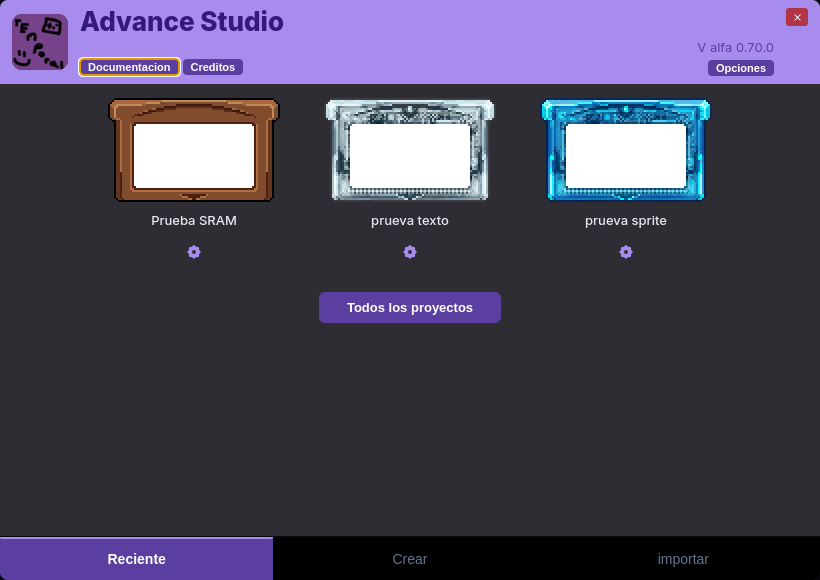
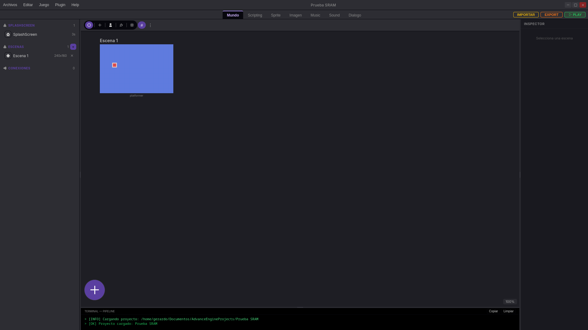
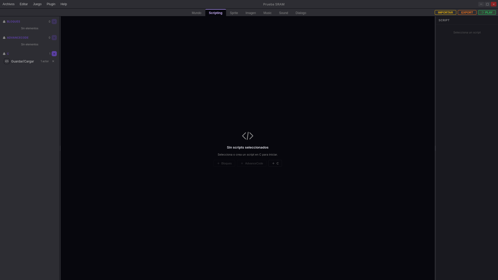
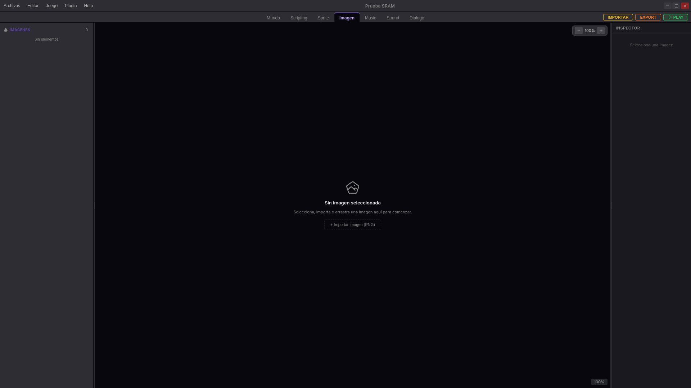
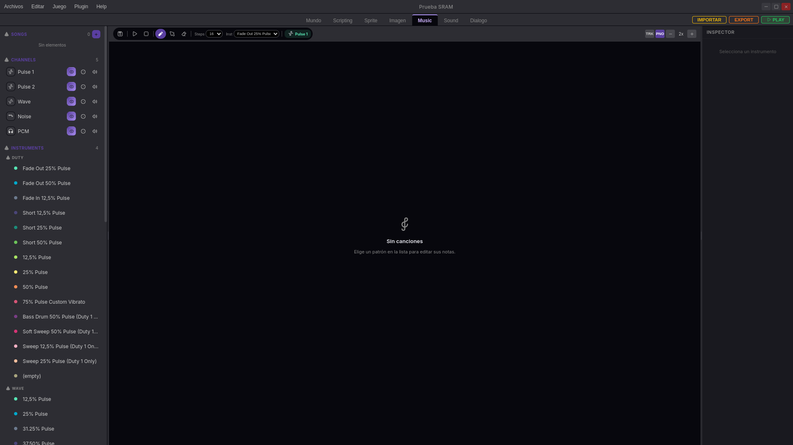
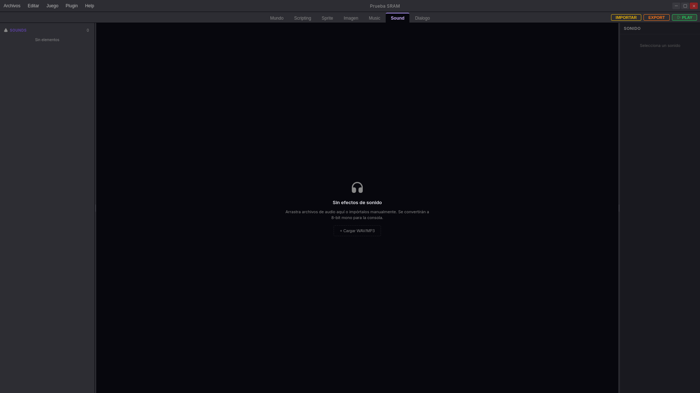
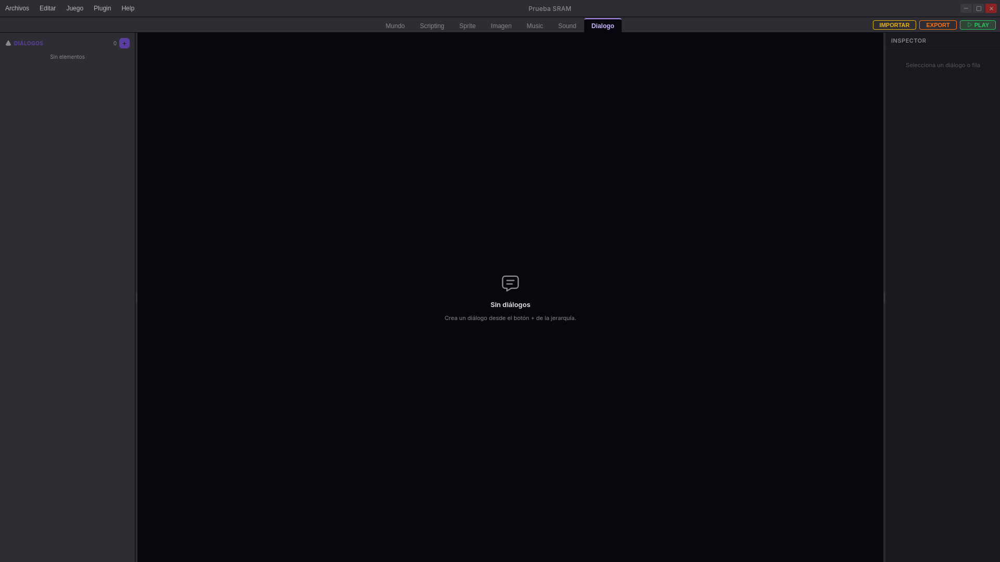

#AdvanceEngine完全マニュアル

> **注:** この翻訳には誤りが含まれる可能性があります。元のドキュメントはスペイン語で書かれています。

> **AdvanceEngine** は、Game Boy Advance ゲームを作成するためのビジュアル IDE です。シーンを描画し、スプライトをアニメーション化し、音楽を作成し、ダイアログとプログラム ロジックを C で作成します。その後、エミュレータやフラッシュカートで動作する `.gba` ROM をエクスポートします。
>
> このマニュアルでは、**C API のすべてのタブ、すべてのパネル、すべてのオプション、およびすべての機能** について、実際のアプリケーションのスクリーンショットを使用して説明しています。

---

## インデックス

1. [イントロとスタート](#1-イントロとスタート)
2. [ランチャー(メイン画面)](#2-ランチャー-メイン画面)
3. [エディター (一般構造)](#3-エディターの一般構造)
4. [ワールドタブ](#4-ワールドタブ)
5. [スクリプトタブ(C)](#5-scripting-tab-c)
6. [スプライトタブ](#6-スプライトタブ)
7. [画像タブ](#7-画像タブ)
8. [音楽タブ](#8-音楽タブ)
9. [サウンドタブ](#9-サウンドタブ)
10. [ダイアログタブ](#10-ダイアログタブ)
11. [設定](#11-設定)
12. [GBAへエクスポート](#12-export-to-gba)
13. [エンジン C API リファレンス](#13-engine-c-api-reference)
14. [ガイド: 0 から終わりまでゲームを作る](#14-guide-make-a-game-from-0-to-end)
15. [トラブルシューティング](#15-トラブルシューティング)

---

## 1. 概要と開始

###何ができるのか
- 完全な 2D ゲーム: **プラットフォーム、トップダウン/RPG、パズル、ビジュアル ノベル** など。
- 背景画像を含むシーン、タイルによる衝突、スプライトとアニメーションを含むアクター。
- トランジションを備えたマルチシーン (フェード、インスタント、またはカスタム タイルセット)。- 音楽 (4 チャンネル PSG + PCM) と効果音。
- フォント (タイルセット)、9 スライス ボックス、複数の言語、ページネーションを備えたダイアログ。
- 動作プリミティブを備えた **C** のロジックで、SRAM に保存されます。

### 要件
- Windows 10/11 (x64) または Linux (x64/arm64)。
- **devkitARM** で ROM をエクスポートします。アプリは、**オプション → 一般 → devkitPro のインストール** から自動的にインストールします。
- スプライトと背景用の外部画像エディター (Aseprite、GIMP、Photoshop)。

### 高速ブート
1. アプリを開きます。 **ランチャー** が表示されます ([最近]、[作成]、[インポート] タブ)。
2. 新しいプロジェクトを作成するか、既存のプロジェクトを開きます。
3. **エディタ**で、[ワールド]、[スクリプト]、[スプライト]、[画像]、[音楽]、[サウンド]、[ダイアログ]のタブで作業します。
4. **Game → Export GBA** (または PLAY ボタン) を押して ROM を生成します。
5. 内蔵エミュレータで試してください。

---

## 2. ランチャー (メイン画面)



アプリを開いた時の画面です。上は **AppHeader** で、下はタブです。

### アプリヘッダー
- **ロゴとバージョン** (`AdvanceEngine`、`V alpha 0.70.0`)。
- **ドキュメント**: マニュアル (このファイルと残りのドキュメント) を開きます。
- **クレジット**: 雲の背景がアニメーション化されたクレジット画面。
- **オプション**: 設定モーダルを開きます (セクション 11 を参照)。

### ランチャータブ

#### 最近の
カートリッジとして開かれた **最後の 3 つのプロジェクト**を表示します (カバーがある場合はカバー付き)。カートリッジをクリックするとプロジェクトが開きます。以下は [**すべてのプロジェクト**] ボタンです。#### 作成
新しいプロジェクトを作成するためのフォーム:
- プロジェクトの **名前**。
- **著者**。
- **テンプレート** (カートリッジの色): `透明:白`、`フラット:黄色`など。
- **パス** (デフォルトでは「AdvanceEngineProjects」フォルダー) が保存されます。
- **カバー** (PNG 480×270 を推奨)。

作成時には、エディターが開き、デフォルトのシーンが表示されます。

#### インポート
フォルダー (ダウンロードまたはコピーしたプロジェクトなど) からプロジェクトをインポートできます。

#### すべてのプロジェクト
以下を含むプロジェクトの完全なリスト:
- 名前、作成者、日付。
- コンテキスト メニュー (右クリック): **開く**、**表紙の変更**、**削除**。
- 検索。

### カートリッジ
カートリッジはプロジェクトを視覚的に表現したものです。
- **表紙** (画像 480×270)。
- **色** (テンプレートによって異なります)。
- **デカール** (装飾的な切り抜き/ステンシル)。
- コンテキスト メニュー: 名前の変更、表紙の変更、削除。

---

## 3. エディター (一般的な構造)


プロジェクトを開くと、メイン画面である **エディタ** に入ります。構成は次のとおりです。

### トップバー (EditorTopBar)
- **メニュー**: ファイル、編集、ゲーム、プラグイン、ヘルプ。
  - **ファイル**: 保存、GBA のエクスポート、アセットのエクスポート、プロジェクトの終了。
  - **編集**: 元に戻す/やり直し、コピー/貼り付け。
  - **ゲーム**: 統合エミュレータのPLAY/STOP。
  - **プラグイン**: プラグイン管理 (将来)。
  - **ヘルプ**: 対応するタブの設定、またはマニュアルを開きます。- **ウィンドウ ボタン** (最小化、最大化、閉じる) - ウィンドウはフレームレスです。
- **PLAY/STOP**: ROM に統合されたエミュレータをエクスポートして開きます。

### タブ
エディターの 7 つのタブ。それぞれにキャンバス、階層、インスペクターが含まれます。
- **ワールド**: シーン、カメラ、俳優、接続、トランジション。
- **スクリプト**: C のロジック。
- **スプライト**: スプライトシートとアニメーション。
- **画像**: 背景とレイヤー。
- **音楽**: ピアノロール/トラッカー。
- **サウンド**: サウンドエフェクト。
- **ダイアログ**: 行と言語によるダイアログ。

### 階層パネル (左)
セクションと要素を含むツリー。許可するもの:
- **要素を選択**します。
- **名前を変更** (ダブルクリックまたは F2)。
- **削除** (✕ ボタンで確認)。
- **コンテキスト メニュー** (右クリック): 名前の変更、削除。
- **セクションを折りたたむ**。
- **シーンをドラッグ**します(ワールド内)。

### キャンバス (中央)
各タブの作業領域: シーン、コード、スプライト、背景、ピアノロールなど。

### 警部（右）
選択した要素のプロパティを表示します。タブや要素によって変わります。

### パイプラインターミナル (以下、ワールド内)
自動スクロール、**コピー**、**クリア** ボタンを使用して、エクスポート ログ (情報、警告、エラー) を表示します。

### グローバル キーボード ショートカット
- **Ctrl+S**: プロジェクトを保存します。
- **Ctrl+Z / Ctrl+Y**: 元に戻す/やり直し。
- **Ctrl+C / Ctrl+V / Ctrl+X / Ctrl+A**: クリップボード (フォーカスのあるフィールドを尊重)。
- **Del**: 削除 (フォーカスのあるフィールドを尊重)。
- **エスケープ**: メニュー/モーダルを閉じます。

---

## 4.「世界」タブ

これはメイン タブです。**シーン**、**アクター**、**カメラ**、**接続**、**トランジション**がここに配置されます。

### キャンバス
- **シーン** (カード) とそのミニマップ (背景画像)、名前、およびシーンが 240×160 より大きい場合の「CAM x,y」インジケーター。
- **カメラ** (破線の長方形 240×160): **ダッギング**して視点を移動できます。 GBAで見られたシーンの一部です。
- シーン間の **接続** (矢印付きの曲線)。色はタイプ（入力/出力）を示します。
- **ズーム/パン**: ホイールでズーム (場合によっては Ctrl+ホイール)、中央ボタンまたは移動ツールでドラッグします。
- ピクセル **グリッド** (サイズは設定可能)。

### ツール (下部のキャンバス バー)
- **移動**: ビューをドラッグします。
- **シーンの追加**: 新しいシーンを作成します (「シーン N」という名前を付けます)。
- **接続**: 2 つのシーン (入力/出力) を結合します。
- **削除**: 選択したシーンまたは接続を削除します。
- **衝突**: 衝突タイル (ソリッド、プラットフォーム、ランプ) をペイントします。

### 階層
- **SplashScreen** (スプラッシュ スクリーン。削除できません)。
- **シーン**: それぞれにネストされた**アクター**が含まれます。
- **接続**: シーン間の関係。
- **名前変更** (ダブルクリック)、**削除** (確認付き)、**コンテキスト メニュー**を使用できます。

### シーンインスペクター
- **名前**。
- **タイプ**: プラットフォーマー / トップダウン / rpg / 格闘 (参考情報、エンジンは変更されません)。- **位置** (エディターの世界における x、y)。
- **サイズ** (幅、高さ)。
- **背景色** (画像がない場合)。
- **背景画像**: **画像** (背景とレイヤー) から割り当てられます。
- **カメラ**: `カメラ X` および `カメラ Y` (視点)。
- **衝突**: タイルのサイズと衝突マップ (衝突ツールを使用してキャンバスに描画)。
- **ソング**: シーンのバックグラウンドソング。
- **バックグラウンド サウンド**: ループ PCM エフェクト。

### 俳優検査官
- **名前**、**タイプ** (静的、対話可能、オブジェクト、テキスト)。
- **位置** (x、y)、**サイズ** (幅、高さ)、**z** (描画順序)。
- **スプライト**: スプライトシートとアニメーション。
- **衝突**: コライダー (幅、高さ、オフセット) とタイルによる衝突。
- **エリア**: スクリプト内の `actor_in_area`/`actor_entered` のトリガー ゾーン (幅、高さ、オフセット)。
- **ダイアログ ボックス** (テキスト タイプ アクターの場合): セクション 10 を参照してください。
- **スクリプト**: 割り当てられた C スクリプト (このアクターに対して実行されるスクリプト)。
- **歌/サウンド**: 俳優に割り当てられます。

### 接続
- **接続** ツールを使用して作成されます (ソース シーンと宛先シーンをクリックします)。
- **接続インスペクター**: 名前、入力および出力トランジション タイプ (フェード、インスタント、またはタイルセット)、速度、タイルセット/グラデーション。
- **コンテキスト メニュー**: 名前の変更、削除。
- エンジンは「switchScene(n)」を実行することで設定されたトランジションを再生します。

### トランジション
- **フェードアウト**: シーンがフェードイン/フェードインします。
- **インスタント**: 直接変更。- **カスタム タイルセット**: マスクとしてアニメーション化される 3×3 (またはそれ以上の) 画像 (セクション 12 を参照)。
- これらは、**接続** (入力/出力) および **SplashScreen** インスペクターで構成されます。

### パイプラインターミナル
- エクスポート ログを表示します: シーン、アクター、ソース、ダイアログ、エラー。
- **コピー** および **クリア** ボタン。

---

## 5. [スクリプト] タブ (C)



ここでは、**ゲーム ロジック**が **C** でプログラムされています。これが有効な唯一のモードです (現時点では AdvanceCode と Blocks は無効になっています)。

### モード
- **ブロック**: 無効になります (近日公開予定)。
- **AdvanceCode**: 無効になっています (近日公開予定)。
- **C**: エンジン言語。使用されているものです。

### 階層
- セクション **C**: C モードのスクリプトをリストします。
- 新しいスクリプトを作成するための **+** ボタン。
- ダブルクリックして名前を変更し、✕ で削除します (確認あり)。
- 作成時に、インスペクターの **名前** フィールドがフォーカスされ、即時に名前を変更できるように選択されます。

### コードエディタ
- **行番号付きの**ガター**。
- **構文のハイライト**: コメント、`#include`、文字列、数値、キーワード、devkitARM タイプ (`u8`、`s16`...)、およびエンジン API。
- **Tab** = 2 つのスペース、Enter 時の **自動インデント**、中括弧/括弧の **自動終了**。
- **元に戻す/やり直し** (Ctrl+Z / Ctrl+Y / Ctrl+Shift+Z) 独自の履歴付き (連続して書き込まれたものをグループ化)。
- **ズーム** (Ctrl+ホイール、9 ～ 26 ピクセル) パーセント インジケーター付き (クリックすると 100% に戻ります)。- 右側の VS Code スタイル **ミニマップ** (1 行にバー、クリックまたはドラッグしてジャンプ)。
- **スニペット** (上部バー): `script_update()`、`script_init()`、読み取りキー、プリミティブ、ダイアログ、保存など。

### スクリプトインスペクタ
- **名前**。
- **モード** (C、残りを無効化)。
- **ステータス**: 「エクスポート済み」、「未割り当て」、「空」、「Script_update missing」など。
- **割り当て**: スクリプトは**割り当てられた各アクター**に対して実行されます(ワールド → アクター → スクリプト)。割り当てられていない場合は実行されません。
- **ヘルプ**: 方法と契約の説明。

### 契約書
```c
void script_init(void) {
  // 1 vez, al entrar en la escena (después de colocar los actores).
}
void script_update(void) {
  // cada frame del juego.
}
```
-
 どちらもオプションです。 `script_update` を定義しない場合、スクリプトはセットアップのみを行います。
- それぞれの定義は **正確に 1 つ**必要です (複数ある場合、エンジンは何も呼び出しません)。
- エンジンは **フレームごと** (60 fps) `script_update` を呼び出します。

### エンジン API (C)
機能ごとの完全なリファレンスについては、**セクション 13** を参照してください。

---

## 6. スプライトタブ


**スプライトシートとアニメーション** エディター。画像をインポートし、グリッドとフレームを定義します。

### キャンバス
- **スプライトシート**をタイル(列×行)の**グリッド**で表示します。
- ホイールとドラッグで **ズームとパン**。
- タイルの**ページネーション**と**ブラシの選択** (タイル)。
- 再生付きフレームの **タイムライン** (再生/一時停止)。
- **オニオン スキン** (オニオン スキン) 前/下のフレームを表示します。
- 構成可能な **グリッド** と画像のスムージング。

### 階層
- **スプライト**: スプライトシートのリスト (画像付き)。
- *+** ボタンをクリックして、新しいものを作成します (または画像をインポートします)。
- コンテキストメニューまたは✕で名前の変更/削除を行います。

### 検査官
- スプライトシートの **名前**。
- **画像**: パス付きでロード/インポート (PNG/JPG)。
- **グリッド**: 列と行。
- **タイル**: 各タイルの幅と高さ。
- **アニメーション**: フレーム、モード (ループ/1 回/ピンポン)、および速度を含むアニメーションのリスト。
- **フレーム**: タイル、期間。

### 注記
- スプライトシートは画像としてインポートされます (エディターではピクセルごとに描画されません)。- エンジンは **実際の透明度** (PNG のアルファ チャネル) でタイルを描画します。

---

## 7. 画像タブ



**背景とレイヤー** エディター (視差あり)。

### キャンバス
- レイヤーを重ねた**背景**を表示します。
- **ズームとパン**。
- 選択したレイヤーの **プレビュー** (実際のサイズまたは拡大縮小された)。
- **画像をインポート** (ボタンまたはドラッグ アンド ドロップ)。

### 階層
- **背景**: ネストされた**レイヤー**を含む背景のリスト。
- *+** ボタンで背景またはレイヤーを作成します。
- コンテキストメニューまたは✕で名前の変更/削除を行います。

### レイヤーインスペクター
- **名前**。
- **画像**: ロード/インポート。
- **視差**: X/Y 速度 (カメラと一緒に動きます)。
- **速度**: レイヤーアニメーション (アニメーション化されている場合)。
- **可視性** (目) および **再スケール** (画面サイズに合わせたスケール)。
- **アニメーション モード** (ループ/1 回/ピンポン)。

### 注記
- レイヤーの順序を変更できます (階層内でドラッグ)。
- 選択したレイヤーを実際のサイズでプレビューしたり、拡大縮小したりできます。

---

## 8.「音楽」タブ



ピアノロール (PNO) とトラッカー (TRK) を備えた **音楽** エディター。

### キャンバス
- **ピアノロール** (PNO): 本物のキーボード + ノートグリッド。
- **トラッカー** (TRK): コンパクトなトラッカー タイプのビュー。
- **ズーム** (Ctrl+ホイール)、**水平スクロール** (Shift+ホイール)。
- 設定可能なステップ サイズ (16/32/48/64) の **グリッド**。
- **背景** 設定可能: グリッドまたはチェス。
- **再生ヘッド** ドラッグ可能。

### ツール- **鉛筆**: メモをペイントします。
- **選択**: ノートを選択します。
- **下書き**: メモを削除します。

### 楽器
- **チャンネル**: パルス 1、パルス 2、ウェーブ、ノイズ、PCM。
- チャンネルごとの **インストゥルメント** (プリセット付き)。
- チャンネルごとの **ミュート/ソロ**。
- すべての操作に対する **元に戻す/やり直し** (Ctrl+Z/Y)。

### パターン
- 再生（再生/一時停止）のあるパターンのリスト。
- **サイズ変更可能なパターン** (16/32/48/64 ステップ)。
- マルチパターン**ループ**。

### 検査官
- **曲**: 名前、アーティスト、テンポ (BPM)。
- **パターン**: ステップ、楽器。
- **インストゥルメント**: タイプ (デューティ/波形/ノイズ)、ボリューム、デューティ、エンベロープ、スイープなど。

### 注記
- 音楽は 4 PSG + PCM チャンネルで ROM にエクスポートされます。
- インストゥルメントは、ノートで使用されるプリセットから派生します。

---

## 9. [サウンド]タブ



**サウンドエフェクト**エディタ。

### キャンバス
- **波形**はタイプに従って表示されます。
- Web オーディオを使用してリアルタイムで**プレビュー**します。
- **インポート** WAV/MP3/OGG​​。

### 検査官
- エフェクトの**名前**。
- **タイプ**: パルス/波/ノイズ。
- **メモ**、**持続時間**、**ボリューム**、**デューティサイクル**、**エンベロープ**、**スイープ**。
- **波形** (波形の場合)。
- **プレビュー** (再生/停止)。

### 注記
- エフェクトはエディターとゲーム内で再生できます (スクリプトからの「sound_play」、またはアクター/ダイアログに割り当てられます)。

---

## 10. ダイアログタブ



行と言語を備えた **ダイアログ** エディター。

＃＃＃ ボード- **列**: ID、コード、名前 (話者)、言語ごとに 1 列 (ES、FR など)。
- **行**: 各行はダイアログの「行」です。
- **セクション ヘッダー**: ダイアログとその行数および言語。
- **+ Row** 行を追加します。
- すべてのセルの **オンライン編集**。
- **矢印によるセル間のナビゲーション**。
- **行を削除**するには、✕を使用します。

### 階層
- **ダイアログ**: ダイアログのリスト。
- *+** ボタンで作成します。
- コンテキストメニューまたは✕で名前の変更/削除を行います。

### 行インスペクター
- **ID** (読み取り専用)。
- **コード** (短い識別子、`showDialogueRow("code")`)。
- **名前** (発言者)。
- **言語別のテキスト**。
- **サウンド** (行を表示するときの効果)。
- **ソース** (行タイルセット)。
- **行を削除**。

### ダイアログインスペクタ
- **名前**。
- リンクされた**シーン**。
- **言語** (最大 6 つ、+ を使用して追加)。
- **ダイアログを削除**。

### ダイアログ ボックス (9 スライス ボックス)
**テキスト型**のアクターのインスペクター (ワールド → アクター):
- **3×3 画像**: コーナー、エッジ、中央。
- **幅/高さ** (画面に限定)。
- **オフセット X / オフセット Y** (位置、画面に限定)。
- **ボックス内のスピーカーの名前** (チェックボックス)。
- **改行**: 単語ごと/文字ごと。

### 対話エンジン (C)
- `showDialogue(id)`: 行 0 からダイアログを表示します。
- `showDialogueRow("code")` / `showDialogueRow("ID")`: 行にジャンプします。- `nextDialogueRow()`: 次の **ページ** (テキストが収まらない場合は次のページ、収まらない場合は次の行) に進みます。
- `dialogueUpdate()`: A を押したときのみ進みます (各フレームを呼び出します)。
- `hideDialogue()`: 非表示にします。

---

## 11. 設定

これらは、**オプション** (AppHeader) または **ヘルプ → タブ/全般** で開きます。

### 一般
- アプリの **言語** (es-ES、en-US、ja-JP、ru-RU)。
- **テーマ** (7 つの定義済み + カスタム色)。
- **テキストサイズ**。
- **フラットカラー** (切り替え)。
- **スプラッシュ**: 継続時間、背景画像。
- **devkitPro**: インストール/確認します。

### 外観
- テーマの色 (パネル、アクセント、テキスト、背景)。
- フォントサイズ。

### 「モジュール」タブ
- **ワールド**: グリッド、接続色、アニメーション。
- **スクリプト**: エディターのフォント サイズ、ミニマップ。
- **スプライト**: グリッド、オニオンスキン。
- **画像**: スムージング。
- **音楽**: デフォルト ビュー (PNO/TRK)、ピアノの色。
- **サウンド**: 音量。
- **ダイアログ**: ボックスの色、キャンバスの背景。
- **エミュレータ**: ボタンの再マッピング、ウィンドウのテーマ。

---

## 12. GBA へのエクスポート

###パイプライン
1. プロジェクトを **保存** (Ctrl+S) — `main.c` と `Makefile` が `&lt;project&gt;/build/` に生成されます。
2. **GBA のエクスポート** (ゲーム → エクスポート、または PLAY) — devkitARM で ROM をビルドします。
3. ROM を含む **統合エミュレータ** が開きます。

### 生成された構造体
```
<proyecto>/build/
├── main.c          # el código fuente C del juego
├── Makefile
├── <proyecto>.elf
└── <proyecto>.gba
```
### `main.c`
- **シーン**: プロジェクト内のすべてのシーンとその背景画像、衝突、カメラ、俳優、および歌。
- **アクター**: スプライト、アニメーション、コライダー、エリア。
- **ソースとダイアログ**: テキスト テーブルと 9 スライス ボックス。
- **C スクリプト**: `main()` の前に挿入されるロジック。
- **エンジン**: ソフトウェア レンダリング、PSG + PCM サウンド、入力、SRAM に保存。

### 要件
- **devkitARM** (オプション → 一般からインストール)。
- ROM は **mGBA** (外部および統合) および **フラッシュカート** で動作します。

### 注記
- レンダリングはソフトウェアによって行われます。予算は 1 フレームあたり最大 5,600 の可視ピクセルです。
- SRAM は `.sav` (外部 mGBA およびフラッシュカート) に保存されます。内部エミュレータはシャットダウン時に SRAM をダンプしません。

---

## 13. エンジン C API リファレンス

> これは、エンジンがスクリプトで利用できるようにするものについての **関数ごとの** リファレンスです。コードは「main()」の前に挿入され、ここですべてを呼び出すことができます。

＃＃＃ みんな
```c
typedef struct {
  u16 period;   // valor del registro FREQ (o ratio|cs<<3 para noise); 0xFFFF = silencio
  u8 instIdx;
} GBANote;

typedef struct {
  s16 x, y, z;
  u16 w, h;
  s16 prevX, prevY, prevW, prevH;
  u8 hasCollider;
  u16 cw, ch;
  s16 cox, coy;
  u8 hasArea;
  u16 aw, ah;
  s16 aox, aoy;
  u32 areaInside, areaWas;
  s16 vx, vy;
  s8 face;
  u8 coyote, jumpBuf, jumpHeld;
  const GBAFrame* frames[MAX_ACTOR_FRAMES];
  u16 delays[MAX_ACTOR_FRAMES];
  u8 frameCount, mode, frame, prevFrame, dir, animSpeed;
  u8 dbIdx;        // caja de diálogo del actor
  s16 dbX, dbY, dbW, dbH;
  u8 speakerInside;  // nombre dentro/fuera de la caja
  u8 wordWrap;       // salto de línea
} GBAActor;

extern GBAActor gActors[ACTOR_COUNT];
extern GBAActor* gSelf;      // el actor cuyo script se está ejecutando
#define PLAYER_INDEX 0       // el actor 0 es "el jugador"
```
＃＃＃ 入り口
```c
#define KEY_A       0x0001
#define KEY_B       0x0002
#define KEY_SELECT  0x0004
#define KEY_START   0x0008
#define KEY_RIGHT   0x0010
#define KEY_LEFT    0x0020
#define KEY_UP      0x0040
#define KEY_DOWN    0x0080
#define KEY_R       0x0100
#define KEY_L       0x0200
#define KEY_SHOULDER 0x0300   // R|L

#define REG_KEYINPUT *(vu16*)0x04000130   // 0 = pulsado
```
-
 `u16 キー = ~REG_KEYINPUT & 0x3FF;` → 1 のビット = 押された。
- `gJp` → エッジ (ビットが押された **このフレーム**)。それ自体が更新されます。 「今すぐAを押してください」という意味で使われます。
- `gKeysPrev` → 前のフレームの状態。

### 俳優と動き
```c
// Mover con colisiones (desliza por paredes)
void moveActorCollide(GBAActor* a, s16 dx, s16 dy);
// Mover al jugador con el D-pad (solo si no hay script C)
void movePlayer(u16 keys, GBAActor* p);
// Actualiza el jugador (input + empuje actor-actor)
void updatePlayer(void);

// Primitivas de movimiento (listas para usar)
void moveTopDown(GBAActor* a, u16 keys);     // 4 direcciones, sin gravedad
void movePlatformer(GBAActor* a, u16 keys);  // gravedad + coyote + salto variable
int  onFloor(GBAActor* a);                   // 1 si está en el suelo
static inline void approach(s16* v, s16 target, s16 step);

// Geometría
static inline void actorBox(const GBAActor* a, s16* bx, s16* by, s16* bw, s16* bh);
static inline int rectsOverlap(...);
static inline int rectHitsSolid(s16 bx, s16 by, s16 bw, s16 bh, s16 dx, s16 dy);
```
### シーン
```c
void switchScene(int n);                       // cambia a la escena n (orden del editor)
void switchSceneNamed(int n, const char* name); // con el nombre de la conexión
extern int gScene;
```
-
 `n` は **エディター内のダイアログの順序** (0、1、2...) です。

＃＃＃ 音
```c
void noteOn(int ch, const GBAInst* inst, u16 period);  // suena una nota
void soundPlay(int idx, int loop);                     // efecto PCM (0 = una vez, 1 = bucle)
void soundStop(void);
```
-
 `idx` は、PCM を使用したエフェクトの中でのエフェクトのインデックスです。

### 対話
```c
void showDialogue(int id);              // muestra el diálogo id desde la fila 0
void showDialogueRow(const char* key);  // salta a una fila por su Código o ID
void nextDialogueRow(void);             // siguiente página/fila
void hideDialogue(void);
void dialogueUpdate(void);              // avanza solo al pulsar A
extern int gLang;                       // 0 = primer idioma, 1 = segundo, …
```
-
 `id` = エディター内のダイアログの順序。
- `key` = **コード**フィールドまたは行の**完全なID**。
- テキストはボックスに収まる **ページ** に分割されています。先に進むと、次のページに進み、さらに次の行に進みます。

### 保存済み (SRAM)
```c
int  aeSaveHasGame(void);              // 1 si hay partida guardada válida
int  aeSaveWrite(const u8* data, u32 size); // guarda (0 ok, -1 si no cabe)
int  aeSaveRead(u8* data, u32 size);   // carga (0 ok, -1 sin partida)
void aeSaveClear(void);                // borra la partida
```
-
 **256 バイト** のブロック (`AE_SAVE_MAX`)、SRAM `0x0E000000` 内。
- マジック、バージョン、チェックサム付き (FNV-1a)。チェックサムが一致しない場合は「不一致」として扱われます。
- SRAM は `.sav` (外部 mGBA およびフラッシュカート) に保存されます。

### 定数と定義
```c
#define SCREEN_W 240
#define SCREEN_H 160
#define PIXEL_COUNT (SCREEN_W * SCREEN_H)
#define ACTOR_COUNT ...
#define MAX_ACTOR_FRAMES 32
#define AE_SAVE_MAX 256
#define WALK_SPEED 2
#define RUN_SPEED 3
#define GRAVITY 1
#define MAX_FALL 5
#define JUMP_VEL -11
#define COYOTE_FRAMES 5
#define JUMP_BUFFER 5
```
### デバッグ
- エンジンにはコンソールがありません。デバッグするには、`gBackBuf` を使用してピクセルをチェックするか、視覚的なインジケーター (テスト プロジェクトの隅のピクセルなど) を追加します。
- パイプライン ターミナル (World) にはエクスポート ログが表示されます。

---

## 14. ガイド: 0 から最後までゲームを作る

### 1. プロジェクトを作成する
- ランチャー → **作成** → 名前、作成者、テンプレート、カバー。
- エディタが開きます。

### 2. アセット (外部) を描画します
- **スプライト**: タイル グリッドを含む PNG (たとえば、タイルあたり 16×16)。
- **背景**: 240×160 の画像 (またはそれ以上の画像、カメラでトリミングされます)。
- **トランジション タイルセット**: マスク フレームを含む画像。

### 3. 世界
- **ワールド → +** でシーンを作成します。ドラッグして配置します。
- **背景画像** (画像から) と **曲**を割り当てます。
- **アクターを追加** (階層内のアクター + ボタン)、スプライトとアニメーションを割り当てます。
- 衝突ツールを使用して**衝突**をペイントします。
- **接続ツールを使用してシーンを接続**します。

### 4. スプライト
- スプライトシートをインポートし、グリッド(列×行)を定義します。
- **アニメーション**とそのフレームを作成します。

### 5. 画像
- 背景をインポートし、レイヤーと視差を定義します。

### 6.音楽
- 曲、パターンを作成し、楽器を使ってノートをペイントします。

### 7. サウンド
- エフェクト (パルス/ウェーブ/ノイズ) を作成するか、WAV をインポートします。

### 8. 対話
- ダイアログを作成し、行 (行を参照するための **コード** を含む)、言語、フォント、および 9 スライス ボックスを追加します。

### 9. スクリプト (C)- **C** モードでスクリプトを作成し、アクターに割り当てます。
- `script_update`にロジック（入力、移動、ダイアログ、保存）を記述します。
- プリミティブ (`moveTopDown`/`movePlatformer`)、`showDialogueRow`、`aeSaveWrite` などを使用します。

### 10. エクスポートとテスト
- **ゲーム → GBA をエクスポート** (または PLAY)。
- ROM は `<プロジェクト>/build/` に生成されます。
- 内蔵エミュレータまたは mGBA/フラッシュカートで試してください。

### 例: ダイアログと保存を備えたプラットフォーム
```c
u8 save[16];

void script_update(void) {
  u16 keys = ~REG_KEYINPUT & 0x3FF;
  movePlatformer(gSelf, keys);

  if (gJp & KEY_B) {          // B: guardar
    save[0] = gScene;
    save[1] = gSelf->x;
    save[2] = gSelf->y;
    aeSaveWrite(save, 3);
  }
  if (gJp & KEY_START) {     // START: cargar
    if (aeSaveHasGame()) {
      aeSaveRead(save, 3);
      gSelf->x = save[1];
      gSelf->y = save[2];
    }
  }
  if (gJp & KEY_A) showDialogueRow("saludo");  // A: hablar
  dialogueUpdate();
}
```
--
-

## 15. トラブルシューティング

### ROM がコンパイルされません
- パイプラインターミナル (World) のログを確認します。そこにCエラーが表示されます。
- 一般的なエラー: 未宣言の関数 (前方宣言の追加)、未定義の変数、間違った型。

### テキストが表示されません
- フォントに画像が含まれていることと、`gFontCharMap` に文字が含まれていることを確認します。
- テキストはボックス内に描画されます。ボックスが小さすぎる場合、テキストは切り取られます (ページネーション)。

### 対話が進まない
- `dialogueUpdate()` はフレームごとに呼び出す必要があります。
- `showDialogueRow` は、行の **コード** または **ID** を使用します。

### 保存が持続しない
- 外部 mGBA/フラッシュカートでは、終了時に `.sav` が保存されます。
・内蔵エミュレータ(EJS)ではシャットダウン時にSRAMダンプを行いません。
- セッションで書き込み/読み取りが機能していることを視覚的なインジケーター (赤/緑) で確認します。

### ゲームが遅い
- フレームごとの可視ピクセルを減らします (カメラ上のアクターが減り、スプライトが小さくなります)。
- アニメーションには `animSpeed` を使用します。
- VBLANK バジェット (~5,600 可視ピクセル) を確認します。

### 俳優が瞬きする
- ダブルバッファリングを使用します (エンジンはすでにこれを行っています)。
- アクターを不必要に再描画しないでください。

### トランジション タイルが表示されません
- タイルセットにはフレームが必要です。マスクは透明度にビット 0x8000 を使用します。

---

> **注**: このマニュアルではバージョン **0.70.0** について説明します。一部の高度な機能 (AdvanceCode、ブロック、タイル/ピクセル エディター) は開発中です。